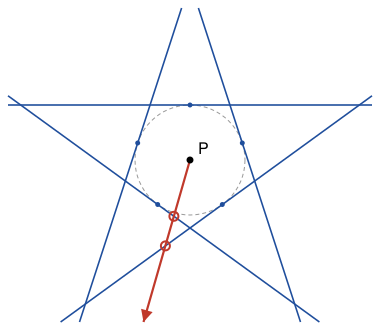

## Statement

Soit $k \geqslant 1$ un entier et $P$ un point du plan. On veut tracer $n$ droites, dont aucune ne passe
par $P$, de sorte que toute demi-droite d'origine $P$ coupe au moins $k$ de ces droites.

Quel est le plus petit nombre $n$ de droites qui permet d'y arriver ?

## Hints

1. Commence par $k = 1$. Deux droites suffisent-elles ? Et trois ?
2. Prends une des droites tracées, et la droite qui passe par $P$ et lui est parallèle. Ses deux
   demi-droites d'origine $P$ coupent-elles cette droite ? Combien de droites peuvent-elles couper à
   elles deux ?
3. Pour la construction, pense à des droites tangentes à un cercle de centre $P$, régulièrement
   réparties.
4. La tangente au cercle en un point $T$ est coupée par une demi-droite d'origine $P$ exactement quand
   cette demi-droite fait un angle aigu avec $[PT)$.

## Solution

La réponse est $n = 2k + 1$.

**Il faut au moins $2k + 1$ droites.** Supposons qu'on ait tracé $n$ droites qui conviennent. Il y en a
au moins une, puisque $k \geqslant 1$ ; appelons-la $d$. Soit $\delta$ la droite qui passe par $P$ et
qui est parallèle à $d$. Le point $P$ partage $\delta$ en deux demi-droites d'origine $P$, et aucune des
deux ne coupe $d$, puisque $\delta$ et $d$ sont parallèles et distinctes.

Chacune des $n - 1$ autres droites coupe $\delta$ en au plus un point. Ce point n'est pas $P$, donc il
est sur une seule des deux demi-droites. Ainsi, chaque droite tracée coupe au plus une des deux
demi-droites, et $d$ n'en coupe aucune. Le nombre de droites coupées par la première demi-droite, plus
le nombre de droites coupées par la seconde, vaut donc au plus $n - 1$.

Or chaque demi-droite doit couper au moins $k$ droites. Donc $2k \leqslant n - 1$, c'est-à-dire
$n \geqslant 2k + 1$.

**$2k + 1$ droites suffisent.** Traçons un cercle de centre $P$ et plaçons sur ce cercle $2k + 1$
points $T_1, T_2, \ldots, T_{2k+1}$ régulièrement espacés : l'angle entre deux rayons $[PT_j]$ voisins
vaut $\alpha = \frac{360^\circ}{2k + 1}$. On trace la tangente au cercle en chacun de ces points. Ces
droites ne passent pas par $P$.

*Quand une demi-droite coupe-t-elle une tangente ?* Prenons une demi-droite $D$ d'origine $P$ et un des
points $T$. La tangente en $T$ est perpendiculaire à $(PT)$. Appelons $\theta$ l'angle entre $D$ et la
demi-droite $[PT)$, entre $0^\circ$ et $180^\circ$.

- Si $\theta < 90^\circ$, la demi-droite $D$ coupe la tangente : c'est le point $M$ de $D$ tel que le
  triangle $PTM$ soit rectangle en $T$ (si $\theta = 0^\circ$, c'est $T$ lui-même).
- Si $\theta \geqslant 90^\circ$, la droite qui passe par $P$ perpendiculairement à $(PT)$ sépare le
  plan en deux. La tangente est entièrement du côté de $T$, sans toucher cette droite, alors que $D$ est
  de l'autre côté ou sur cette droite. Donc $D$ ne coupe pas la tangente.

*Combien de tangentes la demi-droite $D$ manque-t-elle ?* Elle manque les tangentes aux points $T_j$
tels que l'angle entre $D$ et $[PT_j)$ est au moins $90^\circ$. Ces points $T_j$ sont tous sur un même
demi-cercle fermé, celui qui est opposé à $D$. Supposons qu'il y en ait $m$. Ce sont des points voisins
du cercle, donc le premier et le dernier sont séparés par un angle de $(m - 1)\alpha$, et cet angle est
au plus $180^\circ$ :

$$(m - 1) \times \frac{360^\circ}{2k + 1} \leqslant 180^\circ, \qquad \text{donc} \qquad m - 1 \leqslant \frac{2k + 1}{2} = k + \frac{1}{2}.$$

Comme $m$ est entier, $m \leqslant k + 1$. La demi-droite $D$ manque donc au plus $k + 1$ tangentes, et
elle coupe au moins $(2k + 1) - (k + 1) = k$ d'entre elles.

**Conclusion.** Le plus petit nombre de droites possible est $n = 2k + 1$.

## Going further

Pour $k = 1$, on trouve $3$ droites : les trois côtés prolongés d'un triangle équilatéral de centre
$P$. Vérifie sur une figure qu'aucune demi-droite d'origine $P$ n'échappe aux trois droites, et que
deux droites ne suffisent jamais.
