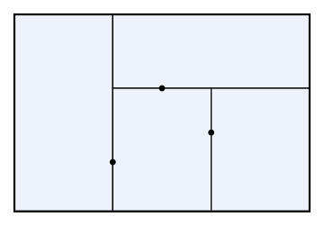

## Statement

On place $n$ points à l'intérieur d'un rectangle $R$, de sorte que deux de ces points ne soient jamais sur une même droite parallèle à l'un des côtés de $R$.

On découpe ensuite $R$ en plusieurs petits rectangles, dont les côtés sont parallèles à ceux de $R$, de sorte qu'aucun des points donnés ne soit à l'intérieur d'un petit rectangle. Les points peuvent en revanche se trouver sur les côtés des petits rectangles.

Montrer que le nombre de petits rectangles est supérieur ou égal à $n + 1$.

## Hints

1. Où peut se trouver un des points donnés ? Montre qu'il est sur un côté d'un petit rectangle, et que ce côté n'est pas sur le bord de $R$.
2. Appelle « trait » un segment le plus long possible formé de côtés de petits rectangles, et qui n'est pas sur le bord de $R$. Pourquoi y a-t-il au moins $n$ traits ?
3. Si $k$ est le nombre de petits rectangles, ils ont $4k$ coins en tout. Regroupe ces coins selon le point du plan où ils se trouvent. Combien de coins peut-il y avoir en un même point ?
4. Montre que chaque extrémité d'un trait est un point où les côtés forment un « T », et que chaque point en « T » est l'extrémité d'un seul trait.

## Solution

On note $k$ le nombre de petits rectangles. Comme ils ont leurs côtés parallèles à ceux de $R$, tous leurs côtés sont horizontaux ou verticaux, si l'on dessine $R$ avec deux côtés horizontaux.

**Étape 1. Les traits.**

On appelle **côté intérieur** un côté d'un petit rectangle qui n'est pas sur le bord de $R$. Sur une droite horizontale ou verticale, les côtés intérieurs mis bout à bout forment un ou plusieurs segments. On appelle **trait** chacun de ces segments, pris le plus long possible : un trait est un segment formé de côtés intérieurs, et il ne se prolonge pas, à aucun de ses deux bouts, par un autre côté intérieur situé sur la même droite. Dans la figure, il y a trois traits : deux verticaux et un horizontal.

On note $s$ le nombre de traits.

**Étape 2. Il y a au moins $n$ traits.**

Soit $P$ l'un des points donnés. Les petits rectangles recouvrent $R$, donc $P$ appartient à l'un d'eux. Comme $P$ n'est pas à l'intérieur de ce petit rectangle, il est sur l'un de ses côtés. Ce côté n'est pas sur le bord de $R$, puisque $P$ est à l'intérieur de $R$. C'est donc un côté intérieur, et $P$ est sur un trait.

Deux points donnés ne peuvent pas être sur un même trait, car un trait est contenu dans une droite parallèle à l'un des côtés de $R$. Chaque point donné est donc sur un trait, et deux points différents sont sur deux traits différents. Par conséquent, $s \geqslant n$.

**Étape 3. On compte les coins.**

Les $k$ petits rectangles ont $4k$ coins en tout. Regroupons-les selon le point du plan où ils se trouvent, et regardons combien de coins il peut y avoir en un même point $Q$. Autour de $Q$, on trace une droite horizontale et une droite verticale : elles découpent le voisinage de $Q$ en quatre « quarts ».

- **Si $Q$ est l'un des quatre sommets de $R$**, un seul quart est dans $R$, et il y a exactement $1$ coin en $Q$.
- **Si $Q$ est sur le bord de $R$ sans en être un sommet**, deux quarts sont dans $R$. Chaque petit rectangle qui a un coin en $Q$ remplit un quart, et un petit rectangle qui contient $Q$ au milieu d'un de ses côtés remplirait les deux quarts à lui seul, sans laisser de place pour un coin. Comme il y a au moins un coin en $Q$, il y en a exactement $2$. Les côtés forment un « T » : la barre du T est le bord de $R$, et la tige est un côté intérieur qui part de $Q$ vers l'intérieur.
- **Si $Q$ est à l'intérieur de $R$**, les quatre quarts sont remplis. Un petit rectangle qui a un coin en $Q$ remplit un quart, et un petit rectangle qui contient $Q$ au milieu d'un côté remplit deux quarts voisins. Il n'y a pas de petit rectangle qui contienne $Q$ à l'intérieur, sinon $Q$ ne serait le coin d'aucun rectangle. Il y a donc deux possibilités :
  - $4$ coins en $Q$, qui forment une **croix** ;
  - $2$ coins et un rectangle qui contient $Q$ au milieu d'un de ses côtés. Ce côté forme la barre d'un « T », et les côtés communs aux deux autres rectangles forment la tige.

On note $t$ le nombre de points en « T », sur le bord de $R$ ou à l'intérieur, et $c$ le nombre de croix. En additionnant les coins point par point, on obtient

$$4k = 4 \times 1 + 2t + 4c.$$

**Étape 4. Il y a exactement $2s$ points en « T ».**

Prenons un trait, par exemple horizontal, et l'une de ses extrémités $E$. Le côté intérieur qui finit en $E$ a un coin en $E$, donc $E$ est l'un des points de l'étape 3.

- $E$ n'est pas un sommet de $R$ : un segment horizontal qui finit en un sommet de $R$ est sur le bord de $R$.
- $E$ n'est pas une croix : en une croix, les côtés intérieurs continuent en ligne droite des deux côtés, et le trait ne s'arrêterait pas en $E$.

Donc $E$ est un point en « T ». De plus, en $E$, c'est la tige du T qui s'arrête : la barre est soit le bord de $R$, qui ne fait partie d'aucun trait, soit le côté d'un petit rectangle qui passe tout droit par $E$, et dont le trait continue donc des deux côtés de $E$.

Inversement, en un point en « T », exactement un trait s'arrête, celui qui contient la tige.

Ainsi, chaque trait a deux extrémités, chacune est un point en « T », et chaque point en « T » est l'extrémité d'un seul trait. On en déduit $t = 2s$.

**Conclusion.** En remplaçant $t$ par $2s$ dans l'égalité de l'étape 3, on obtient $4k = 4 + 4s + 4c$, c'est-à-dire

$$k = 1 + s + c.$$

Comme $c \geqslant 0$ et $s \geqslant n$ d'après l'étape 2, on a $k \geqslant n + 1$ : il y a au moins $n + 1$ petits rectangles.

## Going further

Dans la figure, on a $n = 3$, trois traits, aucune croix, et $k = 1 + 3 + 0 = 4$ petits rectangles : la borne $n + 1$ est atteinte. Pour tout $n$, on peut l'atteindre : il suffit de couper $R$ par $n$ segments verticaux qui vont du bord du bas au bord du haut, chacun passant par l'un des points.

L'égalité $k = 1 + s + c$ est valable pour n'importe quel découpage d'un rectangle en rectangles. Vérifie-la sur un quadrillage $3 \times 4$ : combien y a-t-il de traits et de croix ?
