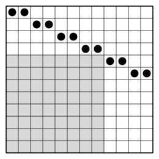

## Statement

Théo place des jetons dans les cases d'un tableau de $30 \times 30$ cases, en respectant les trois règles suivantes.

- Chaque case contient au plus un jeton.
- Pour chaque case vide, il y a au moins un jeton dans sa ligne ou dans sa colonne.
- Pour chaque jeton, il y a au plus un autre jeton dans sa ligne et sa colonne réunies.

On cherche le plus petit entier $k$ qui a la propriété suivante : quelle que soit la façon dont Théo a placé ses jetons, chaque carré de $k \times k$ cases du tableau contient au moins un jeton.

Déterminer cet entier $k$.

## Hints

1. Combien de jetons une ligne peut-elle contenir, au plus ? Et une colonne ?
2. Attention : une ligne peut très bien ne contenir aucun jeton. Cherche une disposition qui laisse un grand carré vide. Essaie de mettre deux jetons côte à côte sur chacune des premières lignes, en descendant en escalier.
3. Tu dois trouver une disposition avec un carré vide de $20 \times 20$ cases. Montre ensuite qu'un carré vide de $21 \times 21$ cases est impossible.
4. Si un carré de $21 \times 21$ cases est vide, combien de jetons y a-t-il, au plus, dans les $21$ colonnes de ce carré ? Ces jetons sont tous dans les $9$ autres lignes.

## Solution

On va montrer que **la réponse est $k = 21$**. Il faut pour cela deux choses : trouver une disposition qui laisse un carré de $20 \times 20$ cases vide, puis montrer qu'aucune disposition ne laisse un carré de $21 \times 21$ cases vide.

**Une remarque.** Une ligne contient au plus $2$ jetons. En effet, si une ligne en contenait $3$, chacun de ces jetons aurait au moins $2$ autres jetons dans sa ligne, ce que la troisième règle interdit. De même, une colonne contient au plus $2$ jetons.

### Une disposition avec un carré vide de $20 \times 20$ cases

On numérote les lignes de $1$ à $30$ en partant du haut, et les colonnes de $1$ à $30$ en partant de la gauche. Sur chaque ligne $i$ allant de $1$ à $15$, on place deux jetons, dans les colonnes $2i - 1$ et $2i$. Les lignes $16$ à $30$ restent vides. La figure montre le même escalier sur un tableau plus petit.

On vérifie les règles.

- Chaque case contient au plus un jeton.
- La ligne $1$ a ses jetons dans les colonnes $1$ et $2$, la ligne $2$ dans les colonnes $3$ et $4$, et ainsi de suite jusqu'à la ligne $15$, qui a ses jetons dans les colonnes $29$ et $30$. Chaque colonne contient donc exactement un jeton. Une case vide a donc toujours un jeton dans sa colonne.
- Un jeton a exactement un autre jeton dans sa ligne, son voisin, et aucun autre dans sa colonne.

Regardons maintenant les lignes $11$ à $30$ et les colonnes $1$ à $20$. Les lignes $16$ à $30$ sont vides. Les lignes $11$ à $15$ ont leurs jetons dans les colonnes $21$ à $30$. Ce carré de $20 \times 20$ cases ne contient donc aucun jeton.

Ainsi, pour $k = 20$, la propriété n'est pas vraie, et pour $k$ plus petit que $20$ non plus, car le carré vide de $20 \times 20$ cases contient des carrés vides plus petits. Donc $k \geqslant 21$.

### Aucun carré de $21 \times 21$ cases n'est vide

Supposons qu'une disposition respecte les trois règles et laisse un carré de $21 \times 21$ cases vide. Ce carré occupe $21$ lignes et $21$ colonnes du tableau.

**Une colonne du carré est vide.** Les jetons placés dans les $21$ colonnes du carré ne sont pas dans le carré. Ils sont donc dans les $30 - 21 = 9$ autres lignes. D'après la remarque, ces $9$ lignes contiennent ensemble au plus $9 \times 2 = 18$ jetons. Il y a donc au plus $18$ jetons dans les $21$ colonnes du carré. Comme $18 < 21$, l'une de ces colonnes ne contient aucun jeton, dans tout le tableau.

**Une ligne du carré est vide.** Le même raisonnement, en échangeant le rôle des lignes et des colonnes, montre que l'une des $21$ lignes du carré ne contient aucun jeton.

**La contradiction.** La case qui est à la fois dans cette ligne et dans cette colonne est une case du carré, donc elle est vide. Mais il n'y a aucun jeton ni dans sa ligne, ni dans sa colonne. La deuxième règle n'est pas respectée, ce qui est impossible.

Donc, quelle que soit la disposition, chaque carré de $21 \times 21$ cases contient au moins un jeton.

**Conclusion.** Le plus petit entier $k$ cherché est $k = 21$.

## Going further

On remplace le tableau de $30 \times 30$ cases par un tableau de $3m \times 3m$ cases, où $m$ est un entier strictement positif. Montrer que la réponse est alors $k = 2m + 1$. Attention, si $m$ est impair, le nombre $3m$ de colonnes est impair, et l'escalier ci-dessus ne tombe pas juste : il faut trouver une autre disposition.
