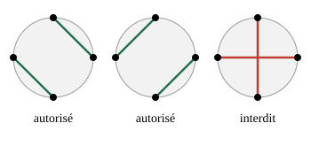

## Statement

Un nombre **pair** de personnes sont assises autour d'une table ronde. Au signal, tout le monde tend le bras en même temps et serre la main d'une autre personne : chacun serre exactement une main, et personne ne reste sans partenaire.

Les bras passent au-dessus de la table, et on veut que **deux bras ne se croisent jamais**.

Voici ce que cela donne avec quatre personnes : deux dispositions conviennent, la troisième est interdite.

On note $P_n$ le nombre de dispositions possibles quand il y a $2n$ personnes autour de la table. On vient de voir que $P_2 = 2$, et on a évidemment $P_1 = 1$.

1. Trouver $P_3$, c'est-à-dire le nombre de dispositions avec six personnes.
2. Numérotons les personnes de $1$ à $2n$ dans l'ordre autour de la table. Montrer que la personne $n^{\circ} 1$ ne peut serrer la main que d'une personne portant un numéro **pair**.
3. On pose par convention $P_0 = 1$. Montrer que pour tout $n \geqslant 1$,

   $$P_n = P_0 P_{n-1} + P_1 P_{n-2} + P_2 P_{n-3} + \cdots + P_{n-1} P_0 .$$

4. En déduire le nombre de dispositions pour huit personnes, puis pour dix personnes.

## Hints

1. Avec six personnes, regardez d'abord qui peut serrer la main de la personne $n^{\circ} 1$, puis comptez les possibilités qui restent dans chaque cas.
2. Le bras de la personne $n^{\circ} 1$ coupe la table en deux. Les gens assis d'un côté ne peuvent serrer la main que de gens du même côté : sinon leur bras croiserait celui de la personne $n^{\circ} 1$.
3. Un groupe de personnes qui ne peuvent se serrer la main qu'entre elles doit être de taille paire. Regardez combien de personnes il y a de chaque côté du bras.
4. Une fois que vous savez que la personne $n^{\circ} 1$ serre la main de la personne $n^{\circ} 2k+2$, comptez séparément les dispositions à gauche et celles à droite : elles se choisissent indépendamment.

## Solution

### 1. Six personnes

Numérotons les six personnes de $1$ à $6$ dans l'ordre autour de la table. La personne $n^{\circ} 1$ serre la main de $2$, de $4$ ou de $6$ (on verra à la question 2 pourquoi $3$ et $5$ sont impossibles).

- **$1$ avec $2$** : restent $3, 4, 5, 6$ côte à côte, qui doivent se serrer la main sans croisement. C'est le cas de quatre personnes : $2$ possibilités.
- **$1$ avec $4$** : restent $2, 3$ d'un côté et $5, 6$ de l'autre. Chaque paire est forcée : $1$ possibilité.
- **$1$ avec $6$** : restent $2, 3, 4, 5$ côte à côte : $2$ possibilités.

Au total

$$P_3 = 2 + 1 + 2 = 5 .$$

### 2. Un numéro pair

Supposons que la personne $n^{\circ} 1$ serre la main de la personne $n^{\circ} m$. Son bras traverse la table et la sépare en deux zones :

- d'un côté les personnes $2, 3, \ldots, m-1$, soit $m - 2$ personnes ;
- de l'autre les personnes $m+1, m+2, \ldots, 2n$, soit $2n - m$ personnes.

Une personne d'une zone ne peut pas serrer la main d'une personne de l'autre zone : son bras devrait passer par-dessus celui de la personne $n^{\circ} 1$, donc le croiser.

Chaque zone se débrouille donc toute seule, et pour que tout le monde y trouve un partenaire il faut que chaque zone contienne un nombre **pair** de personnes. Il faut donc que $m - 2$ soit pair, c'est-à-dire que $m$ soit pair.

### 3. La relation de récurrence

Écrivons $m = 2k + 2$, où $k$ est un entier avec $0 \leqslant k \leqslant n-1$. D'après la question 2, la zone de gauche contient $m - 2 = 2k$ personnes, et celle de droite $2n - m = 2(n - 1 - k)$ personnes.

Les deux zones se remplissent indépendamment l'une de l'autre :

- la zone de gauche, avec ses $2k$ personnes assises côte à côte, admet $P_k$ dispositions ;
- la zone de droite, avec ses $2(n-1-k)$ personnes, en admet $P_{n-1-k}$.

Une zone vide ($k = 0$, ou $k = n-1$) n'offre qu'une seule possibilité : ne rien faire. C'est ce que dit la convention $P_0 = 1$.

Les valeurs de $k$ donnent des dispositions deux à deux différentes, puisque le partenaire de la personne $n^{\circ} 1$ change. En les additionnant toutes :

$$P_n = \sum_{k=0}^{n-1} P_k \, P_{n-1-k} = P_0 P_{n-1} + P_1 P_{n-2} + \cdots + P_{n-1} P_0 .$$

Contrôle : $P_2 = P_0 P_1 + P_1 P_0 = 1 + 1 = 2$ et $P_3 = P_0 P_2 + P_1 P_1 + P_2 P_0 = 2 + 1 + 2 = 5$. C'est bien ce qu'on a trouvé.

### 4. Huit et dix personnes

$$P_4 = P_0 P_3 + P_1 P_2 + P_2 P_1 + P_3 P_0 = 5 + 2 + 2 + 5 = \boxed{14},$$

$$P_5 = P_0 P_4 + P_1 P_3 + P_2 P_2 + P_3 P_1 + P_4 P_0 = 14 + 5 + 4 + 5 + 14 = \boxed{42} .$$

Il y a donc $14$ dispositions pour huit personnes et $42$ pour dix personnes.

## Going further

La suite $1, 1, 2, 5, 14, 42, 132, \ldots$ est celle des **nombres de Catalan**. Elle compte aussi les façons de découper un polygone convexe en triangles (exercice 5201) et les chemins d'un quadrillage qui restent sous la diagonale (exercice 2405), où l'on démontre la formule

$$P_n = \frac{1}{n+1} \binom{2n}{n} .$$

Pour dix personnes, cela donne bien $\frac{1}{6} \binom{10}{5} = \frac{252}{6} = 42$.
