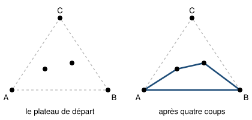

## Statement

Le **Criss-Cross** se joue à deux sur une feuille de papier.

**Le plateau.** On marque trois points $A$, $B$, $C$ formant un triangle, puis on place $n$ points supplémentaires **à l'intérieur** de ce triangle. Au départ rien n'est tracé : même les côtés du triangle ne sont pas dessinés.

**Un coup.** Tracer un segment entre deux points du plateau, à condition qu'il ne coupe aucun segment déjà tracé et qu'il ne passe par aucun troisième point. Tracer un côté du triangle est un coup autorisé comme un autre.

**La fin.** Les joueurs jouent à tour de rôle. Le joueur qui ne peut plus jouer a perdu.

On suppose les points placés sans malice : jamais trois d'entre eux ne sont alignés.

1. Jouer plusieurs parties avec $n = 2$ points intérieurs, en changeant les coups et la position des points. Que remarque-t-on sur le nombre de coups ?
2. Montrer qu'une partie terminée comporte toujours exactement $3n + 3$ segments, quels que soient l'emplacement des points et les coups joués.
3. Qui gagne une partie à $10$ points intérieurs, le premier ou le second joueur ?

On admettra la **formule d'Euler** : pour un dessin du plan d'un seul tenant, formé de points reliés par des segments qui ne se coupent pas,

$$S - A + F = 2,$$

où $S$ est le nombre de points, $A$ le nombre de segments et $F$ le nombre de régions du plan découpées par le dessin, **la région extérieure comprise**.

## Hints

1. Compte les coups à la fin de chaque partie de la question 1. Le résultat devrait te surprendre.
2. À la fin d'une partie, regarde une région du dessin. Peut-elle avoir quatre côtés ? Peut-elle contenir un point du plateau à l'intérieur ?
3. Si toutes les régions sont des triangles, compte de deux façons différentes les couples formés d'une région et d'un segment qui la borde.
4. Tu obtiens $3F = 2A$. Avec la formule d'Euler et $S = n + 3$, il ne reste plus que de l'algèbre.
5. Pour la question 3, la seule chose qui compte est la parité du nombre total de coups.

## Solution

**Question 1.** Avec $2$ points intérieurs, toute partie terminée compte **$9$ segments**, quoi qu'on fasse. Le vainqueur est donc toujours le premier joueur, puisque $9$ est impair. Ce n'est pas un jeu de stratégie : le résultat est écrit d'avance.

**Question 2.** Plaçons-nous à la fin d'une partie, quand plus aucun coup n'est possible.

**(a) Les trois côtés du triangle sont tracés.**

Tous les points du plateau sont dans le triangle $ABC$, donc tout segment tracé reste dans ce triangle. Un tel segment ne peut pas couper le côté $[AB]$, car il faudrait pour cela des points de part et d'autre de la droite $(AB)$. Le coup « tracer $[AB]$ » est donc toujours disponible tant qu'il n'a pas été joué. À la fin il a donc été joué, et de même pour $[BC]$ et $[CA]$.

**(b) Toute région est un triangle.**

Prenons une région bornée $Z$ du dessin. Son bord est un polygone dont les sommets sont des points du plateau.

- **Aucun point du plateau n'est à l'intérieur de $Z$.** Sinon, ce point verrait au moins un sommet du bord, et le segment qui les relie ne couperait rien : un coup serait encore possible.
- **Le bord de $Z$ a exactement trois sommets.** S'il en avait quatre ou plus, on pourrait tracer une diagonale entièrement contenue dans $Z$ (tout polygone à au moins quatre sommets en possède une), et ce segment ne couperait rien : encore un coup possible.

Donc chaque région bornée est un triangle. Quant à la région extérieure, son bord est le triangle $ABC$ d'après le point (a) : elle est elle aussi bordée par exactement trois segments.

Au passage, ces triangles pavent le triangle $ABC$ et leurs sommets sont tous les points du plateau : le dessin est bien d'un seul tenant, et la formule d'Euler s'applique.

**(c) Le double comptage : $3F = 2A$.**

Comptons de deux façons les couples (région, segment qui borde cette région).

- *Par région.* Chaque région, bornée ou non, est bordée par exactement $3$ segments. Cela fait $3F$ couples.
- *Par segment.* Chaque segment a un triangle de chaque côté, et ces deux triangles sont différents puisqu'ils sont de part et d'autre du segment. Cela fait $2A$ couples.

Donc

$$3F = 2A, \qquad \text{c'est-à-dire} \qquad F = \frac{2A}{3} .$$

**(d) Le calcul.**

Le plateau compte $S = n + 3$ points. La formule d'Euler donne

$$S - A + \frac{2A}{3} = 2, \qquad \text{donc} \qquad S - \frac{A}{3} = 2, \qquad \text{donc} \qquad A = 3S - 6 .$$

Avec $S = n + 3$ :

$$A = 3(n+3) - 6 = 3n + 3 .$$

Le nombre de segments à la fin, c'est-à-dire le nombre de coups de la partie, vaut donc toujours $\boxed{3n + 3}$.

Vérification avec $n = 2$ : $3 \times 2 + 3 = 9$, ce qui confirme la question 1.

**Question 3.** Avec $n = 10$ points intérieurs, la partie dure

$$3 \times 10 + 3 = 33 \ \text{coups}.$$

Les joueurs alternent, donc le premier joueur joue les coups de rang impair : $1$, $3$, $\ldots$, $33$. C'est lui qui joue le dernier coup, et le second joueur se retrouve sans coup possible.

**Le premier joueur gagne.**

**Conclusion générale.** Le Criss-Cross n'a aucune stratégie : la partie dure $3n+3$ coups quoi qu'il arrive. Le premier joueur gagne quand $3n+3$ est impair, c'est-à-dire quand $n$ est **pair**.

## Going further

Changeons le plateau : au lieu d'un triangle, prenons un **carré** de quatre points, avec $n$ points à l'intérieur.

Le raisonnement est le même, à une différence près : la région extérieure est maintenant bordée par $4$ segments et non par $3$. Le double comptage devient

$$3(F - 1) + 4 = 2A, \qquad \text{c'est-à-dire} \qquad 3F + 1 = 2A .$$

Avec $S = n + 4$ et la formule d'Euler, on trouve

$$A = 3S - 7 = 3n + 5 .$$

Comparons alors deux plateaux qui ont le même nombre total de points, $13$ :

| plateau | points intérieurs | total de points | coups | gagnant |
| --- | --- | --- | --- | --- |
| triangle | 10 | 13 | 33 | le premier |
| carré | 9 | 13 | 32 | le second |

Le même nombre de points, et pourtant deux vainqueurs différents. C'est la forme du contour qui décide.
