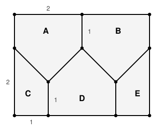

## Statement

On place $6$ points, n'importe où, à l'intérieur d'un rectangle de dimensions $4 \times 3$.

Montrer qu'on peut toujours en trouver **deux** dont la distance est inférieure ou égale à
$\sqrt 5$.

## Hints

1. Le principe des tiroirs avec $6$ points : combien de morceaux faut-il pour être sûr que
   deux points tombent dans le même ?
2. Il en faut **cinq**, pas six. Avec six morceaux, les six points pourraient se répartir un
   par morceau.
3. Chaque morceau doit avoir un diamètre au plus $\sqrt 5$ : deux points du même morceau ne
   doivent jamais pouvoir être plus éloignés que cela.
4. $\sqrt5$ est la diagonale d'un rectangle $2 \times 1$. Cherche un découpage en cinq
   morceaux dont tous les sommets sont à coordonnées entières et deux à deux distants d'au
   plus $\sqrt5$.
5. Le découpage n'est pas fait de rectangles. Autorise-toi des pentagones, en traçant des
   diagonales « en zigzag ».

## Solution

**Pourquoi cinq morceaux et pas six.**

Le réflexe est de couper le rectangle $4 \times 3$ en six rectangles $2 \times 1$, dont la
diagonale vaut justement $\sqrt{2^2 + 1^2} = \sqrt 5$. Mais avec **six** morceaux et **six**
points, rien n'empêche chaque morceau de recevoir exactement un point : le principe des
tiroirs ne dit rien.

Il faut donc un découpage en **cinq** morceaux seulement. Alors deux des six points tombent
forcément dans le même morceau, et il suffira que chaque morceau ait un diamètre au plus
$\sqrt 5$.

**Le découpage.**

Plaçons le rectangle dans un repère, avec les sommets $(0;0)$, $(4;0)$, $(4;3)$ et $(0;3)$.
On marque les points suivants sur le bord : $(1;0)$ et $(3;0)$ en bas, $(0;2)$ à gauche,
$(4;2)$ à droite, $(2;3)$ en haut. Et deux points à l'intérieur : $(1;1)$ et $(3;1)$, plus le
point $(2;2)$.

On trace alors la ligne brisée qui va de $(0;2)$ à $(1;1)$, puis à $(2;2)$, puis à $(3;1)$,
puis à $(4;2)$, ainsi que les trois segments verticaux descendant de $(1;1)$ vers $(1;0)$, de
$(3;1)$ vers $(3;0)$, et de $(2;3)$ vers $(2;2)$.

Cela découpe le rectangle en cinq polygones :

| Morceau | Sommets |
|---|---|
| A, en haut à gauche | $(0;3)$, $(2;3)$, $(2;2)$, $(1;1)$, $(0;2)$ |
| B, en haut à droite | $(2;3)$, $(4;3)$, $(4;2)$, $(3;1)$, $(2;2)$ |
| C, en bas à gauche | $(0;2)$, $(1;1)$, $(1;0)$, $(0;0)$ |
| D, en bas au milieu | $(1;1)$, $(2;2)$, $(3;1)$, $(3;0)$, $(1;0)$ |
| E, en bas à droite | $(3;1)$, $(4;2)$, $(4;0)$, $(3;0)$ |

**Chaque morceau a un diamètre égal à $\sqrt5$.**

Chacun de ces cinq polygones est convexe. Pour une figure convexe, deux points le plus
éloignés possible sont toujours deux **sommets** : il suffit donc de vérifier les distances
entre sommets.

Prenons le morceau A, de sommets $(0;3)$, $(2;3)$, $(2;2)$, $(1;1)$, $(0;2)$. Les dix
distances valent
$$2,\quad \sqrt5,\quad \sqrt5,\quad 1,\quad 1,\quad \sqrt5,\quad \sqrt5,\quad \sqrt2,
\quad 2,\quad \sqrt2 ,$$
et la plus grande est bien $\sqrt 5$.

Prenons le morceau D, de sommets $(1;1)$, $(2;2)$, $(3;1)$, $(3;0)$, $(1;0)$. Les distances
les plus longues sont
$$(1;1)-(3;0) = \sqrt5, \quad (2;2)-(3;0) = \sqrt5, \quad (2;2)-(1;0) = \sqrt5,
\quad (3;1)-(1;0) = \sqrt5 ,$$
et toutes les autres valent $1$, $\sqrt2$ ou $2$. Le diamètre est encore $\sqrt5$.

Le morceau C a pour sommets $(0;2)$, $(1;1)$, $(1;0)$, $(0;0)$ : sa plus grande distance est
$(0;2)-(1;0) = \sqrt5$.

Enfin B est le symétrique de A et E le symétrique de C, par la symétrie qui envoie $x$ sur
$4 - x$. Leurs diamètres valent donc aussi $\sqrt5$.

**Conclusion.**

Les cinq morceaux recouvrent le rectangle. Chacun des six points appartient à au moins un
morceau (pour un point sur une frontière, on choisit arbitrairement). Par le principe des
tiroirs, un morceau contient au moins deux des six points, et ces deux points sont distants
d'au plus le diamètre de ce morceau, c'est-à-dire d'au plus $\sqrt 5$. $\blacksquare$

## Going further

Le nombre $\sqrt 5$ n'est pas le meilleur possible. Place les six points
$$(0;0), \quad (0;\tfrac{13}{6}), \quad (2;\tfrac56), \quad (2;3),
\quad (4;0), \quad (4;\tfrac{13}{6}) .$$

Vérifie que deux quelconques d'entre eux sont à distance au moins $\dfrac{13}{6}$ : par
exemple
$$(0;0) \text{ et } (2;\tfrac56) : \quad
\sqrt{2^2 + (\tfrac56)^2} = \sqrt{\frac{144 + 25}{36}} = \sqrt{\frac{169}{36}}
= \frac{13}{6} .$$

Comme $\dfrac{13}{6} \approx \text{2,17}$ et $\sqrt5 \approx \text{2,24}$, la vraie
distance minimale garantie se situe donc quelque part entre $\dfrac{13}{6}$ et $\sqrt 5$.
Notre découpage donne une borne correcte, mais pas la plus fine.
