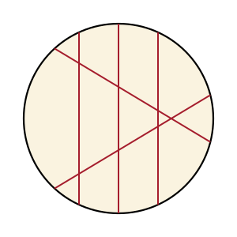

## Statement

On veut partager un gâteau rond en $13$ parts, pas forcément égales. Chaque coup de couteau est **rectiligne** et traverse le gâteau de part en part, du bord au bord. Le couteau est vertical, de sorte que chaque part garde de la crème sur le dessus.

Combien de coups de couteau faut-il au minimum ?

## Hints

1. Commence petit. Avec $1$ coup on obtient $2$ parts. Avec $2$ coups, combien au maximum ? Avec $3$ ?
2. Quand on donne un nouveau coup, de combien de parts le nombre total augmente-t-il ? Regarde le trajet du couteau à l'intérieur du gâteau : il est coupé en morceaux par les coups précédents, et chaque morceau sépare une part en deux.
3. Le $k$-ième coup rencontre au plus $k-1$ coups déjà donnés. Combien de parts nouvelles crée-t-il, au plus ?
4. Tu obtiendras un maximum de parts après $k$ coups. Trouve le plus petit $k$ pour lequel ce maximum atteint $13$.
5. N'oublie pas la construction : il faut aussi **exhiber** un découpage en exactement $13$ parts avec ce nombre de coups.

## Solution

**Réponse : il faut $5$ coups de couteau.**

### Combien de parts au maximum avec $k$ coups ?

Donnons les coups l'un après l'autre et regardons ce que fait le $k$-ième.

À l'intérieur du gâteau, le $k$-ième coup est un segment. Les $k-1$ coups déjà donnés le coupent en plusieurs morceaux : s'il en rencontre $j$, il est coupé en $j+1$ morceaux. Or chaque morceau traverse une part et la sépare en deux, ce qui crée exactement **une part de plus**.

Le $k$-ième coup ajoute donc $j+1$ parts, où $j$ est le nombre de coups précédents qu'il rencontre à l'intérieur du gâteau. Comme $j \leqslant k-1$, il ajoute au plus $k$ parts.

En partant d'une seule part (le gâteau entier) et en ajoutant au plus $1$, puis au plus $2$, puis au plus $3$, …, on obtient après $k$ coups au plus

$$1 + 1 + 2 + 3 + \cdots + k = 1 + \frac{k(k+1)}{2} \quad \text{parts.}$$

### On cherche le plus petit $k$ qui permette d'atteindre 13

| $k$ | $1$ | $2$ | $3$ | $4$ | $5$ |
|---|---|---|---|---|---|
| nombre maximal de parts | $2$ | $4$ | $7$ | $11$ | $16$ |

Avec $4$ coups, on ne peut donc pas dépasser $11$ parts : c'est insuffisant. Il faut au moins $5$ coups.

### Cinq coups suffisent

Il reste à donner un découpage en **exactement** $13$ parts avec $5$ coups. En voici un : trois coups parallèles, puis deux coups qui traversent les trois premiers et se croisent entre eux, le tout entièrement à l'intérieur du gâteau.

*Vérifions le compte.* Reprenons le raisonnement coup par coup :

- coup 1 (parallèle) : $1 \to 2$ parts ;
- coup 2 (parallèle au premier, donc il n'en rencontre aucun) : $+1$, soit $3$ parts ;
- coup 3 (parallèle aux deux premiers) : $+1$, soit $4$ parts ;
- coup 4 (il traverse les trois coups parallèles, donc $j = 3$) : $+4$, soit $8$ parts ;
- coup 5 (il traverse les trois parallèles et le quatrième coup, donc $j = 4$) : $+5$, soit $13$ parts.

On obtient bien $13$ parts.

### Conclusion

$$\boxed{\,5\text{ coups de couteau, et c'est le minimum.}\,}$$

*Attention.* Une erreur classique consiste à s'arrêter dès que l'on a trouvé qu'il faut « au moins $4$ » coups, parce que $3$ coups ne donnent que $7$ parts. Mais « $3$ coups ne suffisent pas » n'entraîne pas « $4$ coups suffisent » : il faut aller au bout du calcul et constater que $4$ coups plafonnent à $11$ parts. La correction du polycopié d'origine annonce d'ailleurs $4$ coups, ce qui est impossible.

## Going further

1. Quels nombres de parts peut-on obtenir avec exactement $5$ coups ? Trouve le minimum (tous les coups parallèles) et le maximum, puis montre que tous les nombres intermédiaires sont atteignables.

2. Combien de coups faut-il pour $100$ parts ? Et pour $2025$ parts ?

3. La formule $1 + \dfrac{k(k+1)}{2}$ compte les régions découpées dans un disque par $k$ droites en position générale. Démontre-la proprement par récurrence sur $k$.

4. Et en trois dimensions ? Combien de morceaux au maximum obtient-on en coupant une boule par $k$ plans ? Commence par $k = 1, 2, 3$.
