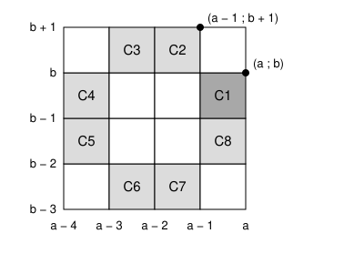

## Statement

Dans un repère orthonormé, on considère le disque formé des points $(x\,;\,y)$ tels que
$$x^2 + y^2 \leqslant 2014^2 .$$
On trace le quadrillage formé de tous les petits carrés de côté $1$, dont les sommets ont des
coordonnées entières, qui sont **entièrement** contenus dans ce disque. On appelle ces petits carrés
des **cases**.

Au départ, chaque case contient le nombre $1$. Un **tour** consiste à choisir une ligne, une colonne
ou une diagonale du quadrillage, et à changer le signe du nombre écrit dans chacune de ses cases :
les $1$ deviennent des $-1$, et les $-1$ deviennent des $1$.

Ici, une diagonale est formée de toutes les cases du quadrillage dont les centres sont sur une même
droite faisant un angle de $45°$ avec les axes.

Peut-on, après un certain nombre de tours, avoir un $-1$ dans une seule case, et des $1$ dans toutes
les autres ?

## Hints

1. Commence par un tableau $4 \times 4$ : peut-on y obtenir un seul $-1$ ? Cherche $8$ cases du
   tableau telles que chaque ligne, chaque colonne et chaque diagonale en contienne $0$ ou $2$.
2. Que devient alors le produit des nombres écrits dans ces $8$ cases lors d'un tour ?
3. Dans le disque, place une couronne de $8$ cases de ce type autour de la case qui doit contenir le
   $-1$, du côté du centre du disque. Il reste à vérifier que ces $8$ cases sont bien dans le
   quadrillage.
4. Grâce aux symétries du disque, on peut supposer que la case du $-1$ est
   $[a - 1, a] \times [b - 1, b]$ avec $a \geqslant b \geqslant 1$. Montre que
   $(a - 1)^2 + (b + 1)^2 \leqslant 2014^2$. Le cas $a = b$ demande un argument de parité.

## Solution

La réponse est **non**. Supposons au contraire qu'on puisse arriver à un seul $-1$, dans une case
que l'on appelle $C_1$, et cherchons une contradiction.

**Étape 1. On se ramène à une case bien placée.**

Le disque ne change pas si l'on change $x$ en $-x$, si l'on change $y$ en $-y$, ou si l'on échange
$x$ et $y$. Ces transformations envoient les lignes, les colonnes et les diagonales du quadrillage sur
des lignes, des colonnes et des diagonales. On peut donc supposer que le centre de $C_1$ a ses deux
coordonnées positives, l'abscisse au moins égale à l'ordonnée. Autrement dit,
$$C_1 = [a - 1, a] \times [b - 1, b] \qquad \text{avec } a, b \text{ entiers et } a \geqslant b \geqslant 1 .$$
Le coin de $C_1$ le plus loin de l'origine est $(a\,;\,b)$, donc $a^2 + b^2 \leqslant 2014^2$.

**Étape 2. La couronne de huit cases.**

Prenons les huit cases $C_1, \ldots, C_8$ dessinées ci-dessous. Elles forment le bord d'un bloc de
$4 \times 4$ cases, privé de ses quatre coins.

On vérifie sur la figure que **chaque ligne, chaque colonne et chaque diagonale contient soit
aucune, soit exactement deux de ces huit cases**. Par exemple, la ligne de $C_1$ contient aussi
$C_4$, et la diagonale de $C_1$ qui descend vers la gauche contient aussi $C_6$.

Supposons un instant que ces huit cases soient toutes dans le quadrillage (on le vérifie aux étapes
3 et 4). Regardons le produit $\Pi$ des huit nombres écrits dans ces cases. À chaque tour, on change
le signe de $0$ ou de $2$ d'entre eux, donc $\Pi$ ne change pas. Au départ, $\Pi = 1$. À la fin, il
n'y aurait qu'un seul $-1$, dans $C_1$, donc $\Pi = -1$. C'est impossible.

Il reste à montrer que les huit cases sont bien dans le quadrillage, c'est-à-dire que leurs quatre
sommets sont dans le disque.

**Étape 3. Le point $(a - 1\,;\,b + 1)$ est dans le disque.**

- Si $a > b$, alors $a - b \geqslant 1$ et
  $$(a - 1)^2 + (b + 1)^2 = a^2 + b^2 - 2(a - b) + 2 \leqslant a^2 + b^2 \leqslant 2014^2 .$$
- Si $a = b$, on a $2a^2 \leqslant 2014^2$. Il ne peut pas y avoir égalité. En effet, si
  $2a^2 = 2014^2 = 4 \times 1007^2$, alors $a^2 = 2 \times 1007^2$ est pair, donc $a$ est pair.
  En écrivant $a = 2a'$, on obtient $2a'^2 = 1007^2$ : à gauche un nombre pair, à droite un nombre
  impair. Donc $2a^2 < 2014^2$. Les deux nombres sont pairs, donc $2a^2 \leqslant 2014^2 - 2$, et
  $$(a - 1)^2 + (a + 1)^2 = 2a^2 + 2 \leqslant 2014^2 .$$

**Étape 4. Les huit cases sont dans le quadrillage.**

On utilise deux règles simples, qui viennent des étapes 1 et 3 :

- **Règle A.** Un point $(x\,;\,y)$ avec $|x| \leqslant a$ et $|y| \leqslant b$ est dans le disque, car
  $x^2 + y^2 \leqslant a^2 + b^2$.
- **Règle B.** Un point $(x\,;\,y)$ avec $|x| \leqslant a - 1$ et $|y| \leqslant b + 1$ est dans le
  disque, car $x^2 + y^2 \leqslant (a - 1)^2 + (b + 1)^2$.

*Si $a \geqslant 2$.*

- Les cases $C_1$, $C_4$, $C_5$ et $C_8$ ont leurs sommets d'abscisses entre $a - 4$ et $a$, et
  d'ordonnées entre $b - 2$ et $b$. Comme $a \geqslant 2$, on a $a - 4 \geqslant -a$, donc
  $|x| \leqslant a$. Comme $b \geqslant 1$, on a $b - 2 \geqslant -b$, donc $|y| \leqslant b$. La
  règle A s'applique.
- Les cases $C_2$, $C_3$, $C_6$ et $C_7$ ont leurs sommets d'abscisses entre $a - 3$ et $a - 1$, et
  d'ordonnées entre $b - 3$ et $b + 1$. Comme $a \geqslant 2$, on a $a - 3 \geqslant -(a - 1)$, donc
  $|x| \leqslant a - 1$. Comme $b \geqslant 1$, on a $b - 3 \geqslant -(b + 1)$, donc
  $|y| \leqslant b + 1$. La règle B s'applique.

*Si $a = 1$.* Alors $b = 1$ et $C_1 = [0, 1] \times [0, 1]$ touche le centre du disque. Les huit cases
ont des sommets d'abscisses entre $-3$ et $1$, et d'ordonnées entre $-2$ et $2$, donc
$x^2 + y^2 \leqslant 9 + 4 = 13$ : elles sont largement dans le disque.

**Conclusion : on ne peut pas obtenir un seul $-1$. Le produit des nombres écrits dans les huit cases
de la couronne autour de cette case ne change jamais, et il vaudrait $-1$ au lieu de $1$.**

## Going further

Le nombre $2014$ ne joue presque aucun rôle. La même preuve marche pour un disque de rayon $R$,
pour tout entier $R \geqslant 4$ : l'étape 3 utilise seulement que $2a^2 = R^2$ est impossible, ce
qui est vrai car $\sqrt{2}$ n'est pas un nombre rationnel, et le cas $a = 1$ de l'étape 4 demande
$13 \leqslant R^2$.
