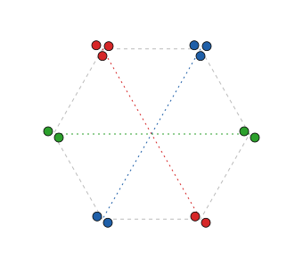

## Statement

Patricia a placé $2018$ points dans le plan, de sorte que les distances entre deux de ces points
soient toutes différentes. Elle colorie ensuite chacun des $2018$ points, en faisant attention à
ceci : pour chaque point $P$, le point le plus proche de $P$ et le point le plus éloigné de $P$
sont de la même couleur que $P$.

Combien de couleurs différentes, au plus, Patricia a-t-elle pu utiliser ?

## Hints

1. Montre que chaque couleur sert à colorier au moins trois points.
2. Peut-il y avoir deux couleurs qui servent chacune pour exactement trois points ? Appelle ces
   points $A_1, A_2, A_3$ et $B_1, B_2, B_3$, numérotés de sorte que $A_1A_2 < A_2A_3 < A_3A_1$ et
   $B_1B_2 < B_2B_3 < B_3B_1$.
3. Quel est le point le plus proche de $A_3$ ? Quel est le point le plus éloigné de $B_2$ ? Compare
   alors $A_2A_3$, $A_3B_2$ et $B_2B_3$.
4. Pour construire un exemple, place les points par petits paquets autour des sommets d'un polygone
   régulier qui a un nombre pair de sommets. Quel est le sommet le plus éloigné d'un sommet donné ?

## Solution

**Réponse : $504$ couleurs au plus.**

Dans toute la solution, $XY$ désigne la distance entre les points $X$ et $Y$.

### Chaque couleur sert pour au moins trois points

Prenons une couleur et un point $P$ de cette couleur. Le point $Q$ le plus proche de $P$ et le point
$R$ le plus éloigné de $P$ ont la même couleur que $P$. Ce sont deux points différents, car
$PQ < PR$ (il y a au moins deux autres points que $P$, et les distances sont toutes différentes).
La couleur sert donc pour au moins trois points : $P$, $Q$ et $R$.

### Au plus une couleur sert pour exactement trois points

Supposons, au contraire, que deux couleurs servent chacune pour exactement trois points : les points
$A_1, A_2, A_3$ pour la première, $B_1, B_2, B_3$ pour la seconde. Les trois distances entre les
$A_i$ sont différentes : numérotons-les de sorte que
$$A_1A_2 < A_2A_3 < A_3A_1 ,$$
et de même $B_1B_2 < B_2B_3 < B_3B_1$.

- *Le point le plus proche de $A_3$.* Il a la couleur de $A_3$, donc c'est $A_1$ ou $A_2$. Comme
  $A_3A_2 < A_3A_1$, c'est $A_2$. En particulier, $A_3$ est plus près de $A_2$ que de $B_2$ :
  $$A_2A_3 < A_3B_2 .$$
- *Le point le plus éloigné de $B_2$.* Il a la couleur de $B_2$, donc c'est $B_1$ ou $B_3$. Comme
  $B_2B_1 < B_2B_3$, c'est $B_3$. En particulier, $B_2$ est plus loin de $B_3$ que de $A_3$ :
  $$A_3B_2 < B_2B_3 .$$

On obtient $A_2A_3 < B_2B_3$. Mais les deux couleurs jouent le même rôle : le même raisonnement,
en échangeant les lettres $A$ et $B$, donne $B_2B_3 < A_2A_3$. C'est impossible. Donc au plus une
couleur sert pour exactement trois points.

### La majoration

Si Patricia a utilisé $k$ couleurs, une d'elles au plus sert pour $3$ points, et chacune des
$k - 1$ autres sert pour au moins $4$ points. Il y a donc au moins $4(k - 1) + 3 = 4k - 1$ points :
$$4k - 1 \leqslant 2018 , \qquad \text{donc} \qquad k \leqslant \frac{2019}{4} = \text{504,75} .$$
Comme $k$ est un entier, $k \leqslant 504$.

### Une construction avec $504$ couleurs

Voici d'abord l'idée sur un petit exemple, avec $14$ points et $3$ couleurs. On place les points par
petits paquets aux six sommets d'un hexagone régulier : trois points près de deux sommets voisins,
deux points près de chacun des quatre autres. Deux paquets placés à des sommets opposés ont la même
couleur.

Pour $2018$ points, on fait de même avec un polygone régulier à $1008$ sommets, numérotés
$S_1, S_2, \ldots, S_{1008}$ dans l'ordre. Comme $1008$ est pair, chaque sommet $S_i$ a un sommet
opposé, à savoir $S_{i+504}$ (ou $S_{i-504}$ si $i > 504$).

- **Les paquets.** Tout près de chaque sommet, on place deux points, et même trois près de $S_1$ et
  près de $S_2$. Cela fait $2 \times 1008 + 2 = 2018$ points. On les place de sorte que toutes les
  distances soient différentes : c'est toujours possible, quitte à bouger très légèrement les
  points.
- **Le plus proche.** Les paquets sont très petits par rapport au côté du polygone. Pour un point
  $P$ d'un paquet, le point le plus proche est donc dans le même paquet.
- **Le plus éloigné.** Les sommets $S_i$ et $S_{i+504}$ sont les deux extrémités d'un diamètre du
  cercle sur lequel se trouvent les sommets. Tout autre sommet est à une distance de $S_i$
  strictement plus petite que ce diamètre, puisqu'une corde qui n'est pas un diamètre est plus
  courte qu'un diamètre. Si les paquets sont assez petits, le point le plus éloigné de $P$ est donc
  dans le paquet du sommet opposé.
- **Le coloriage.** Pour $k = 1, 2, \ldots, 504$, on colorie avec la couleur numéro $k$ les points
  des paquets de $S_k$ et de $S_{k+504}$.

Pour chaque point $P$, le point le plus proche est dans le même paquet, et le point le plus éloigné
est dans le paquet opposé : ils ont bien la couleur de $P$. Ce coloriage utilise $504$ couleurs.

**Conclusion : Patricia a pu utiliser au plus $504$ couleurs, et $504$ couleurs sont possibles.**

## Going further

- Combien de couleurs, au plus, avec $2016$ points ? Et avec $2014$ points ? (Pour la construction,
  adapte le nombre de sommets du polygone et la taille des paquets.)
- Pourquoi la construction a-t-elle besoin d'un polygone qui a un nombre **pair** de sommets ?
