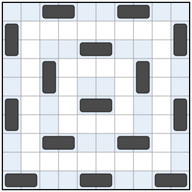

## Statement

Soit $n$ un entier strictement positif. On pose des dominos (de taille $1 \times 2$, chacun couvrant
exactement deux cases voisines) sur un échiquier de $2n \times 2n$ cases, sans qu'ils se
chevauchent.

On veut que **chaque case de l'échiquier**, couverte ou non, ait **exactement une** case voisine
couverte par un domino. Deux cases sont voisines si elles ont un côté commun (les diagonales ne
comptent pas).

Pour chaque $n$, quel est le plus grand nombre de dominos qu'on peut poser ainsi ?

## Hints

1. Essaie $n = 1$ et $n = 2$. Que dire d'une case couverte : quelle est sa seule voisine couverte ?
2. Pour un domino, regarde l'ensemble des cases voisines d'une de ses deux cases. Combien y en a-t-il,
   si on ajoute autour de l'échiquier une rangée de cases imaginaires ?
3. Chaque case de l'échiquier est dans la « zone » d'un seul domino. Compare $8 \times$ (nombre de
   dominos) au nombre de cases, en tenant compte des cases imaginaires.
4. Sur le bord de l'échiquier, parcouru comme une boucle, peut-il y avoir trois cases couvertes à la
   suite ? Une seule case libre entre deux cases couvertes ?
5. Pour construire, découpe l'échiquier en anneaux carrés emboîtés et ne pose des dominos que sur un
   anneau sur deux.

## Solution

On note $M$ le nombre de dominos. La réponse est $M = \frac{n(n+1)}{2}$.

**Une remarque.** Une case couverte a toujours pour voisine couverte l'autre case de son domino.
Comme elle n'a qu'une seule voisine couverte, c'est celle-là. Deux dominos ne se touchent donc
jamais par un côté.

### La majoration

**Les zones.** On ajoute autour de l'échiquier une rangée de cases imaginaires, qui forment un
cadre. Pour un domino $D$, on appelle **zone** de $D$ l'ensemble des cases, réelles ou imaginaires,
qui sont voisines d'au moins une case de $D$. Pour un domino horizontal, ce sont ses deux cases
(chacune est voisine de l'autre), les deux cases au-dessus, les deux cases en dessous, la case à
gauche et la case à droite. Une zone compte toujours **$8$ cases**.

**Les cases réelles.** Chaque case de l'échiquier a exactement une voisine couverte, donc elle est
dans la zone d'un seul domino. Les zones recouvrent donc les $4n^2$ cases de l'échiquier, sans
qu'une case soit comptée deux fois.

**Les cases imaginaires.** Une case imaginaire a au plus une voisine dans l'échiquier, donc elle
est dans une zone au plus. Une case imaginaire est dans une zone quand sa voisine dans l'échiquier
est couverte. Une case couverte au bord de l'échiquier a une voisine imaginaire si elle n'est pas
dans un coin, et deux si elle est dans un coin. Si $b$ est le nombre de cases couvertes au bord
et $c \leqslant 4$ le nombre de coins couverts, il y a donc $b + c$ cases imaginaires dans les zones.

En comptant les cases des $M$ zones, on obtient

$$8M = 4n^2 + b + c \leqslant 4n^2 + b + 4.$$

**Le bord de l'échiquier.** Les cases du bord forment une boucle de $8n - 4$ cases, où deux cases
qui se suivent sont voisines. Le long de cette boucle :

- on ne voit jamais trois cases couvertes à la suite, sinon celle du milieu aurait deux voisines
  couvertes ;
- on ne voit jamais une seule case libre entre deux cases couvertes, sinon cette case libre aurait
  deux voisines couvertes.

Les cases couvertes forment donc des groupes d'au plus $2$ cases, séparés par des groupes d'au moins
$2$ cases libres. Il y a autant de groupes couverts que de groupes libres, donc au moins autant de
cases libres que de cases couvertes sur le bord : $b \leqslant \frac{8n - 4}{2} = 4n - 2$.

**Conclusion de la majoration.** On obtient $8M \leqslant 4n^2 + 4n - 2 + 4 = 4n^2 + 4n + 2$, donc

$$M \leqslant \frac{n(n+1)}{2} + \frac{1}{4}.$$

Comme $M$ et $\frac{n(n+1)}{2}$ sont des entiers, $M \leqslant \frac{n(n+1)}{2}$.

### La construction

**Les anneaux.** On découpe l'échiquier en $n$ anneaux carrés emboîtés : l'anneau $A_1$ est le bord
de l'échiquier, l'anneau $A_2$ est le bord de ce qui reste, et ainsi de suite jusqu'à l'anneau
$A_n$, qui est le carré central de $2 \times 2$ cases. L'anneau $A_j$ est le bord d'un carré de côté
$2(n - j + 1)$, il a $8(n - j) + 4$ cases, un multiple de $4$.

**Les dominos.** On ne met des dominos que sur les anneaux de numéro impair $A_1, A_3, A_5, \ldots$
Sur un tel anneau, on numérote les cases $0, 1, 2, \ldots$ en partant du coin en haut à gauche et en
tournant dans le sens des aiguilles d'une montre. Deux cases qui se suivent sur l'anneau sont
toujours voisines, même dans un coin. Pour chaque entier $q$, les cases numérotées $4q + 2$ et
$4q + 3$ forment un domino. Les cases couvertes sont donc celles dont le numéro a pour reste $2$ ou
$3$ dans la division par $4$.

Voici le résultat pour $n = 5$ ; les anneaux $A_1$, $A_3$, $A_5$ sont teintés.

**Le nombre de dominos.** L'anneau $A_j$ reçoit $\frac{8(n - j) + 4}{4} = 2(n - j) + 1$ dominos. On
écrit $2(n - j) + 1 = (n - j + 1) + (n - j)$. Pour $j = 1, 3, 5, \ldots$ on obtient
$n + (n - 1)$, puis $(n - 2) + (n - 3)$, et ainsi de suite. En tout, on retrouve chaque entier de
$1$ à $n$ une fois, donc il y a $1 + 2 + \cdots + n = \frac{n(n+1)}{2}$ dominos.

**Vérification.** Il faut voir que chaque case a exactement une voisine couverte.

*Une case d'un anneau impair.* Ses voisines sur les anneaux d'à côté sont sur des anneaux pairs,
donc libres, ou bien hors de l'échiquier. Seules comptent ses deux voisines sur son propre anneau,
la précédente et la suivante. Si son numéro a pour reste $0$, la précédente (reste $3$) est couverte
et la suivante (reste $1$) ne l'est pas. On vérifie de même les restes $1$, $2$ et $3$ : il y a
toujours exactement une des deux qui est couverte.

*Une case d'un anneau pair $A_j$.* Ses voisines sur $A_j$ sont libres. Seules comptent ses voisines
sur les anneaux impairs $A_{j-1}$ (à l'extérieur) et $A_{j+1}$ (à l'intérieur).

- **Si c'est un coin de $A_j$**, elle a deux voisines sur $A_{j-1}$ : les deux cases qui encadrent
  le coin de $A_{j-1}$, juste avant et juste après lui. On passe de l'une à l'autre en avançant de
  $2$ cases sur l'anneau. Comme le nombre de cases de l'anneau est un multiple de $4$, leurs restes
  dans la division par $4$ diffèrent de $2$, même pour le coin de départ : l'un est $0$ ou $1$,
  l'autre est $2$ ou $3$. Exactement une est couverte.
- **Sinon**, elle a une voisine $O$ sur $A_{j-1}$ et une voisine $I$ sur $A_{j+1}$. Disons qu'elle
  est sur le côté numéro $k$ de $A_j$ ($k = 0$ pour le haut, $1$ pour la droite, $2$ pour le bas,
  $3$ pour la gauche). Chaque côté de $A_{j-1}$ a $4$ cases de plus qu'un côté de $A_{j+1}$, et sur
  son côté, $O$ est $2$ cases plus loin du coin de départ que $I$. Le numéro de $O$ dépasse donc
  celui de $I$ de $4k + 2$. Les restes diffèrent de $2$, et comme pour les coins, exactement une des
  deux est couverte.

Chaque case a donc exactement une voisine couverte.

**Conclusion.** Le plus grand nombre de dominos est $\frac{n(n+1)}{2}$ : on ne peut pas faire mieux
d'après le comptage des zones, et la construction par anneaux atteint ce nombre.
