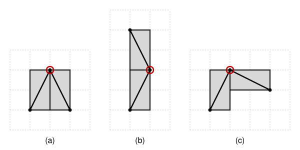
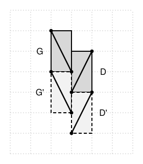
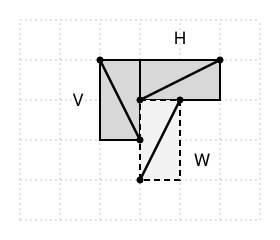

## Statement

Un rectangle quadrillé est entièrement découpé en dominos, c'est-à-dire en rectangles de $1 \times 2$
ou de $2 \times 1$ cases.

Dans chaque domino, on trace l'une de ses deux diagonales, le segment qui joint deux coins opposés
du domino. On suppose que deux diagonales n'ont jamais d'extrémité commune.

Montrer qu'exactement deux des quatre coins du rectangle sont des extrémités de diagonales.

## Hints

1. Fais quelques essais sur un rectangle de $2 \times 3$ ou de $4 \times 4$. Que remarques-tu sur le
   sens des diagonales (montantes ou descendantes) ?
2. Si toutes les diagonales vont dans le même sens, la conclusion est facile. Montre-le d'abord.
3. Il suffit alors de montrer que deux dominos qui se touchent par un morceau de côté ont des
   diagonales de même sens. Fais la liste des façons dont deux dominos peuvent se toucher.
4. Une diagonale a une extrémité sur chacun des deux petits côtés de son domino. Si les deux coins
   d'un petit côté sont déjà pris par d'autres diagonales, le domino est impossible.
5. Deux dominos verticaux côte à côte, décalés d'une case, l'un à diagonale montante et l'autre à
   diagonale descendante : regarde la case qui est juste sous le plus haut des deux. Quel domino peut
   la couvrir ?

## Solution

Disons qu'une diagonale est **montante** si elle monte de gauche à droite, et **descendante**
sinon. Deux dominos sont **voisins** s'ils ont un morceau de côté en commun.

Une remarque servira tout le temps.

> **Remarque.** La diagonale d'un domino joint un coin d'un de ses petits côtés au coin opposé de
> l'autre petit côté. Elle a donc **une extrémité sur chacun des deux petits côtés**. Par
> conséquent, si les deux coins d'un petit côté d'un domino sont déjà des extrémités d'autres
> diagonales, ce domino est impossible. Si un seul de ces deux coins est déjà pris, la diagonale
> part forcément de l'autre.

Une autre chose servira : si on fait tourner toute la figure, ou si on la retourne comme dans un
miroir, on obtient encore un rectangle découpé en dominos, avec des diagonales sans extrémité
commune. Une montante peut alors devenir descendante, mais deux diagonales de sens différents
restent de sens différents. On pourra donc toujours tourner ou retourner la figure pour se placer
dans une position commode.

**Étape 1 : il suffit que toutes les diagonales aillent dans le même sens.** Supposons par exemple
qu'elles soient toutes montantes. Le coin en bas à gauche du rectangle n'appartient qu'à un seul
domino, celui qui couvre la case de ce coin, et c'est aussi le coin en bas à gauche de ce domino.
Une diagonale montante part justement de là : ce coin du rectangle est une extrémité. Pour la même
raison, le coin en haut à droite en est une. En revanche, le coin en bas à droite du rectangle est
le coin en bas à droite du seul domino qui le contient, et une diagonale montante ne passe pas par
là : ce n'est pas une extrémité. De même pour le coin en haut à gauche. Il y a donc exactement deux
coins qui conviennent. Si toutes les diagonales sont descendantes, c'est pareil avec les deux autres
coins.

**Étape 2 : il suffit que deux dominos voisins aient toujours des diagonales de même sens.** Prenons
deux dominos quelconques, et une case dans chacun. On peut aller d'une de ces cases à l'autre en
passant à chaque fois à une case qui a un côté commun avec la précédente (on suit une ligne, puis une
colonne). Deux cases consécutives de ce chemin sont dans le même domino, ou dans deux dominos
voisins. Le sens de la diagonale ne change donc jamais le long du chemin : les deux dominos ont des
diagonales de même sens, et toutes les diagonales vont dans le même sens.

Il reste à montrer que deux dominos voisins ne peuvent pas avoir des diagonales de sens différents.
Supposons le contraire, et passons en revue toutes les façons dont deux dominos peuvent se toucher.

**Étape 3 : les cas où deux extrémités se rencontrent tout de suite.** Ce sont les trois cas de la
figure 1, où le point commun est entouré.

- *(a) Deux dominos parallèles qui forment un carré de $2 \times 2$.* Tournons la figure pour qu'ils
  soient verticaux. Chacune des deux diagonales a une extrémité sur le côté commun. Celle du domino de
  gauche est en haut de ce côté si elle est montante, en bas si elle est descendante. Celle du domino
  de droite est en bas si elle est montante, en haut si elle est descendante. Avec des sens
  différents, les deux extrémités tombent au même point.
- *(b) Deux dominos parallèles bout à bout.* Tournons la figure pour qu'ils soient verticaux, l'un
  au-dessus de l'autre. Leur côté commun est un petit côté de chacun. La diagonale du domino du bas y
  arrive à droite si elle est montante, à gauche si elle est descendante. Celle du domino du haut en
  part à gauche si elle est montante, à droite si elle est descendante. Avec des sens différents,
  c'est encore le même point.
- *(c) Deux dominos perpendiculaires.* Leur côté commun est un petit côté de l'un et un morceau de
  grand côté de l'autre. Tournons la figure pour que ce côté commun soit vertical : c'est alors un
  petit côté du domino horizontal $H$, collé contre un grand côté du domino vertical $V$. En
  retournant la figure, on peut supposer que $H$ est à droite de $V$ et qu'il touche la case du haut
  de $V$. Si $V$ est montante et $H$ descendante, $V$ se termine en son coin en haut à droite, qui est
  aussi le coin en haut à gauche de $H$, d'où part sa diagonale : même point. L'autre choix, $V$
  descendante et $H$ montante, est le **motif 2** de l'étape 5.

Il reste un seul cas : deux dominos parallèles côte à côte, **décalés d'une case**. Tournons et
retournons la figure pour qu'ils soient verticaux, avec $G$ à gauche, plus haut d'une case que $D$ à
droite. Si $G$ est descendante et $D$ montante, c'est le **motif 1** de l'étape 4. Si au contraire
$G$ est montante et $D$ descendante, un demi-tour de la figure échange les places de $G$ et de $D$
sans changer le sens des diagonales, et l'on retombe sur le motif 1.

**Étape 4 : le motif 1 est impossible.** Le motif 1 est formé de deux dominos verticaux $G$ et $D$,
$G$ à gauche et plus haut d'une case, $G$ à diagonale descendante et $D$ à diagonale montante
(figure 2, en gris).

*La case juste sous $G$.* Elle est dans la colonne de $G$ et dans la ligne de la case du bas de $D$,
donc elle fait bien partie du rectangle. Appelons-la $c$. Sa voisine du haut est dans $G$, sa voisine
de droite est dans $D$. Son coin en haut à droite est une extrémité de la diagonale de $G$, son coin
en bas à droite une extrémité de celle de $D$. Le domino qui couvre $c$ est donc :

- soit horizontal, avec la case à gauche de $c$ : son petit côté droit est alors le côté droit de $c$,
  dont les deux coins sont déjà pris. C'est impossible d'après la remarque ;
- soit vertical, avec la case sous $c$ : son petit côté du haut est le côté du haut de $c$, dont le
  coin droit est pris. D'après la remarque, sa diagonale part du coin en haut à gauche de $c$ : elle
  est **descendante**.

S'il n'y a pas de case sous $c$, aucun domino ne peut couvrir $c$, ce qui est déjà une contradiction.
Sinon, $c$ et la case du dessous forment un domino descendant $G'$.

*La case juste sous $D$.* Elle est dans la colonne de $D$ et dans la ligne de la case du bas de $G'$,
donc elle fait partie du rectangle. Appelons-la $c'$. Sa voisine du haut est dans $D$, sa voisine de
gauche est dans $G'$. Son coin en haut à gauche est une extrémité de la diagonale de $D$, son coin en
bas à gauche une extrémité de celle de $G'$. Le domino qui couvre $c'$ est donc :

- soit horizontal, avec la case à droite de $c'$ : son petit côté gauche est le côté gauche de $c'$,
  dont les deux coins sont pris. Impossible ;
- soit vertical, avec la case sous $c'$ : le coin gauche du côté du haut de $c'$ est pris, donc sa
  diagonale part du coin en haut à droite de $c'$ et descend vers la gauche : elle est **montante**.

Là encore, s'il n'y a pas de case sous $c'$, c'est une contradiction. Sinon, on obtient un domino
montant $D'$.

*On recommence.* Les dominos $G'$ et $D'$ forment exactement le motif 1, deux cases plus bas. Le même
raisonnement fournit un nouveau motif 1 encore deux cases plus bas, et ainsi de suite sans fin. Mais
le rectangle n'a qu'un nombre fini de lignes : au bout d'un moment, la case sous $c$ ou sous $c'$
n'existe plus, et l'on obtient une contradiction. **Le motif 1 ne peut pas apparaître.**

**Étape 5 : le motif 2 est impossible.** Le motif 2 est formé d'un domino vertical $V$ à diagonale
descendante, et d'un domino horizontal $H$ à diagonale montante, collé à droite de la case du haut de
$V$ (figure 3, en gris).

Regardons la case $c$ juste sous la case de gauche de $H$. C'est aussi la case à droite de la case du
bas de $V$, donc elle fait partie du rectangle. Sa voisine de gauche est dans $V$ et sa voisine du
haut dans $H$. Son coin en haut à gauche est une extrémité de la diagonale de $H$, son coin en bas à
gauche une extrémité de celle de $V$. Le domino qui couvre $c$ est donc :

- soit horizontal, avec la case à droite de $c$ : les deux coins de son petit côté gauche sont pris.
  Impossible ;
- soit vertical, avec la case sous $c$ : comme pour $c'$ plus haut, sa diagonale est **montante**.

On obtient un domino montant $W$ (s'il n'y a pas de case sous $c$, c'est déjà une contradiction).
Mais alors $V$ et $W$ sont deux dominos verticaux côte à côte, $V$ à gauche et plus haut d'une case,
$V$ descendant et $W$ montant : c'est le motif 1, qui est impossible. **Le motif 2 ne peut pas
apparaître non plus.**

**Conclusion.** Deux dominos voisins ont toujours des diagonales de même sens. D'après l'étape 2,
toutes les diagonales vont dans le même sens, et d'après l'étape 1, exactement deux coins du
rectangle sont des extrémités de diagonales : ceux du bas à gauche et du haut à droite si les
diagonales sont montantes, les deux autres si elles sont descendantes.

## Going further

Le bord du rectangle est indispensable : c'est lui qui arrête la descente du motif 1. Dans un
quadrillage qui s'étend sans fin dans toutes les directions, on peut mélanger les deux sens.

Remplissons chaque colonne de dominos verticaux, en décalant d'une case d'une colonne à la suivante,
et prenons des diagonales descendantes dans toutes les colonnes de gauche jusqu'à une certaine
colonne, puis montantes dans toutes les colonnes suivantes. Deux diagonales n'ont jamais d'extrémité
commune : à la frontière, on retrouve le motif 1 (ou son image dans un miroir), répété sans fin vers le haut et vers le bas.
