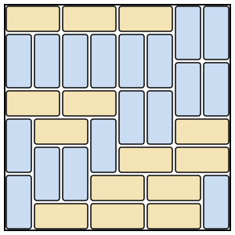
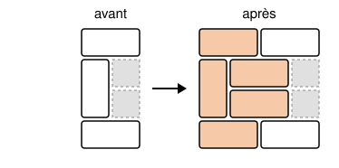

## Statement

On pave entièrement une grille carrée de $n \times n$ cases avec des dominos. Chaque domino couvre
deux cases voisines, couché ou debout, et les dominos ne se chevauchent pas.

Une **ligne de coupe** est une droite du quadrillage, horizontale ou verticale, qui passe à
l'intérieur de la grille (elle laisse des cases des deux côtés) et qui ne coupe aucun domino en deux.

Quel est le plus grand entier pair $n$ tel que **tout** pavage de la grille $n \times n$ par des
dominos possède au moins une ligne de coupe ?

## Hints

1. Essaie $n = 2$ et $n = 4$ : trouves-tu toujours une ligne de coupe ?
2. Une droite du quadrillage peut-elle couper un seul domino ? Compte les cases d'un côté de la
   droite, dans une grille $6 \times 6$.
3. Dans une grille $6 \times 6$, combien y a-t-il de droites du quadrillage à l'intérieur de la grille ?
   Combien de dominos ? Un domino peut-il être coupé par deux droites ?
4. Pour $n = 8$, il existe un pavage sans aucune ligne de coupe. Cherche-le en demandant à chaque
   droite de couper au moins deux dominos.
5. Pour passer d'un bon pavage à une grille plus grande, ajoute deux colonnes à gauche et regarde
   comment raccorder l'ancienne première colonne.

## Solution

La réponse est $n = 6$. Il faut montrer deux choses : tout pavage de la grille $6 \times 6$ a une ligne
de coupe, et pour tout $n$ pair au moins égal à $8$, un pavage de la grille $n \times n$ n'en a aucune.

Appelons **séparatrices** les droites du quadrillage qui passent à l'intérieur de la grille. Une
grille $n \times n$ en a $n - 1$ horizontales et $n - 1$ verticales.

**Un domino est coupé par au plus une séparatrice.** Ses deux cases sont séparées par un seul trait
du quadrillage.

**Dans une grille $6 \times 6$, une séparatrice coupe un nombre pair de dominos.** D'un côté de la
séparatrice, il y a un rectangle de $6 \times k$ cases, avec $k$ entre $1$ et $5$ : c'est un nombre
pair de cases. Ces cases sont couvertes de deux façons :

- par des dominos entièrement de ce côté, qui couvrent chacun $2$ cases, donc un nombre pair de cases
  en tout ;
- par des dominos coupés par la séparatrice, qui couvrent chacun $1$ case de ce côté.

Le nombre de dominos coupés est donc égal à un nombre pair moins un nombre pair : il est pair.

**Le cas $n = 6$.** Supposons qu'un pavage de la grille $6 \times 6$ n'ait aucune ligne de coupe.
Chacune des $5 + 5 = 10$ séparatrices coupe alors au moins un domino, donc au moins $2$ puisque ce
nombre est pair. Comme un domino n'est coupé que par une seule séparatrice au plus, il faut au moins
$10 \times 2 = 20$ dominos différents. Or le pavage n'en compte que $36 \div 2 = 18$. C'est une
contradiction : **tout pavage de la grille $6 \times 6$ a une ligne de coupe.**

**Un pavage $8 \times 8$ sans ligne de coupe.** En voici un.

On vérifie séparatrice par séparatrice que chacune coupe au moins un domino. Par exemple, la
séparatrice horizontale entre la première et la deuxième ligne coupe les deux dominos debout en
haut à droite.

**Agrandir un pavage sans ligne de coupe.** Prenons un pavage sans ligne de coupe d'un rectangle de
$m$ lignes et $k$ colonnes, avec $k \geqslant 3$. Montrons qu'on peut en fabriquer un pour le
rectangle de $m$ lignes et $k + 2$ colonnes.

On ajoute deux colonnes à gauche du rectangle. Regardons l'ancienne première colonne, case par case.

- Si une de ses cases est couverte par un domino couché, ce domino reste en place, et on pose un
  nouveau domino couché dans les deux nouvelles cases de la même ligne.
- Si deux de ses cases sont couvertes par un domino debout, on enlève ce domino. On pose à sa place
  un domino couché sur chacune des deux lignes, qui couvre l'ancienne case et la nouvelle case juste
  à sa gauche, et un domino debout dans la colonne tout à gauche.

Toutes les cases sont bien couvertes. Vérifions qu'aucune séparatrice n'est une ligne de coupe.

- *Une séparatrice horizontale* coupait, dans l'ancien pavage, un domino debout. S'il n'était pas dans
  la première colonne, il est toujours là. S'il y était, il a été remplacé par un domino debout dans
  la nouvelle colonne de gauche, à la même hauteur, qui coupe la même séparatrice.
- *Une ancienne séparatrice verticale* coupait un domino couché. Ce domino n'a pas bougé, car on n'a
  enlevé que des dominos debout.
- *La séparatrice entre l'ancienne première colonne et la nouvelle colonne juste à sa gauche.* Elle
  est coupée dès que l'ancienne première colonne contenait un domino debout. C'est le cas : sinon,
  tous les dominos de cette colonne seraient couchés et couvriraient toute la deuxième colonne, et la
  séparatrice entre la deuxième et la troisième colonne (qui existe car $k \geqslant 3$) ne couperait
  aucun domino.
- *La séparatrice entre les deux nouvelles colonnes.* Elle est coupée dès que l'ancienne première
  colonne contenait un domino couché. C'est le cas, car la séparatrice entre la première et la
  deuxième colonne de l'ancien pavage coupait un domino, forcément couché sur ces deux colonnes.

En faisant tourner la figure d'un quart de tour, on peut de la même façon ajouter deux lignes à un
pavage sans ligne de coupe qui a au moins $3$ lignes.

**Tous les $n$ pairs à partir de $8$.** On part du pavage $8 \times 8$. On ajoute deux colonnes,
puis deux lignes : on obtient un pavage $10 \times 10$ sans ligne de coupe. On recommence pour
obtenir $12 \times 12$, puis $14 \times 14$, et ainsi de suite. Pour tout $n$ pair au moins égal à
$8$, il existe donc un pavage de la grille $n \times n$ sans ligne de coupe.

**Conclusion.** Le plus grand entier pair $n$ tel que tout pavage de la grille $n \times n$ ait une
ligne de coupe est $n = 6$.

## Going further

Le même argument montre que tout pavage d'une grille $4 \times 4$ a une ligne de coupe : il y a $6$
séparatrices, qui demanderaient au moins $12$ dominos, et il n'y en a que $8$.

Le plus petit rectangle qui a un pavage sans ligne de coupe est le rectangle de $5$ lignes et
$6$ colonnes. Essaie de le trouver : chacune des $4 + 5 = 9$ séparatrices doit couper au moins un
domino, avec seulement $15$ dominos. (Il y a exactement $6$ tels pavages.)
