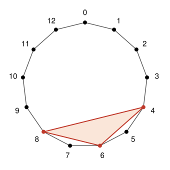

## Statement

Soit $n \geqslant 3$ un entier. On colorie $2n$ sommets d'un polygone régulier à $4n + 1$ sommets.

Montrer qu'il existe trois sommets coloriés qui forment un triangle isocèle.

## Hints

1. Numérote les sommets $S_0, S_1, \ldots, S_{4n}$ en tournant, et lis les numéros « modulo $4n+1$ » :
   $S_{-1}$ est $S_{4n}$, $S_{4n+1}$ est $S_0$, etc. Pourquoi $S_{a-i}$, $S_a$, $S_{a+i}$ forment-ils
   toujours un triangle isocèle ?
2. Raisonne par l'absurde. Autour d'un sommet colorié $S_a$, regroupe les autres sommets en paires
   $\{S_{a-i}, S_{a+i}\}$. Combien de sommets coloriés une paire peut-elle contenir ? Combien de paires
   y a-t-il, et combien d'autres sommets coloriés ?
3. Sépare deux cas : deux sommets voisins ne sont jamais coloriés tous les deux, ou au contraire deux
   sommets voisins sont coloriés.
4. Dans chaque cas, regarde du côté des sommets $S_{2n}$ et $S_{2n+1}$, à l'opposé du sommet de départ.

## Solution

**Notations.** Numérotons les sommets $S_0, S_1, \ldots, S_{4n}$ en tournant autour du polygone. On lit
les numéros modulo $4n + 1$ : $S_{-1}$ désigne $S_{4n}$, $S_{-2}$ désigne $S_{4n-1}$, $S_{4n+1}$
désigne $S_0$, et ainsi de suite. Par exemple, $S_{-(2n-1)}$ est le sommet $S_{2n+2}$.

**Le fait de base.** Pour tout sommet $S_a$ et tout $i$ entre $1$ et $2n$, les sommets $S_{a-i}$, $S_a$
et $S_{a+i}$ forment un triangle isocèle en $S_a$. En effet, la droite qui passe par $S_a$ et par le
centre du polygone est un axe de symétrie du polygone, et cette symétrie échange $S_{a-i}$ et $S_{a+i}$ :
donc $S_aS_{a-i} = S_aS_{a+i}$. Ces trois sommets sont bien différents, car $4n + 1$ est impair.

Raisonnons par l'absurde : supposons que trois sommets coloriés ne forment jamais un triangle isocèle.

**Les paires autour d'un sommet colorié.** Prenons un sommet colorié $S_a$. Les $4n$ autres sommets se
regroupent en $2n$ paires $\{S_{a-i}, S_{a+i}\}$, pour $i$ allant de $1$ à $2n$. D'après le fait de
base, une paire ne contient jamais deux sommets coloriés. Or il reste $2n - 1$ sommets coloriés à
répartir dans ces $2n$ paires : **toutes les paires sauf une contiennent exactement un sommet
colorié, et une seule paire n'en contient aucun.**

**Premier cas : deux sommets voisins ne sont jamais coloriés tous les deux.** Numérotons les sommets
pour que $S_0$ soit colorié. Ses voisins $S_1$ et $S_{-1}$ ne sont pas coloriés : la paire
$\{S_{-1}, S_1\}$ est la paire vide. Chaque paire $\{S_{-i}, S_i\}$ avec $i$ entre $2$ et $2n$ contient
donc exactement un sommet colorié.

- Dans la paire $\{S_{-2n}, S_{2n}\}$, un des deux sommets est colorié. Quitte à numéroter dans l'autre
  sens, c'est $S_{2n}$.
- Son voisin $S_{2n-1}$ n'est pas colorié. Dans la paire $\{S_{-(2n-1)}, S_{2n-1}\}$, c'est donc
  $S_{-(2n-1)}$, c'est-à-dire $S_{2n+2}$, qui est colorié.
- Son voisin $S_{2n+3}$, c'est-à-dire $S_{-(2n-2)}$, n'est pas colorié. Comme $2n - 2 \geqslant 2$,
  la paire $\{S_{-(2n-2)}, S_{2n-2}\}$ contient un sommet colorié : c'est $S_{2n-2}$.

Les sommets $S_{2n-2}$, $S_{2n}$ et $S_{2n+2}$ sont coloriés et forment un triangle isocèle en $S_{2n}$.
C'est une contradiction.

**Second cas : deux sommets voisins sont coloriés.** Numérotons-les $S_0$ et $S_1$. D'après le fait de
base, trois sommets ne sont pas coloriés :

- $S_{-1}$, à cause du triangle $S_{-1}S_0S_1$, isocèle en $S_0$ ;
- $S_2$, à cause du triangle $S_0S_1S_2$, isocèle en $S_1$ ;
- $S_{2n+1}$, à cause du triangle $S_1S_{2n+1}S_{4n+1}$, isocèle en $S_{2n+1}$ (on rappelle que
  $S_{4n+1}$ est $S_0$).

Il reste $4n + 1 - 5 = 4n - 4$ sommets, à savoir $S_3, \ldots, S_{2n}$ et $S_{-2}, \ldots, S_{-(2n-1)}$,
parmi lesquels $2n - 2$ sont coloriés. Regroupons-les en $2n - 2$ paires, pour $j$ allant de $1$ à
$n - 1$ :

$$P_j = \{S_{2j+1}, S_{-(2j+1)}\} \qquad \text{et} \qquad Q_j = \{S_{2j+2}, S_{-2j}\}.$$

Les paires $P_j$ sont symétriques par rapport à $S_0$ et les paires $Q_j$ par rapport à $S_1$, puisque
$2j + 2 = 1 + (2j+1)$ et $-2j = 1 - (2j+1)$. Chaque paire contient donc au plus un sommet colorié, et
comme il y a $2n - 2$ sommets coloriés pour $2n - 2$ paires, **chaque paire en contient exactement
un**. Le fait de base donne encore deux règles.

- *(R1)* Les sommets $S_{2j+2}$ et $S_{-(2j+2)}$, symétriques par rapport à $S_0$, ne sont pas coloriés tous les
  deux. Donc si $S_{2j+2}$ est colorié, $S_{-(2j+2)}$ ne l'est pas, et dans la paire
  $Q_{j+1} = \{S_{2j+4}, S_{-(2j+2)}\}$, c'est $S_{2j+4}$ qui est colorié.
- *(R2)* Les sommets $S_{2j+3}$ et $S_{-(2j+1)}$, symétriques par rapport à $S_1$, ne sont pas coloriés tous les
  deux. Donc si $S_{-(2j+1)}$ est colorié, $S_{2j+3}$ ne l'est pas, et dans la paire
  $P_{j+1} = \{S_{2j+3}, S_{-(2j+3)}\}$, c'est $S_{-(2j+3)}$ qui est colorié.

Comme $n \geqslant 3$, les paires $P_2$ et $Q_2$ existent.

- *$S_6$ est colorié.* Sinon, dans $Q_2 = \{S_6, S_{-4}\}$, c'est $S_{-4}$. Alors $S_4$ n'est pas
  colorié (symétrique de $S_{-4}$ par rapport à $S_0$), donc dans $Q_1 = \{S_4, S_{-2}\}$, c'est
  $S_{-2}$. Mais $S_0$, $S_{-2}$, $S_{-4}$ forment un triangle isocèle en $S_{-2}$ : contradiction.
  Par la règle (R1), $S_6, S_8, \ldots, S_{2n}$ sont alors tous coloriés.
- *$S_{-5}$ est colorié.* Sinon, dans $P_2 = \{S_5, S_{-5}\}$, c'est $S_5$. Alors $S_{-3}$ n'est pas
  colorié (symétrique de $S_5$ par rapport à $S_1$), donc dans $P_1 = \{S_3, S_{-3}\}$, c'est $S_3$.
  Mais $S_1$, $S_3$, $S_5$ forment un triangle isocèle en $S_3$ : contradiction. Par la règle (R2),
  $S_{-5}, S_{-7}, \ldots, S_{-(2n-1)}$ sont alors tous coloriés.
- *$S_4$ est colorié.* Sinon, dans $Q_1$, c'est $S_{-2}$. Mais $S_1$, $S_{-2}$, $S_{-5}$ forment un
  triangle isocèle en $S_{-2}$, puisque $-2 = 1 - 3$ et $-5 = -2 - 3$ : contradiction.

Ainsi $S_4, S_6, \ldots, S_{2n}$ sont coloriés, et en particulier $S_{2n-2}$ et $S_{2n}$, puisque
$2n - 2 \geqslant 4$. Le sommet $S_{-(2n-1)}$, c'est-à-dire $S_{2n+2}$, est colorié aussi. Les sommets
$S_{2n-2}$, $S_{2n}$ et $S_{2n+2}$ forment un triangle isocèle en $S_{2n}$ : contradiction.

**Conclusion.** Dans les deux cas, on aboutit à une contradiction. Il existe donc toujours trois sommets
coloriés qui forment un triangle isocèle.

## Going further

L'hypothèse $n \geqslant 3$ est nécessaire. Pour $n = 2$, on colorie $4$ sommets d'un polygone à $9$
sommets, et les sommets $S_0$, $S_1$, $S_3$ et $S_4$ ne contiennent aucun triangle isocèle. Pour le
vérifier, compte les côtés qui séparent deux sommets en faisant le tour le plus court : les distances
obtenues dans chacun des quatre triangles sont toutes différentes.

L'énoncé est en fait loin d'être optimal : une recherche par ordinateur montre que, dans le polygone à
$13$ sommets, $5$ sommets coloriés contiennent toujours un triangle isocèle, alors que l'énoncé en
demande $6$.
