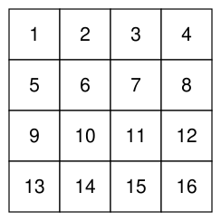

## Statement

Soit $n \geqslant 2$ un entier. On écrit les entiers $1, 2, \ldots, n^2$ dans les $n^2$ cases d'un échiquier $n \times n$, ligne par ligne : la première ligne contient $1, 2, \ldots, n$ de gauche à droite, la deuxième ligne contient $n + 1, n + 2, \ldots, 2n$, et ainsi de suite. Voici l'échiquier obtenu pour $n = 4$.

À chaque étape, on choisit deux cases qui ont un côté commun, et on ajoute un même entier aux deux nombres écrits dans ces deux cases, ou bien on leur retranche un même entier.

Trouver toutes les valeurs de $n$ pour lesquelles on peut arriver à un échiquier qui ne contient que des $0$. Pour ces valeurs, trouver le plus petit nombre d'étapes qui permet d'y arriver.

## Hints

1. Que devient la parité de la somme de tous les nombres de l'échiquier au cours d'une étape ?
2. Quand $n$ est pair, découpe l'échiquier en carrés de $2 \times 2$ cases. Combien d'étapes suffisent pour mettre des $0$ dans un tel carré ?
3. Pour montrer qu'on ne peut pas faire mieux, regroupe les cases en « paquets » : au début chaque case forme un paquet à elle seule, et à chaque étape on réunit les paquets des deux cases choisies. Combien reste-t-il de paquets, au moins, après $m$ étapes ?
4. Montre qu'à la fin, un paquet qui contient $1$, $2$ ou $3$ cases ne peut pas ne contenir que des $0$. Pour $3$ cases, cherche une combinaison des trois nombres qui ne change jamais.

## Solution

**Étape 1 : $n$ doit être pair.** À chaque étape, on ajoute un même entier $t$ à deux nombres, ou on le leur retranche. La somme de tous les nombres de l'échiquier change donc de $2t$ ou de $-2t$, un nombre pair : **la parité de cette somme ne change jamais.**

Au départ, la somme vaut $S = 1 + 2 + \cdots + n^2$. En écrivant cette somme à l'endroit puis à l'envers et en ajoutant terme à terme, chaque colonne donne $n^2 + 1$, donc $2S = n^2(n^2 + 1)$ et $S = n^2(n^2 + 1)/2$.

Si $n$ est impair, on écrit $n = 2k + 1$. Alors $n^2 + 1 = 4k^2 + 4k + 2 = 2(2k^2 + 2k + 1)$, donc $S = n^2\,(2k^2 + 2k + 1)$ est le produit de deux nombres impairs : $S$ est impair. Or un échiquier rempli de $0$ a une somme paire. **Pour $n$ impair, c'est impossible.**

**Étape 2 : une méthode en $3n^2/4$ étapes quand $n$ est pair.** On découpe l'échiquier en $n^2/4$ carrés de $2 \times 2$ cases. Dans un tel carré, la ligne du haut contient deux nombres $a$ et $a + 1$, et la ligne du bas contient $a + n$ et $a + n + 1$. On fait trois étapes :

- on retranche $a$ aux deux cases du haut, qui contiennent maintenant $0$ et $1$ ;
- on retranche $1$ aux deux cases de droite : il reste $0$ et $0$ en haut, et $a + n$, $a + n$ en bas ;
- on retranche $a + n$ aux deux cases du bas.

Le carré ne contient plus que des $0$. En faisant cela dans chacun des $n^2/4$ carrés, on arrive à un échiquier rempli de $0$ en $3 \times n^2/4 = 3n^2/4$ étapes.

**Étape 3 : on ne peut pas faire mieux.** Supposons qu'on arrive à un échiquier rempli de $0$ en $m$ étapes. On range les cases en **paquets** de la façon suivante. Au début, chaque case forme un paquet à elle seule : il y a $n^2$ paquets. À chaque étape, si les deux cases choisies sont dans deux paquets différents, on réunit ces deux paquets en un seul. Sinon, on ne change rien.

Chaque étape fait baisser le nombre de paquets d'au plus $1$. **À la fin, il reste donc au moins $n^2 - m$ paquets.**

Les paquets ne font que grossir, et les deux cases choisies à une étape sont dans le même paquet juste après. Donc, à la fin, les deux cases d'une même étape sont toujours dans le même paquet final. Autrement dit, **les nombres d'un paquet final n'ont été modifiés que par des étapes portant sur deux cases de ce paquet.** Montrons alors qu'un paquet final contient au moins $4$ cases.

- *Un paquet d'une seule case.* Cette case n'a jamais été choisie, elle contient toujours son nombre de départ, qui n'est pas $0$.
- *Un paquet de deux cases $u$ et $v$.* Toutes les étapes qui touchent $u$ ou $v$ portent sur le couple $(u, v)$ et ajoutent ou retranchent le même entier aux deux nombres. La différence entre le nombre de $u$ et celui de $v$ ne change donc jamais. Au départ, les deux nombres sont différents, donc ils ne peuvent pas valoir $0$ tous les deux à la fin.
- *Un paquet de trois cases.* Colorions l'échiquier en noir et blanc comme un vrai échiquier : deux cases qui ont un côté commun sont de couleurs différentes. Parmi trois cases, deux ont la même couleur et n'ont donc pas de côté commun. Les étapes qui touchent ce paquet portent donc sur au plus deux couples de cases. Elles portent sur au moins deux couples, sinon l'une des trois cases n'aurait jamais été choisie et serait restée seule dans son paquet. Ces deux couples ont une case en commun, que l'on appelle $v$, et s'écrivent $(u, v)$ et $(v, w)$.

  Notons $x_u$, $x_v$, $x_w$ les nombres écrits dans ces cases. Une étape sur $(u, v)$ ajoute le même entier à $x_u$ et $x_v$, et une étape sur $(v, w)$ le même entier à $x_v$ et $x_w$. Dans les deux cas, la quantité $x_v - x_u - x_w$ ne change pas. À la fin, elle vaut $0$. Elle valait donc déjà $0$ au départ : **le nombre de départ de $v$ est la somme de ceux de $u$ et de $w$.**

  Montrons que c'est impossible. Notons $x$ le nombre de départ de $v$. La case à droite de $v$ contient $x + 1$, celle de gauche $x - 1$, celle du dessous $x + n$ et celle du dessus $x - n$, quand ces cases existent. Les cases $u$ et $w$ sont deux de ces voisines.

  - Si ce sont les deux voisines de gauche et de droite, leur somme vaut $2x$, qui n'est pas égal à $x$ puisque $x \geqslant 1$. De même pour les voisines du dessus et du dessous.
  - Sinon, l'une est à gauche ou à droite, l'autre au-dessus ou au-dessous. Leur somme vaut $2x + \varepsilon + \eta\,n$, où $\varepsilon$ et $\eta$ valent chacun $1$ ou $-1$. L'égalité $x = 2x + \varepsilon + \eta\,n$ donne $x = -\varepsilon - \eta\,n$. Si $\eta = 1$, alors $x \leqslant 1 - n < 0$, c'est impossible. Si $\eta = -1$, la voisine de $v$ est celle du dessus, et $x = n - \varepsilon$. Pour $\varepsilon = 1$, on a $x = n - 1$ et la voisine du dessus contiendrait $x - n = -1$, ce qui n'existe pas. Pour $\varepsilon = -1$, on a $x = n + 1$, et la voisine de gauche contiendrait $x - 1 = n$. Mais la case de $n + 1$ est la première de la deuxième ligne : elle n'a pas de voisine à gauche.

  Un paquet final de trois cases est donc impossible.

Chaque paquet final contient donc au moins $4$ cases. Comme il y a $n^2$ cases en tout, il y a au plus $n^2/4$ paquets finaux. Or on a vu qu'il reste au moins $n^2 - m$ paquets à la fin, donc
$$n^2 - m \leqslant \frac{n^2}{4}, \qquad \text{donc} \qquad m \geqslant \frac{3n^2}{4}.$$

**Conclusion : on peut arriver à un échiquier rempli de $0$ si et seulement si $n$ est pair, et dans ce cas le plus petit nombre d'étapes est $3n^2/4$.**

## Going further

Pour $n = 2$, il faut donc exactement $3$ étapes.

Le corrigé original raisonne avec un graphe : les sommets sont les cases, et deux cases sont reliées quand on les a choisies ensemble à une étape. Les paquets de la solution sont les « composantes connexes » de ce graphe, et le corrigé utilise le fait qu'un graphe connexe à $s$ sommets a au moins $s - 1$ arêtes. La méthode des paquets démontre ce fait au passage.
