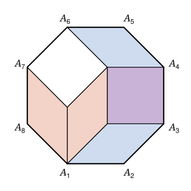

## Statement

Un octogone régulier est découpé en un nombre fini de parallélogrammes : ces parallélogrammes recouvrent tout l'octogone, et deux d'entre eux ne se chevauchent pas (ils peuvent seulement se toucher par leurs bords). Les parallélogrammes ne sont pas forcément tous pareils, et deux voisins ne se touchent pas forcément le long d'un côté entier.

Démontrer que, parmi ces parallélogrammes, il y a au moins deux rectangles.

## Hints

1. Numérotez les sommets $A_1, A_2, \ldots, A_8$. Quels côtés de l'octogone sont parallèles ? Lesquels sont perpendiculaires ?
2. Partez du côté $[A_1A_2]$ : un parallélogramme a un côté posé dessus. Son côté opposé est parallèle à $(A_1A_2)$. S'il n'est pas sur le bord de l'octogone, que trouve-t-on de l'autre côté ?
3. En continuant, vous obtenez une « bande » de parallélogrammes qui traverse l'octogone de $[A_1A_2]$ jusqu'à $[A_5A_6]$, et qui ont tous deux côtés parallèles à $(A_1A_2)$. Faites de même à partir de $[A_3A_4]$.
4. Les deux bandes doivent se croiser. Que dire d'un parallélogramme qui appartient aux deux ?

## Solution

Notons $A_1, A_2, \ldots, A_8$ les sommets de l'octogone, dans l'ordre. Appelons *pièces* les parallélogrammes du découpage.

**Étape 0 : les directions des côtés.** Quand on parcourt le bord d'un octogone régulier, la direction tourne de $45^\circ$ à chaque sommet (car $8 \times 45^\circ = 360^\circ$). Donc :

- deux côtés opposés sont parallèles : $(A_1A_2) \parallel (A_5A_6)$, $(A_3A_4) \parallel (A_7A_8)$, et de même pour les autres ;
- deux côtés séparés par un seul côté sont perpendiculaires, car la direction a tourné de $2 \times 45^\circ = 90^\circ$ : $(A_1A_2) \perp (A_3A_4)$ et $(A_2A_3) \perp (A_4A_5)$.

Deux pièces différentes ne se chevauchent pas : si un point est **à l'intérieur** de deux pièces à la fois (et non sur leur bord), ces deux pièces sont la même.

**Étape 1 : une bande de pièces de $[A_1A_2]$ à $[A_5A_6]$.** Notons $d$ la direction de $(A_1A_2)$.

*Le départ.* Les pièces recouvrent le côté $[A_1A_2]$. Une pièce qui touche ce côté le long d'un morceau de segment (et pas seulement en un point) a forcément un côté posé sur $[A_1A_2]$, puisqu'elle est tout entière d'un même côté de la droite $(A_1A_2)$. Il existe une telle pièce $P_1$ : sinon le côté $[A_1A_2]$ ne serait touché qu'en un nombre fini de points, ceux où arrivent des sommets de pièces. La pièce $P_1$ a deux côtés parallèles à $d$.

*Un pas.* Supposons qu'on ait une pièce $P$ ayant deux côtés parallèles à $d$, et notons $c$ celui de ces deux côtés qui est le plus loin de la droite $(A_1A_2)$.

- Si $c$ est entièrement sur le bord de l'octogone, on s'arrête.
- Sinon, une partie de $c$ est à l'intérieur de l'octogone. Juste de l'autre côté de cette partie, il y a d'autres pièces ; l'une d'elles, $P'$, touche $c$ le long d'un morceau de segment. Comme $P$ et $P'$ ne se chevauchent pas, $P'$ est de l'autre côté de la droite qui porte $c$, et ce morceau est sur un côté de $P'$. Donc $P'$ a deux côtés parallèles à $d$, et son côté le plus éloigné de $(A_1A_2)$ est **strictement plus loin** que $c$.

*La fin.* En répétant le pas à partir de $P_1$, on obtient des pièces $P_1, P_2, P_3, \ldots$ de plus en plus éloignées de $(A_1A_2)$, donc toutes différentes. Comme il n'y a qu'un nombre fini de pièces, on finit par s'arrêter, sur une pièce $P_k$ dont le côté $c$ est entièrement sur le bord de l'octogone. Ce côté est un segment parallèle à $d$, posé sur le bord mais pas sur $(A_1A_2)$ : il est donc sur le côté $[A_5A_6]$, le seul autre côté de l'octogone parallèle à $d$.

Appelons **bande $\mathcal{P}$** la suite $P_1, \ldots, P_k$. Chacune de ses pièces a deux côtés parallèles à $(A_1A_2)$, la première touche $[A_1A_2]$, la dernière touche $[A_5A_6]$, et deux pièces qui se suivent se touchent le long d'un morceau de segment.

**Étape 2 : une seconde bande.** Le même raisonnement, en partant du côté $[A_3A_4]$, donne une **bande $\mathcal{Q}$** de pièces $Q_1, \ldots, Q_m$ qui ont toutes deux côtés parallèles à $(A_3A_4)$, la première touchant $[A_3A_4]$ et la dernière $[A_7A_8]$.

**Étape 3 : les deux bandes ont une pièce en commun.** Traçons un chemin $\gamma$ dans la bande $\mathcal{P}$ : il part d'un point du côté de $P_1$ posé sur $[A_1A_2]$, traverse $P_1$ en restant à l'intérieur, passe dans $P_2$ par un point du morceau de segment commun, et ainsi de suite jusqu'à un point de $[A_5A_6]$. On choisit les points de passage au milieu des morceaux communs, et non en un sommet de pièce. De même, traçons un chemin $\delta$ dans la bande $\mathcal{Q}$, de $[A_3A_4]$ à $[A_7A_8]$.

En dehors de ses deux extrémités, le chemin $\gamma$ est à l'intérieur de l'octogone. Il le coupe en deux morceaux : l'un contient tout le bord de $A_2$ à $A_5$, en particulier le côté $[A_3A_4]$, et l'autre contient le côté $[A_7A_8]$. Le chemin $\delta$ va de l'un à l'autre, donc il croise $\gamma$ en un point $Z$.

Autour de $Z$, prenons un petit disque. Comme $Z$ est sur $\gamma$, ce petit disque est recouvert par une ou deux pièces de $\mathcal{P}$ (une seule si $Z$ est à l'intérieur d'une pièce, deux si $Z$ est un point de passage). De même, il est recouvert par une ou deux pièces de $\mathcal{Q}$. L'une de ces pièces, $Q_j$, recouvre au moins un demi-disque, donc contient un tout petit disque $D$ entièrement formé de points intérieurs à $Q_j$. Le disque $D$ ne peut pas être contenu dans le segment qui sépare éventuellement les deux pièces de $\mathcal{P}$ : il contient un point qui n'est pas sur ce segment, et ce point est intérieur à une pièce $P_i$ de $\mathcal{P}$. Les pièces $P_i$ et $Q_j$ ont un point intérieur commun : c'est la même pièce.

**Étape 4 : un premier rectangle.** Cette pièce commune a deux côtés parallèles à $(A_1A_2)$, car elle est dans $\mathcal{P}$, et deux côtés parallèles à $(A_3A_4)$, car elle est dans $\mathcal{Q}$. Ce sont ses quatre côtés. Comme $(A_1A_2) \perp (A_3A_4)$, ses angles sont droits : c'est un rectangle, dont les côtés sont parallèles à $(A_1A_2)$ et $(A_3A_4)$.

**Étape 5 : un second rectangle.** On recommence avec les côtés $[A_2A_3]$ et $[A_4A_5]$, qui sont aussi perpendiculaires : on obtient un rectangle dont les côtés sont parallèles à $(A_2A_3)$ et $(A_4A_5)$. Ce n'est pas le premier, car un parallélogramme n'a que deux directions de côtés, et $(A_2A_3)$ n'est parallèle ni à $(A_1A_2)$ ni à $(A_3A_4)$.

**Conclusion.** Tout découpage d'un octogone régulier en parallélogrammes contient au moins deux rectangles.

## Going further

Sur la figure, les pièces se touchent côté contre côté et il y a exactement deux rectangles, ce sont des carrés. La démonstration ne suppose rien de tel : les pièces peuvent être de tailles et de formes variées, et se toucher le long de morceaux de côtés.

Le même raisonnement montre qu'un polygone convexe à $2n$ côtés, dont les côtés opposés sont parallèles et de même longueur, découpé en parallélogrammes, contient une pièce ayant ses côtés parallèles à deux côtés choisis à l'avance du polygone, pour chaque choix des deux côtés.
