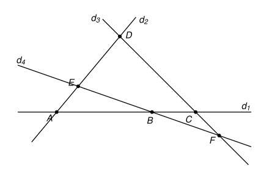

## Statement

On trace $2017$ droites dans le plan. Deux quelconques d'entre elles se coupent toujours, et jamais trois d'entre elles ne passent par un même point. On note $E$ l'ensemble de tous les points d'intersection de ces droites.

Deux points de $E$ sont dits **voisins** lorsqu'ils sont sur une même des $2017$ droites et que le segment qui les joint ne contient aucun autre point de $E$.

Sur la figure, qui montre seulement quatre droites, $A$ et $B$ sont voisins sur $d_1$, de même que $B$ et $C$. En revanche $A$ et $C$ ne sont pas voisins, car le segment $[AC]$ contient $B$.

On veut colorier chaque point de $E$ de sorte que deux points voisins aient toujours des couleurs différentes. Combien faut-il de couleurs au minimum ?

## Hints

1. Commence avec trois droites, puis avec les quatre droites de la figure. Combien de couleurs faut-il ?
2. Pour montrer qu'il faut au moins $3$ couleurs, cherche trois points de $E$ deux à deux voisins. Parmi tous les triangles dont les trois côtés sont portés par trois des droites, prends celui dont l'aire est la plus petite.
3. Pour colorier avec $3$ couleurs, range les points de gauche à droite, et colorie-les un par un dans cet ordre. Choisis bien la direction « de gauche à droite », pour que deux points de $E$ n'aient jamais la même abscisse.
4. Un point de $E$ est sur exactement deux droites, et il a au plus deux voisins sur chacune. Combien de ses voisins sont situés à sa gauche ?

## Solution

La réponse est $3$.

**Étape 1. Quelques remarques.**

Chaque point de $E$ est sur exactement deux des droites : il est l'intersection de deux droites, et une troisième droite passant par lui serait une troisième droite passant par un même point.

Sur une droite $d$, les points de $E$ sont les intersections de $d$ avec les $2016$ autres droites. Ils se suivent le long de $d$, et un point $M$ de $E$ situé sur $d$ a au plus deux voisins sur $d$ : le point de $E$ qui le précède immédiatement sur $d$, et celui qui le suit immédiatement.

**Étape 2. Il faut au moins 3 couleurs.**

*Les triangles.* Prenons trois des droites, $d$, $d'$ et $d''$. Elles se coupent deux à deux en trois points. Ces points ne sont pas alignés : les deux points $d \cap d'$ et $d' \cap d''$ sont sur $d'$, et le troisième point $d \cap d''$ n'est pas sur $d'$, sinon trois droites passeraient par ce point. Les trois droites forment donc un triangle. Il n'y a qu'un nombre fini de façons de choisir trois droites, donc parmi tous ces triangles, il y en a un dont l'aire est la plus petite. On l'appelle $PQR$.

*Les points $P$ et $Q$ sont voisins.* Ils sont sur une même droite, la droite $(PQ)$, qui est l'une des $2017$. Supposons que le segment $[PQ]$ contienne un autre point $M$ de $E$, et cherchons une contradiction. Le point $M$ est l'intersection de $(PQ)$ avec une autre droite $d$. Cette droite $d$ n'est ni $(PR)$ ni $(QR)$, qui coupent $(PQ)$ seulement en $P$ et en $Q$. Elle ne passe pas par $R$, sinon trois droites passeraient par $R$.

La droite $d$ coupe le plan en deux demi-plans. Comme $M$ est strictement entre $P$ et $Q$, les points $P$ et $Q$ sont de part et d'autre de $d$. Le point $R$, qui n'est pas sur $d$, est donc du même côté que l'un des deux, par exemple du même côté que $P$ (l'autre cas est pareil, en échangeant $P$ et $Q$). Alors $Q$ et $R$ sont de part et d'autre de $d$, et $d$ coupe le segment $[QR]$ en un point $M'$ strictement entre $Q$ et $R$.

Le triangle $QMM'$ a ses côtés portés par trois des droites : $(PQ)$, $(QR)$ et $d$. Il est contenu dans le triangle $PQR$, et il lui manque le quadrilatère $PMM'R$. Son aire est donc strictement plus petite que celle de $PQR$, ce qui contredit le choix de $PQR$.

Le segment $[PQ]$ ne contient donc aucun autre point de $E$ : les points $P$ et $Q$ sont voisins. De la même façon, $Q$ et $R$ sont voisins, et $R$ et $P$ aussi.

*Conclusion de l'étape.* Les trois points $P$, $Q$, $R$ sont deux à deux voisins, donc ils doivent avoir trois couleurs différentes. Il faut au moins $3$ couleurs.

**Étape 3. On choisit une bonne direction « horizontale ».**

Pour chaque paire de points de $E$, on trace la droite qui les joint. On obtient un nombre fini de droites. On choisit alors une droite $\Delta$ qui n'est perpendiculaire à aucune d'elles : c'est possible, car il n'y a qu'un nombre fini de directions à éviter.

On se place dans un repère orthonormé dont l'axe des abscisses est $\Delta$. Si deux points $M$ et $N$ de $E$ avaient la même abscisse, la droite $(MN)$ serait perpendiculaire à $\Delta$, ce qui est exclu. Donc **les points de $E$ ont des abscisses toutes différentes.** On les numérote $M_1, M_2, \ldots, M_n$ de la plus petite abscisse à la plus grande.

**Étape 4. Chaque point a au plus deux voisins à sa gauche.**

Soit $M$ un point de $E$, et $d$ l'une des deux droites qui passent par lui. La droite $d$ contient au moins deux points de $E$, qui n'ont pas la même abscisse, donc $d$ n'est pas perpendiculaire à $\Delta$. Les points de $d$ situés d'un côté de $M$ ont donc tous une abscisse plus petite que celle de $M$, et ceux situés de l'autre côté ont tous une abscisse plus grande. Or $M$ a au plus un voisin sur $d$ de chaque côté. Ainsi, au plus un voisin de $M$ sur $d$ a une abscisse plus petite que celle de $M$.

Il en va de même sur la seconde droite qui passe par $M$. Au total, **au plus deux voisins de $M$ ont une abscisse plus petite que celle de $M$.**

**Étape 5. Trois couleurs suffisent.**

On colorie les points $M_1, M_2, \ldots, M_n$ dans cet ordre, avec trois couleurs : rouge, vert et bleu.

Au moment de colorier $M_i$, les points déjà coloriés sont ceux qui ont une abscisse plus petite. D'après l'étape 4, au plus deux d'entre eux sont voisins de $M_i$. Ils utilisent au plus deux des trois couleurs, il en reste donc au moins une. On donne cette couleur à $M_i$.

À la fin, prenons deux points voisins $M_i$ et $M_j$, avec $i < j$. Au moment de colorier $M_j$, le point $M_i$ était déjà colorié, et l'on a choisi pour $M_j$ une couleur différente de celle de $M_i$. Deux points voisins ont donc toujours des couleurs différentes.

**Conclusion.** Il faut au minimum $3$ couleurs.

## Going further

1. Que devient la réponse avec $n$ droites, pour $n = 2$ ? Et pour $n \geqslant 3$ ?
2. Les droites découpent le plan en régions. Montre qu'on peut colorier ces régions avec deux couleurs seulement, de sorte que deux régions qui ont un côté commun soient toujours de couleurs différentes.
