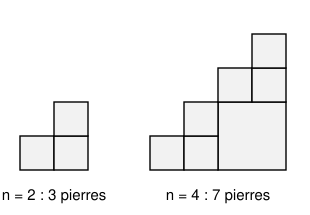
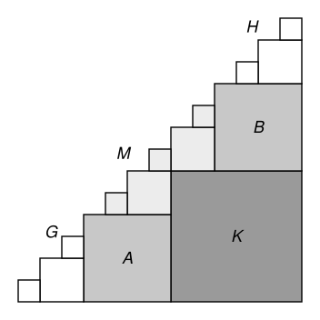

## Statement

Soit $n$ un entier naturel. Un **escalier de taille $n$** est formé de petits carrés $1 \times 1$ :
$1$ carré pour la première marche, $2$ carrés empilés pour la deuxième marche, et ainsi de suite,
jusqu'à $n$ carrés empilés pour la $n$-ième marche.

On dispose de pierres carrées de toutes les tailles (leur côté est un nombre entier), en aussi
grand nombre qu'on veut. On construit l'escalier en le recouvrant exactement par des pierres,
sans trou ni chevauchement. On note $f(n)$ le plus petit nombre de pierres qu'il faut pour
construire un escalier de taille $n$. Par exemple, $f(2) = 3$ et $f(4) = 7$, comme sur la figure.

1. Trouver tous les entiers $n \geqslant 0$ tels que $f(n) = n$.
2. Trouver tous les entiers $n \geqslant 0$ tels que $f(n) = n + 1$.

## Hints

1. Regarde la case tout en haut de chaque marche. Deux de ces cases peuvent-elles être dans la
   même pierre ? Déduis-en que $f(n) \geqslant n$.
2. Regarde la pierre qui contient la case en bas à droite. Si elle contient aussi une case du haut
   d'une marche, que reste-t-il de l'escalier quand on l'enlève ?
3. Pour la question 2, il y a exactement une pierre qui ne contient aucune case du haut d'une
   marche. Montre que c'est la pierre du coin en bas à droite.
4. Regarde ensuite la pierre juste à gauche de la pierre du coin, tout en bas, et la pierre juste
   au-dessus d'elle, tout à droite. Quelle est leur taille ? Que reste-t-il au milieu ?

## Solution

### Notations

On numérote les colonnes de $1$ à $n$ de gauche à droite : la colonne $i$ est la $i$-ième marche,
elle a $i$ cases. On note $(i, j)$ la case de la colonne $i$ située à l'étage $j$ (en comptant
depuis le bas), avec $1 \leqslant j \leqslant i \leqslant n$.

Les $n$ cases $(k, k)$, tout en haut de chaque marche, sont appelées les **sommets**.

Une pierre de côté $s$ occupe des colonnes $a, a+1, \ldots, a+s-1$ et des étages
$b, b+1, \ldots, b+s-1$. Sa case en haut à gauche est $(a, b+s-1)$. Une pierre est dite
**bonne** si elle contient un sommet.

### Deux remarques qui servent tout le temps

**Remarque 1. Une pierre contient au plus un sommet, et elle en contient un exactement quand sa
case en haut à gauche est un sommet.** En effet, la colonne $a$ est la plus basse des colonnes
de la pierre : elle a $a$ cases et doit monter jusqu'à l'étage $b + s - 1$, donc
$b + s - 1 \leqslant a$. Si un sommet $(k, k)$ est dans la pierre, sa colonne vérifie
$k \geqslant a$ et son étage vérifie $k \leqslant b + s - 1$. Donc
$a \leqslant k \leqslant b+s-1 \leqslant a$ : on a $k = a = b + s - 1$, et ce sommet est la case
en haut à gauche.

Comme il y a $n$ sommets et que chaque pierre en contient au plus un, **il faut au moins $n$
pierres : $f(n) \geqslant n$.**

**Remarque 2 : la pierre du coin.** Soit $n \geqslant 1$, et soit $K$ la pierre qui contient la
case $(n, 1)$, en bas à droite. Il n'y a rien à droite de la colonne $n$ ni sous l'étage $1$, donc
si $\ell$ est le côté de $K$, elle occupe les colonnes $n - \ell + 1$ à $n$ et les étages $1$ à
$\ell$. Sa case en haut à gauche $(n - \ell + 1, \ell)$ doit exister, donc
$\ell \leqslant n - \ell + 1$. D'après la remarque 1, $K$ contient un sommet exactement quand
$n - \ell + 1 = \ell$, c'est-à-dire $n = 2\ell - 1$.

Dans ce cas, la colonne $\ell$ est entièrement dans $K$, et le reste de l'escalier forme deux
escaliers de taille $\ell - 1$ : à gauche, les colonnes $1$ à $\ell - 1$ ; en haut, les cases
au-dessus de l'étage $\ell$ (la colonne $\ell + i$ en a $i$, pour $i = 1, \ldots, \ell - 1$).
Aucune autre pierre n'est à cheval sur les deux : elle devrait contenir une case de la colonne
$\ell$, qui est dans $K$.

On dit qu'une construction est **parfaite** si toutes ses pierres sont bonnes. Alors chaque
sommet est dans exactement une pierre et chaque pierre contient exactement un sommet : une
construction parfaite d'un escalier de taille $m$ utilise exactement $m$ pierres.

### Question 1

Pour $n = 0$, l'escalier est vide et $f(0) = 0$ : cela convient.

**Si $f(n) = n$ avec $n \geqslant 1$.** Prenons une construction avec $n$ pierres. Il y a $n$
sommets, et chaque pierre en contient au plus un, donc chaque pierre en contient exactement un :
la construction est parfaite. En particulier $K$ contient un sommet, donc $n = 2\ell - 1$, et
l'escalier se coupe en deux escaliers de taille $m = \ell - 1$, construits chacun de façon
parfaite, donc chacun avec $m$ pierres. Ainsi $f(m) \leqslant m$, donc $f(m) = m$, et
$n + 1 = 2(m + 1)$.

On recommence avec $m$, qui est plus petit que $n$, tant qu'on n'est pas arrivé à $0$. À chaque
pas, le nombre « taille plus $1$ » est divisé par $2$, et à la fin il vaut $0 + 1 = 1$. Donc
$n + 1$ est une puissance de $2$ : **$n = 2^k - 1$.**

**Réciproquement**, construisons de façon parfaite l'escalier de taille $2^k - 1$, de proche en
proche. Pour $k = 0$, il n'y a rien à faire. Si on sait le faire pour la taille $2^k - 1$, alors
pour la taille $2^{k+1} - 1$, on pose dans le coin une pierre de côté $2^k$ (colonnes $2^k$ à
$2^{k+1} - 1$, étages $1$ à $2^k$, sa case en haut à gauche $(2^k, 2^k)$ est un sommet), puis on
construit les deux escaliers de taille $2^k - 1$ qui restent. On utilise
$1 + 2(2^k - 1) = 2^{k+1} - 1$ pierres.

**Réponse 1 : $f(n) = n$ exactement pour $n = 2^k - 1$, $k \geqslant 0$**, c'est-à-dire
$n = 0, 1, 3, 7, 15, \ldots$

Retenons au passage :

> **(★)** Un escalier de taille $m$ a une construction parfaite si et seulement si $m$ est de la
> forme $2^k - 1$.

(Une construction parfaite utilise $m$ pierres, donc $f(m) = m$, et on applique la question 1.)

### Question 2

#### Étape 1 : une seule pierre n'est pas bonne

Soit $n$ tel que $f(n) = n + 1$. Alors $n \geqslant 1$ et $n$ n'est pas de la forme $2^k - 1$
(sinon $f(n) = n$). Prenons une construction avec $n + 1$ pierres. Les $n$ sommets sont dans $n$
pierres différentes, donc exactement une pierre ne contient aucun sommet, et toutes les autres
sont bonnes.

#### Étape 2 : c'est la pierre du coin qui n'est pas bonne

Supposons que $K$ contienne un sommet. Alors $n = 2\ell - 1$ et le reste se coupe en deux
escaliers de taille $\ell - 1$. La pierre qui n'est pas bonne est dans l'un des deux, donc
l'autre est construit de façon parfaite. D'après (★), $\ell - 1 = 2^j - 1$, donc
$n = 2\ell - 1 = 2^{j+1} - 1$, ce qui est exclu.

Donc $K$ ne contient pas de sommet : $\ell < n - \ell + 1$, c'est-à-dire $2\ell \leqslant n$, et
**toutes les autres pierres sont bonnes**.

Appelons **configuration $(n, \ell)$** une construction de l'escalier de taille $n$ dont la pierre
du coin a pour côté $\ell$, avec $2\ell \leqslant n$, et dont toutes les autres pierres sont
bonnes. Une telle construction a $n + 1$ pierres ($n$ bonnes pierres, une par sommet, plus $K$).
Nous venons de montrer : si $f(n) = n + 1$, il existe une configuration $(n, \ell)$.

#### Étape 3 : ce qu'impose une configuration $(n, \ell)$

Prenons une configuration $(n, \ell)$. La figure montre l'exemple $n = 13$, $\ell = 6$.

**La pierre $A$.** Comme $n - \ell \geqslant \ell \geqslant 1$, la case $(n - \ell, 1)$ existe ;
appelons $A$ sa pierre. Elle touche l'étage $1$, donc elle commence à l'étage $1$. Elle ne peut
pas contenir $(n - \ell + 1, 1)$, qui est dans $K$, donc sa dernière colonne est $n - \ell$. Si
$t$ est son côté, sa case en haut à gauche est $(n - \ell - t + 1, t)$, et c'est un sommet
puisque $A$ est bonne : $n - \ell - t + 1 = t$. Ainsi
$$n - \ell = 2t - 1,$$
et $A$ occupe les colonnes $t$ à $2t - 1$ et les étages $1$ à $t$.

**La pierre $B$.** Appelons $B$ la pierre de la case $(n, \ell + 1)$. Elle est dans la dernière
colonne, donc elle finit à la colonne $n$. Elle ne peut pas contenir $(n, \ell)$, qui est dans
$K$, donc elle commence à l'étage $\ell + 1$. Si $s$ est son côté, sa case en haut à gauche
$(n - s + 1, \ell + s)$ est un sommet : $n - s + 1 = \ell + s$, donc $s = t$. Comme
$n - t + 1 = \ell + t$, la pierre $B$ occupe les colonnes $\ell + t$ à $n$ et les étages
$\ell + 1$ à $\ell + t$.

**On a $t \leqslant \ell \leqslant 2t - 1$.** D'abord $\ell \leqslant n - \ell = 2t - 1$. Ensuite,
$A$ et $B$ sont deux pierres différentes ($A$ s'arrête à la colonne $2t - 1 = n - \ell < n$). Si
on avait $\ell \leqslant t - 1$, la case $(2t - 1, t)$ serait à la fois dans $A$ et dans $B$
(sa colonne est entre $\ell + t$ et $n$, son étage entre $\ell + 1$ et $\ell + t$) : c'est
impossible.

**Le découpage.** On a $n = \ell + 2t - 1$. Regardons colonne par colonne ce qui n'est pas dans
$K$, $A$ ou $B$.

- Colonnes $1$ à $t - 1$ : rien n'y est pris. Cette partie, notée $G$, est un escalier de taille
  $t - 1$.
- Colonne $t$ : elle est entièrement dans $A$.
- Colonnes $t + 1$ à $2t - 1$ : les étages $1$ à $t$ sont dans $A$, il reste les étages $t + 1$
  jusqu'en haut.
- Colonnes $2t$ à $\ell + t - 1$ : les étages $1$ à $\ell$ sont dans $K$, il reste les étages
  $\ell + 1$ jusqu'en haut.
- Colonnes $\ell + t$ à $n$ : les étages $1$ à $\ell$ sont dans $K$, les étages $\ell + 1$ à
  $\ell + t$ dans $B$, il reste les étages au-dessus de $\ell + t$. Cette partie, notée $H$, est un
  escalier de taille $t - 1$ (la colonne $\ell + t + i$ en a $i$ cases).

Ce qui reste dans les colonnes $t + 1$ à $\ell + t - 1$ forme la partie $M$ du milieu.

**Aucune pierre n'est à cheval.** Une pierre qui contient une case $(c, j)$ de $G$ et une case
hors de $G$ contient aussi la case $(t, j)$, car ses colonnes se suivent. Comme
$j \leqslant c \leqslant t - 1$, cette case est dans $A$, donc la pierre est $A$, qui ne touche
pas $G$. De même, une pierre qui contient une case $(c, j)$ de $H$ et une case hors de $H$, donc à un
étage au plus égal à $\ell + t$, contient la case $(c, \ell + t)$, qui est dans $B$. Ainsi **toute pierre
autre que $K$, $A$, $B$ est entièrement dans $G$, dans $H$ ou dans $M$.**

**La partie $G$.** Ses pierres sont toutes bonnes : c'est une construction parfaite d'un escalier
de taille $t - 1$. D'après (★), $t - 1 = 2^c - 1$ : **$t$ est une puissance de $2$.**

**La partie $M$.** Faisons glisser $M$ de $t$ colonnes vers la gauche et de $t$ étages vers le
bas : la case $(c, j)$ devient $(c - t, j - t)$. D'après le découpage, $M$ devient l'escalier de
taille $\ell - 1$ privé du carré de côté $\ell - t$ placé dans son coin en bas à droite (colonnes
$t$ à $\ell - 1$, étages $1$ à $\ell - t$ ; avant le glissement, ce sont les cases de $K$
situées au-dessus de l'étage $t$ dans les colonnes $2t$ à $\ell + t - 1$). Les sommets $(c, c)$ deviennent des sommets $(c - t, c - t)$, et les pierres de $M$
restent bonnes.

- Si $\ell = t$, il n'y a pas de carré enlevé : $M$ est un escalier de taille $t - 1$, construit de
  façon parfaite.
- Si $\ell > t$, remettons le carré de côté $\ell - t$ comme une pierre. On obtient une
  construction de l'escalier de taille $\ell - 1$ dont la pierre du coin a pour côté $\ell - t$ et
  dont toutes les autres pierres sont bonnes. Comme $\ell \leqslant 2t - 1$, on a
  $2(\ell - t) \leqslant \ell - 1$ : **c'est une configuration $(\ell - 1, \ell - t)$.**

**Inversement**, si $n - \ell = 2t - 1$ avec $t$ puissance de $2$ et $t \leqslant \ell \leqslant 2t - 1$,
on peut fabriquer une configuration $(n, \ell)$ : on pose $K$, $A$ et $B$, on construit $G$ et $H$
de façon parfaite (question 1), et on remplit $M$ soit de façon parfaite si $\ell = t$, soit avec
une configuration $(\ell - 1, \ell - t)$ glissée de $t$ colonnes et $t$ étages, dont on retire la
pierre du coin, si cette configuration existe. Le découpage ci-dessus montre que ces morceaux
remplissent exactement l'escalier.

#### Étape 4 : les configurations possibles

**Partons d'une configuration $(n, \ell)$** et appliquons l'étape 3 encore et encore. On obtient
des configurations $(n_0, \ell_0) = (n, \ell)$, $(n_1, \ell_1)$, $(n_2, \ell_2)$, $\ldots$, de plus
en plus petites, avec chaque fois un côté $t_i$ pour les pierres $A$ et $B$, et
$\ell_{i+1} = \ell_i - t_i$. La suite s'arrête à un rang $r$ où $\ell_r = t_r$. De plus
$n_{i+1} - \ell_{i+1} = (\ell_i - 1) - (\ell_i - t_i) = t_i - 1$, et cette différence vaut aussi
$2t_{i+1} - 1$, donc $t_{i+1} = t_i / 2$. En notant $t = t_0$ :
$$\ell = t_0 + t_1 + \cdots + t_{r-1} + \ell_r = t + \frac{t}{2} + \frac{t}{4} + \cdots + \frac{t}{2^r} = 2t - \frac{t}{2^r}.$$
Comme $t$ est une puissance de $2$, écrivons $t = 2^{a-1}$ avec $a \geqslant 1$. Le nombre entier
$t / 2^r$ est alors une puissance de $2$, notons-la $2^b$, avec $b = a - 1 - r < a$. On obtient
$$\ell = 2^a - 2^b \qquad \text{et} \qquad n = \ell + 2t - 1 = 2^{a+1} - 2^b - 1, \qquad \text{avec } a > b \geqslant 0.$$

**Réciproquement**, soient $a > b \geqslant 0$, $n = 2^{a+1} - 2^b - 1$, $\ell = 2^a - 2^b$ et
$t = 2^{a-1}$. Alors $n - \ell = 2^a - 1 = 2t - 1$ et $t \leqslant \ell \leqslant 2t - 1$. Si
$b = a - 1$, on a $\ell = t$ et l'étape 3 fabrique la configuration $(n, \ell)$. Sinon,
$$(\ell - 1, \ell - t) = (2^a - 2^b - 1, \ 2^{a-1} - 2^b)$$
est de la même forme avec $a - 1$ à la place de $a$, et $a - 1 > b$. De proche en proche (en
faisant diminuer $a - b$ jusqu'à $1$), cette configuration existe, et l'étape 3 fabrique la
configuration $(n, \ell)$.

#### Conclusion

- Si $f(n) = n + 1$, il existe une configuration $(n, \ell)$, donc $n = 2^{a+1} - 2^b - 1$ avec
  $a > b \geqslant 0$.
- Réciproquement, pour un tel $n$, la configuration correspondante utilise $n + 1$ pierres, donc
  $f(n) \leqslant n + 1$. De plus $n + 1 = 2^b (2^{a+1-b} - 1)$, où $2^{a+1-b} - 1$
  est impair et au moins égal à $3$ : $n + 1$ n'est pas une puissance de $2$, donc $f(n) \neq n$
  d'après la question 1. Comme $f(n) \geqslant n$, on a $f(n) = n + 1$.

**Réponse 2 : $f(n) = n + 1$ exactement pour $n = 2^{a+1} - 2^b - 1$ avec $a > b \geqslant 0$**,
c'est-à-dire $n = 2, 5, 6, 11, 13, 14, 23, \ldots$

Attention à la condition $a > b$ : pour $a = b$, la formule donnerait $n = 2^a - 1$, pour lequel
$f(n) = n$.
