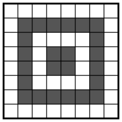
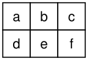

## Statement

On colorie chaque case d'un tableau de $8$ lignes et $8$ colonnes, soit en blanc, soit en noir. On
veut que la règle suivante soit respectée : tout rectangle de $2 \times 3$ cases ou de
$3 \times 2$ cases formé de cases du tableau contient deux cases noires qui ont un côté en commun.

Quel est le plus petit nombre de cases noires possible ?

## Hints

1. Commence par trouver un coloriage qui respecte la règle, même avec beaucoup de cases noires.
   Par exemple, colorie deux lignes entières et deux colonnes entières, bien choisies.
2. On peut descendre à $24$ cases noires. Essaie un carré « en anneau » placé à une case du bord,
   et complète-le au centre.
3. Pour montrer qu'on ne peut pas faire mieux, regarde un rectangle de $2 \times 3$ cases. Montre
   que chacune des deux cases de la colonne du milieu a une voisine noire à l'intérieur du
   rectangle.
4. Déduis-en qu'une case qui n'est pas sur le bord du tableau a au moins deux voisines noires, et
   qu'une case du bord qui n'est pas un coin en a au moins une. Compte ensuite les couples formés
   d'une case et d'une de ses voisines noires.

## Solution

Deux cases sont **voisines** si elles ont un côté en commun. On numérote les lignes de $1$ à $8$ de
bas en haut et les colonnes de $1$ à $8$ de gauche à droite. Un rectangle de $2 \times 3$ cases
(deux lignes, trois colonnes) est dit horizontal, un rectangle de $3 \times 2$ cases est dit
vertical. Nous allons montrer que **le nombre minimal de cases noires est $24$**.

### Un coloriage avec $24$ cases noires

On colorie en noir les $20$ cases du bord du carré formé des lignes $2$ à $7$ et des colonnes $2$ à
$7$, et les $4$ cases du carré central, formé des lignes $4$ et $5$ et des colonnes $4$ et $5$.

Vérifions la règle pour un rectangle horizontal, de lignes $r$ et $r + 1$.

- **Si $r = 1$ ou $r = 7$.** Le rectangle contient trois cases consécutives de la ligne $2$ (ou de
  la ligne $7$). Dans cette ligne, toutes les cases des colonnes $2$ à $7$ sont noires. Parmi trois
  colonnes consécutives, au moins deux sont consécutives et comprises entre $2$ et $7$ : elles
  donnent deux cases noires voisines.
- **Si $2 \leqslant r \leqslant 6$ et que le rectangle contient la colonne $2$ ou la colonne $7$.**
  Les deux cases de cette colonne dans le rectangle sont noires, l'une au-dessus de l'autre.
- **Sinon**, $2 \leqslant r \leqslant 6$ et les colonnes du rectangle sont $3, 4, 5$ ou $4, 5, 6$.
  Ces trois colonnes contiennent toujours les colonnes $4$ et $5$. Si $r = 2$ ou $r = 6$, le
  rectangle contient les cases des colonnes $4$ et $5$ de la ligne $2$ ou de la ligne $7$, qui sont
  noires et voisines. Si $r$ vaut $3$, $4$ ou $5$, le rectangle contient la ligne $4$ ou la ligne
  $5$, et donc deux cases noires voisines du carré central.

Le coloriage ne change pas quand on échange les lignes et les colonnes (symétrie par rapport à une
diagonale du tableau). Les rectangles verticaux conviennent donc aussi. **Ce coloriage respecte la
règle, avec $24$ cases noires.**

### Un outil sur les rectangles

Prenons un rectangle horizontal, et nommons ses cases comme sur la figure ci-dessous.

**La case $b$ a une voisine noire dans le rectangle.** Ses voisines dans le rectangle sont $a$, $c$
et $e$. Supposons qu'elles soient toutes blanches. Il reste $b$, $d$ et $f$, et aucune de ces trois
cases n'est voisine d'une autre : les voisines de $b$ sont $a$, $c$, $e$, celles de $d$ sont $a$ et
$e$, celles de $f$ sont $c$ et $e$. Le rectangle ne contiendrait donc pas deux cases noires
voisines, ce qui contredit la règle.

De même, la case $e$ a une voisine noire dans le rectangle. En tournant la figure d'un quart de
tour : **dans un rectangle vertical, chacune des deux cases de la ligne du milieu a une voisine
noire dans le rectangle.**

### Combien de voisines noires pour chaque case ?

Prenons un coloriage qui respecte la règle.

- **Une case du bord qui n'est pas un coin** a au moins une voisine noire. Par exemple, pour la
  case de la ligne $1$ et de la colonne $j$, avec $2 \leqslant j \leqslant 7$, on utilise le
  rectangle horizontal formé des lignes $1$, $2$ et des colonnes $j - 1$, $j$, $j + 1$ : la case est
  dans sa colonne du milieu. Il y a $4 \times 6 = 24$ cases de ce type.
- **Une case intérieure**, c'est-à-dire qui n'est pas sur le bord, a au moins deux voisines noires.
  Soit $x$ une telle case, en ligne $i$ et en colonne $j$, avec $2 \leqslant i \leqslant 7$ et
  $2 \leqslant j \leqslant 7$. Elle est dans la colonne du milieu d'un rectangle horizontal, donc
  elle a au moins une voisine noire, appelons-la $y$. Supposons par exemple que $y$ soit à gauche de
  $x$. Le rectangle vertical formé des lignes $i - 1$, $i$, $i + 1$ et des colonnes $j$, $j + 1$
  existe, il ne contient pas $y$, et $x$ est dans sa ligne du milieu. Il donne donc une deuxième
  voisine noire de $x$, différente de $y$. Si $y$ est à droite de $x$, on prend les colonnes
  $j - 1$, $j$ ; si $y$ est au-dessus ou en dessous, on fait de même avec un rectangle horizontal.
  Il y a $6 \times 6 = 36$ cases intérieures.

### Le double comptage

Comptons les couples $(x, y)$ où $x$ est une case du tableau et $y$ une voisine noire de $x$.

- D'après ce qui précède, il y a au moins $24 \times 1 + 36 \times 2 = 96$ tels couples.
- D'autre part, une case noire $y$ a au plus $4$ voisines, donc elle est dans au plus $4$ couples.
  S'il y a $n$ cases noires, il y a au plus $4n$ couples.

Ainsi $4n \geqslant 96$, donc $n \geqslant 24$.

### Conclusion

Il faut au moins $24$ cases noires, et le coloriage ci-dessus en a exactement $24$. **Le nombre
minimal de cases noires est $24$.**

## Going further

1. Dans un coloriage du tableau $8 \times 8$ qui respecte la règle avec exactement $24$ cases
   noires, montrer qu'aucune case noire n'est sur le bord du tableau.
2. Reprendre l'exercice avec un tableau de $4$ lignes et $4$ colonnes. Montrer qu'il faut au moins
   $4$ cases noires, et qu'il n'y a qu'un seul coloriage qui respecte la règle avec $4$ cases
   noires.
