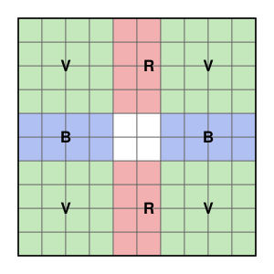
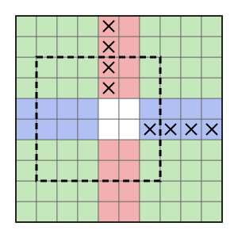

## Statement

Martin place des espions dans certaines cases d'une grille de $2025 \times 2025$ cases, au plus un
espion par case. Aurélien choisit ensuite dans la grille un carré de $1025 \times 1025$ cases, formé
de cases de la grille, sans le montrer à Martin. Il lui dit seulement quels espions se trouvent
dans le carré choisi : il désigne chacun d'eux, il ne donne pas seulement leur nombre.

Combien d'espions Martin doit-il placer, au minimum, pour être sûr de pouvoir retrouver le carré
choisi par Aurélien ?

## Hints

1. Commence par des petits cas : une grille $4 \times 4$ et des carrés $3 \times 3$, puis une grille
   $5 \times 5$ et des carrés $3 \times 3$.
2. Prends deux carrés dont l'un est juste au-dessus de l'autre, décalé d'une seule ligne. En quelles
   cases diffèrent-ils ? Martin doit avoir placé un espion dans l'une d'elles.
3. Tous les carrés possibles contiennent les $25$ colonnes du milieu de la grille, et aussi les
   $25$ lignes du milieu.
4. Un espion placé dans une colonne du milieu peut servir à la fois pour les carrés collés au bord
   gauche et pour ceux collés au bord droit. Essaie de le compter deux fois.
5. Pour la construction, place des espions dans une colonne du milieu pour lire la hauteur du
   carré, et dans une ligne du milieu pour lire sa position de gauche à droite.

## Solution

On numérote les lignes de $1$ à $2025$ de bas en haut, et les colonnes de $1$ à $2025$ de gauche à
droite. Un carré de $1025 \times 1025$ est repéré par sa ligne du bas $p$ et sa colonne de gauche
$q$ : il occupe les lignes $p$ à $p + 1024$ et les colonnes $q$ à $q + 1024$. Il faut
$p + 1024 \leqslant 2025$, donc $p$ et $q$ vont de $1$ à $1001$. On le note $K(p, q)$.

Comme $q \leqslant 1001$ et $q + 1024 \geqslant 1025$, **tout carré contient les colonnes $1001$ à
$1025$** ; on les appelle les $25$ colonnes centrales. De même, tout carré contient les $25$ lignes
centrales, numérotées de $1001$ à $1025$. On découpe la grille en quatre zones :

- la zone $R$ : les cases d'une colonne centrale qui ne sont pas sur une ligne centrale ;
- la zone $B$ : les cases d'une ligne centrale qui ne sont pas sur une colonne centrale ;
- la zone $V$ : les cases qui ne sont ni sur une ligne centrale ni sur une colonne centrale ;
- les $25 \times 25$ cases du centre, qui sont dans tous les carrés et ne servent donc à rien.

La figure montre ces zones dans une grille $10 \times 10$ avec des carrés $6 \times 6$, où il y a
$2$ lignes et $2$ colonnes centrales.

Notons $r$, $b$ et $v$ le nombre d'espions placés dans les zones $R$, $B$ et $V$. On va montrer
que $r + b + v \geqslant 2000$, puis trouver un placement qui marche avec $2000$ espions.

**Il faut au moins $2000$ espions.** Supposons que Martin retrouve toujours le carré.

*Les paires de lignes.* Pour $i$ allant de $1$ à $1000$, on appelle paire numéro $i$ les deux
lignes $i$ et $i + 1025$. Ces $1000$ paires n'ont aucune ligne en commun, et à elles toutes elles
contiennent toutes les lignes qui ne sont pas centrales : les lignes $1$ à $1000$ et les lignes
$1026$ à $2025$.

*Deux carrés collés au bord gauche.* Comparons $K(i, 1)$ et le carré juste au-dessus,
$K(i + 1, 1)$. Ils ont les mêmes colonnes, de $1$ à $1025$. Le premier contient la ligne $i$ et pas
la ligne $i + 1025$, le second contient la ligne $i + 1025$ et pas la ligne $i$, et pour toutes les
autres lignes ils sont pareils. Si aucun espion n'était dans les lignes $i$ ou $i + 1025$ et dans
les colonnes $1$ à $1025$, Aurélien désignerait les mêmes espions pour ces deux carrés, et Martin ne
pourrait pas les distinguer. Il y a donc un espion dans la paire $i$, dans les colonnes $1$ à
$1025$.

*Deux carrés collés au bord droit.* De même avec $K(i, 1001)$ et $K(i + 1, 1001)$ : il y a un
espion dans la paire $i$, dans les colonnes $1001$ à $2025$.

*Ce que cela donne pour la paire $i$.* Notons $r_i$ et $v_i$ le nombre d'espions de la paire $i$
qui sont dans la zone $R$ et dans la zone $V$. Montrons que $2r_i + v_i \geqslant 2$.

- Si $r_i \geqslant 1$, c'est clair.
- Si $r_i = 0$, aucun espion de la paire $i$ n'est dans une colonne centrale. L'espion trouvé à
  gauche est donc dans les colonnes $1$ à $1000$, et celui trouvé à droite dans les colonnes $1026$
  à $2025$ : ce sont deux espions différents de la zone $V$, et $v_i \geqslant 2$.

C'est ici que les colonnes centrales jouent leur rôle : un seul espion peut y servir aux deux
carrés à la fois, c'est pourquoi on le compte deux fois.

*On additionne.* Les paires se partagent toutes les cases des zones $R$ et $V$, donc en ajoutant
les $1000$ inégalités,

$$2r + v \geqslant 2 \times 1000 = 2000.$$

*Même chose avec les colonnes.* En échangeant le rôle des lignes et des colonnes (paires de colonnes
$j$ et $j + 1025$, carrés $K(1, j)$ et $K(1, j + 1)$, puis $K(1001, j)$ et $K(1001, j + 1)$), on
obtient de même

$$2b + v \geqslant 2000.$$

*Conclusion.* En additionnant, $2r + 2b + 2v \geqslant 4000$, donc $r + b + v \geqslant 2000$.
Martin a placé au moins $2000$ espions.

**Avec $2000$ espions, c'est possible.** Martin place :

- un espion dans la colonne $1001$ sur chacune des lignes $1026$ à $2025$, soit $1000$ espions ;
- un espion dans la ligne $1001$ sur chacune des colonnes $1026$ à $2025$, soit $1000$ espions.

Ces $2000$ cases sont toutes différentes. La figure montre ce placement dans le petit cas, avec un
carré possible en pointillés.

Prenons un carré $K(p, q)$. Il contient la colonne $1001$, qui est centrale. L'espion de la ligne
$1025 + j$, pour $j$ entre $1$ et $1000$, est donc dans le carré exactement quand
$1025 + j \leqslant p + 1024$, c'est-à-dire quand $j \leqslant p - 1$. Martin voit donc exactement
$p - 1$ espions de la colonne $1001$, et il en déduit $p$. De même, le carré contient la ligne
$1001$, et Martin y voit exactement $q - 1$ espions, ce qui lui donne $q$. Il connaît alors le carré.

**Conclusion.** Il faut au minimum **$2000$ espions**.

## Going further

Le même raisonnement marche pour une grille $n \times n$ et des carrés $c \times c$ dès que
$c < n < 2c$, c'est-à-dire dès qu'il y a au moins une colonne centrale : le minimum est alors
$2(n - c)$ espions. Par exemple, pour une grille $5 \times 5$ et des carrés $3 \times 3$, il en faut
$4$, et pour une grille $4 \times 4$ et des carrés $3 \times 3$, il en faut $2$.
