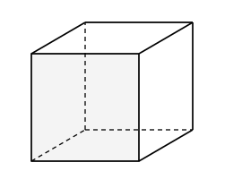

## Statement

On considère un cube dont chaque arête mesure $1$. On pose $8$ fourmis **sur les arêtes** de ce cube. Une fourmi posée sur un sommet est considérée comme se trouvant sur chacune des trois arêtes qui partent de ce sommet.

Les fourmis ne circulent que le long des arêtes. On appelle **distance entre deux fourmis** la longueur du plus court chemin qui mène de l'une à l'autre en ne passant que par les arêtes.

Montrer qu'il existe deux fourmis dont la distance est inférieure ou égale à $1$.

## Hints

1. Associe à chaque fourmi le sommet du cube dont elle est la plus proche. À quelle distance de ce sommet se trouve-t-elle au maximum ?
2. Si deux fourmis ont le même sommet associé, tu as gagné : fais-les se rejoindre en passant par ce sommet. Il reste donc un seul cas à traiter.
3. Dans ce cas restant, il y a $8$ fourmis et $8$ sommets, tous différents : chaque sommet est donc le sommet associé d'exactement une fourmi. C'est une information très forte, sers-t'en.
4. Considère la fourmi qui est la **plus éloignée** de son sommet associé, et note $D$ cette distance. Elle est posée sur une arête : appelle $T$ l'autre extrémité de cette arête. À quelle distance de $T$ se trouve-t-elle ?
5. Une fourmi est associée au sommet $T$. Elle est à distance au plus $D$ de $T$. Additionne les deux bouts de chemin.

## Solution

Notons $d(P, Q)$ la distance entre deux points du cube, au sens de l'énoncé, et $F_1, F_2, \ldots, F_8$ les huit fourmis.

### La construction de départ

À chaque fourmi $F_i$, associons le sommet du cube dont elle est la plus proche, et notons-le $S_i$. Concrètement, $F_i$ est posée sur une arête, dont les extrémités sont deux sommets ; $S_i$ est celui des deux qui est le plus proche. Si la fourmi est exactement au milieu de l'arête, on choisit l'une des deux extrémités au hasard.

Comme une arête mesure $1$ et que $F_i$ est du côté de $S_i$,

$$d(F_i, S_i) \leqslant \frac{1}{2} \qquad \text{pour toute fourmi } F_i.$$

Deux cas se présentent.

### Premier cas : deux fourmis partagent le même sommet

Supposons qu'il existe deux indices $i \neq j$ avec $S_i = S_j$. Notons $S$ ce sommet commun.

Le chemin qui va de $F_i$ à $S$, puis de $S$ à $F_j$, a pour longueur

$$d(F_i, S) + d(S, F_j) \leqslant \frac{1}{2} + \frac{1}{2} = 1.$$

Donc $d(F_i, F_j) \leqslant 1$, et c'est terminé.

### Second cas : les huit sommets associés sont tous différents

Le cube a exactement $8$ sommets, et il y a $8$ fourmis. Si les sommets $S_1, \ldots, S_8$ sont deux à deux distincts, c'est donc que **chaque sommet du cube est le sommet associé d'exactement une fourmi**. C'est ce fait qui va tout faire marcher.

**On regarde la fourmi la plus mal placée.** Posons

$$D = \max_{1 \leqslant i \leqslant 8} \; d(F_i, S_i),$$

et renumérotons les fourmis de façon que ce maximum soit atteint par $F_1$, c'est-à-dire $d(F_1, S_1) = D$. On sait déjà que $D \leqslant \frac{1}{2}$.

**On regarde l'autre bout de son arête.** La fourmi $F_1$ est posée sur une arête dont une extrémité est $S_1$. Notons $T$ l'autre extrémité. En parcourant cette arête, on va de $F_1$ à $T$ en parcourant la longueur $1 - D$, donc

$$d(F_1, T) \leqslant 1 - D.$$

**On trouve une voisine.** Puisque chaque sommet est associé à exactement une fourmi, il existe une fourmi $F_i$ telle que $S_i = T$. Et $F_i$ n'est pas $F_1$, car $S_1 \neq T$.

Par définition de $D$ comme maximum,

$$d(F_i, T) = d(F_i, S_i) \leqslant D.$$

**On conclut.** Le chemin qui va de $F_i$ à $T$, puis de $T$ à $F_1$, a pour longueur

$$d(F_i, T) + d(T, F_1) \leqslant D + (1 - D) = 1.$$

Les deux fourmis $F_i$ et $F_1$ sont donc à distance inférieure ou égale à $1$.

### Conclusion

Dans les deux cas, on a trouvé deux fourmis à distance au plus $1$. Le résultat est démontré.

## Going further

Remarquons comme le second cas retourne à son avantage une situation qui semblait bloquée : c'est précisément parce que les sommets associés sont **tous** occupés qu'on peut affirmer qu'une fourmi attend en face de $F_1$.

Le choix de la fourmi $F_1$ comme la plus éloignée de son sommet n'est pas un détail : c'est lui qui rend les deux majorations compatibles. Plus $F_1$ est loin de $S_1$, plus elle est près de $T$, et en même temps plus la borne $D$ est généreuse pour la fourmi d'en face. Les deux effets se compensent exactement.

Le résultat est optimal : avec seulement $7$ fourmis, on peut les placer deux à deux à distance strictement supérieure à $1$.

Voir aussi l'exercice n° 8407, qui traite les cas de $13$ et de $9$ fourmis, nettement plus simples.
