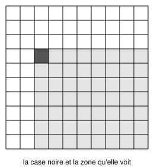
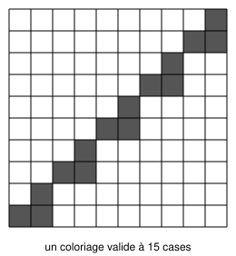

## Statement

On considère une grille $10 \times 10$. Les lignes sont numérotées de $1$ à $10$ de haut en bas, les colonnes de $1$ à $10$ de gauche à droite.

Disons qu'une case **voit** une autre case lorsque cette autre case a un numéro de ligne supérieur ou égal au sien **et** un numéro de colonne supérieur ou égal au sien. Autrement dit, une case voit tout ce qui se trouve dans le quart de grille situé en bas à droite d'elle-même, elle-même exclue.

Martin colorie certaines cases, de sorte que **chaque case coloriée voie au plus une autre case coloriée**.

Quel est le nombre maximal de cases que Martin peut colorier ?

## Hints

1. Commence petit : quel est le maximum sur une grille $2 \times 2$ ? sur une grille $3 \times 3$ ?
2. Comme toujours dans ce genre de problème, il y a deux travaux indépendants : construire un bon coloriage, et démontrer qu'on ne peut pas faire mieux. Une construction ne prouve jamais rien sur le maximum.
3. Pour la majoration, commence par la question la plus simple : combien de cases coloriées peut-il y avoir sur une même ligne ?
4. Une ligne qui porte deux cases coloriées est une ligne spéciale. Prends deux telles lignes, l'une au-dessus de l'autre, et regarde la case la plus à gauche de la ligne du haut : que voit-elle ?
5. Tu devrais obtenir que deux lignes doubles occupent des colonnes entièrement séparées. Combien de lignes doubles y a-t-il alors au maximum ?
6. Pour la construction : essaie de faire descendre un escalier de blocs de deux cases, en intercalant une case isolée entre deux marches.

## Solution

La réponse est $\boxed{15}$.

### Au plus 15 cases

**Étape 1 : au plus deux cases coloriées par ligne.**

Supposons qu'une ligne porte trois cases coloriées, dans les colonnes $c_1 < c_2 < c_3$. La case de colonne $c_1$ voit celle de colonne $c_2$ et celle de colonne $c_3$ : même ligne (le numéro de ligne est donc bien supérieur ou égal), et colonne plus grande. Elle en voit deux, ce qui est interdit.

Appelons **ligne double** une ligne portant exactement deux cases coloriées.

**Étape 2 : deux lignes doubles n'utilisent jamais les mêmes colonnes.**

Prenons deux lignes doubles, la ligne $a$ au-dessus de la ligne $b$ (donc $a < b$). Notons $p < q$ les colonnes des deux cases de la ligne $a$, et $r < s$ celles de la ligne $b$.

Regardons la case de gauche de la ligne du haut, c'est-à-dire la case $(a, p)$. Elle voit déjà la case $(a, q)$, puisque $q > p$. Elle ne doit donc rien voir d'autre.

Or si l'on avait $p \leqslant s$, la case $(b, s)$ serait également vue : sa ligne $b$ est plus grande que $a$, et sa colonne $s$ est supérieure ou égale à $p$. La case $(a,p)$ verrait alors deux cases, ce qui est interdit.

Donc $p > s$. Comme $s > r$ et $q > p$, les quatre colonnes sont distinctes, et le bloc $\{r, s\}$ est tout entier à gauche du bloc $\{p, q\}$.

**Étape 3 : au plus cinq lignes doubles.**

D'après l'étape 2, les blocs de deux colonnes associés aux différentes lignes doubles sont deux à deux disjoints. S'il y a $t$ lignes doubles, elles occupent $2t$ colonnes toutes différentes. Comme il n'y a que $10$ colonnes,

$$2t \leqslant 10, \qquad \text{donc} \qquad t \leqslant 5 .$$

**Étape 4 : le compte.**

Il y a $t$ lignes doubles, qui portent $2$ cases chacune, et $10 - t$ autres lignes, qui portent au plus $1$ case chacune d'après l'étape 1. Le nombre total de cases coloriées est donc au plus

$$2t + (10 - t) = 10 + t \leqslant 10 + 5 = 15 .$$

### Quinze cases sont réalisables

Voici un coloriage valide, en escalier : on descend par blocs de deux cases, en intercalant une case isolée entre deux marches.

Explicitement, les cases coloriées sont

$$(1,10) ; \quad (2,9), (2,10) ; \quad (3,8) ; \quad (4,7), (4,8) ; \quad (5,6) ;$$

$$(6,5), (6,6) ; \quad (7,4) ; \quad (8,3), (8,4) ; \quad (9,2) ; \quad (10,1), (10,2),$$

où $(r, c)$ désigne la case de la ligne $r$ et de la colonne $c$.

Vérifions la condition. Les cases coloriées sont regroupées en cinq blocs de deux cases côte à côte, sur les lignes $2, 4, 6, 8, 10$, plus cinq cases isolées sur les lignes $1, 3, 5, 7, 9$. En descendant, chaque bloc est entièrement à gauche du précédent.

- Une case de droite d'un bloc, comme $(2,10)$ ou $(4,8)$, ne voit rien : tout ce qui est plus bas est strictement plus à gauche.
- Une case de gauche d'un bloc, comme $(2,9)$, voit sa voisine de droite $(2,10)$, et rien d'autre, toujours parce que tout ce qui est plus bas est strictement plus à gauche.
- Une case isolée, comme $(3,8)$, voit uniquement la case de droite du bloc juste en dessous, ici $(4,8)$ : c'est la seule case coloriée plus bas dont la colonne ne soit pas strictement plus petite.

Chaque case coloriée voit donc au plus une autre case coloriée, et il y en a $15$.

**Conclusion.** Le nombre maximal est $15$.

## Going further

Les correcteurs signalent une erreur qui revient sans cesse dans ce type d'exercice : « je ne peux plus ajouter de case à ma construction, donc elle est optimale ».

C'est faux, et le contre-exemple est amusant : colorie seulement le coin en haut à gauche et le coin en bas à droite. Ces deux cases se voient, donc on ne peut plus rien ajouter nulle part sans qu'une case en voie deux. Pourtant $2$ n'est pas la réponse.

Une construction et une majoration sont deux démonstrations séparées. La construction ne sert jamais à démontrer la majoration.
