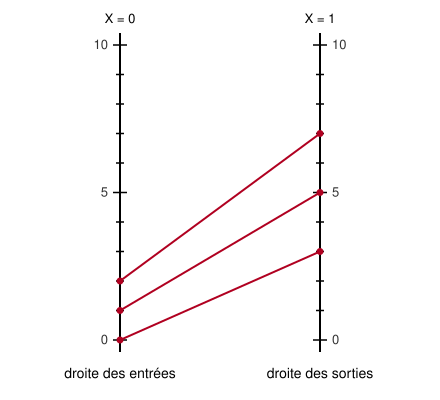

## Statement

Voici une autre façon de dessiner une fonction, sans courbe.

On trace deux droites verticales parallèles : la **droite des entrées**, d'équation $X = 0$, et la **droite des sorties**, d'équation $X = 1$. Les deux portent la même graduation.

Pour un nombre $x$, on place le point $E(0\,;\,x)$ sur la droite des entrées, le point $S(1\,;\,f(x))$ sur la droite des sorties, et on trace le segment $[ES]$. En répétant pour plusieurs valeurs de $x$, on obtient le **diagramme** de la fonction $f$.

**a)** Sur la figure, la fonction est $f(x) = 2x + 3$. Trace toi-même le diagramme pour d'autres valeurs de $x$, puis prolonge les segments au-delà des deux droites. Que remarques-tu ?

**b)** Toujours pour $f(x) = 2x + 3$, détermine par le calcul l'équation de la droite qui porte le segment tracé pour la valeur $x$, et démontre ce que tu as remarqué.

**c)** On prend maintenant $f(x) = mx + p$, avec $m \neq 1$. Démontrer que toutes ces droites passent par un même point $F$, appelé le **foyer** du diagramme, et donner ses coordonnées en fonction de $m$ et $p$.

**d)** Que se passe-t-il quand $m = 1$ ?

**e)** Selon la valeur de $m$, le foyer se trouve-t-il à gauche de la droite des entrées, entre les deux droites, ou à droite de la droite des sorties ?

## Hints

1. Une droite qui passe par $E(0\,;\,x)$ a une équation de la forme $Y = sX + x$ : l'ordonnée à l'origine est $x$ lui-même, puisque la droite des entrées est l'axe des ordonnées.
2. Le coefficient directeur $s$ se lit très vite ici : d'une droite à l'autre, $X$ augmente de $1$ exactement, donc $s$ est égal à la variation de $Y$, c'est-à-dire $f(x) - x$.
3. Dans l'équation obtenue, regroupe tous les termes qui contiennent $x$. Tu obtiens quelque chose de la forme $Y = (\ldots) \times x + (\ldots)$.
4. Un point commun à toutes ces droites est un point dont l'ordonnée ne dépend pas de $x$. Que doit valoir le facteur devant $x$ ?
5. Pour la question e), le signe de $1 - m$ décide de tout.

## Solution

**a) L'observation.**

En prolongeant les segments, on constate que toutes les droites obtenues se coupent en un seul et même point, situé ici en bas à gauche de la figure. Ce point ne dépend pas de la valeur de $x$ choisie.

**b) Le cas $f(x) = 2x + 3$.**

La droite tracée pour la valeur $x$ passe par $E(0\,;\,x)$ et $S(1\,;\,2x+3)$. Entre ces deux points, $X$ augmente de $1$ et $Y$ augmente de
$$(2x + 3) - x = x + 3 .$$
Le coefficient directeur vaut donc $x + 3$, et comme la droite coupe l'axe des ordonnées en $x$, son équation est
$$Y = (x + 3)X + x .$$

On regroupe les termes contenant $x$ :
$$Y = x\,(X + 1) + 3X .$$

Pour que $Y$ ne dépende pas de $x$, il faut $X + 1 = 0$, c'est-à-dire $X = -1$. On obtient alors $Y = 3 \times (-1) = -3$.

Ainsi, quelle que soit la valeur de $x$, la droite passe par le point $F(-1\,;\,-3)$. C'est bien le point commun observé.

**c) Le cas général $f(x) = mx + p$ avec $m \neq 1$.**

Même calcul. La droite passe par $E(0\,;\,x)$ et $S(1\,;\,mx+p)$, donc son coefficient directeur est
$$(mx + p) - x = (m-1)x + p ,$$
et son équation est
$$Y = \big[(m-1)x + p\big]X + x .$$

On regroupe :
$$Y = x\,\big[(m-1)X + 1\big] + pX .$$

Le terme qui dépend de $x$ disparaît exactement quand
$$(m-1)X + 1 = 0, \qquad \text{c'est-à-dire} \qquad X = \frac{1}{1-m} ,$$
ce qui a un sens puisque $m \neq 1$. L'ordonnée correspondante vaut alors
$$Y = p \times \frac{1}{1-m} = \frac{p}{1-m} .$$

**Toutes les droites du diagramme passent donc par le point**
$$\boxed{\,F\left(\frac{1}{1-m}\ ;\ \frac{p}{1-m}\right).}$$

Vérification sur l'exemple : pour $m = 2$ et $p = 3$, on retrouve $X = \dfrac{1}{1-2} = -1$ et $Y = \dfrac{3}{-1} = -3$.

**d) Le cas $m = 1$.**

Si $m = 1$, le coefficient directeur $(m-1)x + p = p$ est le **même pour toutes les valeurs de $x$** : tous les segments sont parallèles entre eux. Il n'y a donc aucun point commun, et le diagramme n'a pas de foyer. Le calcul le disait déjà : l'équation $(m-1)X + 1 = 0$ devient $1 = 0$, qui n'a pas de solution.

**e) Où se trouve le foyer.**

Tout dépend du signe et de la taille de $1 - m$, car l'abscisse du foyer est $\dfrac{1}{1-m}$.

- Si $m > 1$ : alors $1 - m < 0$, donc l'abscisse est négative. **Le foyer est à gauche de la droite des entrées.** (C'est le cas de l'exemple, avec $m = 2$.)
- Si $0 < m < 1$ : alors $0 < 1 - m < 1$, donc $\dfrac{1}{1-m} > 1$. **Le foyer est à droite de la droite des sorties.**
- Si $m = 0$ : l'abscisse vaut exactement $1$. **Le foyer est sur la droite des sorties**, au point $(1\,;\,p)$. C'est normal : la fonction est constante, tous les segments aboutissent au même point de la droite des sorties.
- Si $m < 0$ : alors $1 - m > 1$, donc $0 < \dfrac{1}{1-m} < 1$. **Le foyer est strictement entre les deux droites.**

Plus $m$ est proche de $1$, plus $1-m$ est proche de $0$, et plus le foyer part loin : quand $m = 1$ il a disparu à l'infini, ce qui correspond bien aux segments parallèles de la question d).

**Une remarque pour finir.** L'ordonnée du foyer, $\dfrac{p}{1-m}$, est exactement la solution de l'équation $mx + p = x$, c'est-à-dire le nombre que la fonction laisse inchangé. Ce n'est pas un hasard : pour ce nombre-là, l'entrée et la sortie sont à la même hauteur, le segment est horizontal, et une droite horizontale qui passe par le foyer donne à celui-ci cette hauteur.

## Going further

1. Dans ce diagramme, on voit très bien le coefficient $m$ : quand $x$ augmente de $1$, de combien la sortie se déplace-t-elle ? C'est pourquoi $m$ s'appelle aussi le **taux d'accroissement**.
2. Trace le diagramme de $f(x) = x^2$ pour quelques valeurs de $x$. Les segments ont-ils encore un point commun ?
3. Si on compose deux fonctions affines, on peut poser trois droites verticales côte à côte. Que devient le foyer ?
