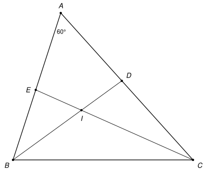
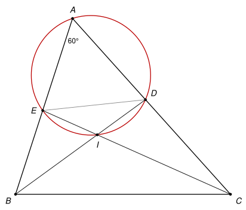

## Statement

Soit $ABC$ un triangle tel que $\widehat{BAC} = 60°$. On note $D$ et $E$ les pieds des bissectrices issues de $B$ et de $C$ : le point $D$ est sur le côté $[AC]$ et le point $E$ sur le côté $[AB]$. Les droites $(BD)$ et $(CE)$ se coupent en un point $I$.

Montrer que les quatre points $A$, $E$, $I$ et $D$ sont sur un même cercle.

## Hints

1. Que vaut la somme $\widehat{ABC} + \widehat{ACB}$ ? Et la somme de leurs moitiés ?
2. Dans le triangle $IBC$, calculez l'angle $\widehat{BIC}$.
3. Comparez $\widehat{DIE}$ et $\widehat{BIC}$, puis ajoutez $\widehat{DAE}$. Que savez-vous d'un quadrilatère dont deux angles opposés ont pour somme $180°$ ?

## Solution

*Rappel (quadrilatère inscriptible).* Soient $X$ et $Y$ deux points, et $M$, $N$ deux points situés de part et d'autre de la droite $(XY)$. Si $\widehat{XMY} + \widehat{XNY} = 180°$, alors les quatre points $X$, $Y$, $M$, $N$ sont sur un même cercle. C'est la réciproque de la propriété bien connue : dans un quadrilatère convexe inscrit dans un cercle, deux angles opposés ont pour somme $180°$.

On va appliquer ce rappel avec la droite $(DE)$ et les deux points $A$ et $I$.

**Étape 1 : la somme des deux autres angles.** Notons $\beta = \widehat{ABC}$ et $\gamma = \widehat{ACB}$. La somme des angles du triangle $ABC$ vaut $180°$, donc

$$\beta + \gamma = 180° - 60° = 120°.$$

**Étape 2 : l'angle $\widehat{BIC}$.** Comme $(BD)$ est la bissectrice de l'angle en $B$, on a $\widehat{IBC} = \frac{\beta}{2}$. De même $\widehat{ICB} = \frac{\gamma}{2}$. Dans le triangle $IBC$ :

$$\widehat{BIC} = 180° - \frac{\beta}{2} - \frac{\gamma}{2} = 180° - \frac{\beta + \gamma}{2} = 180° - 60° = 120°.$$

**Étape 3 : l'angle $\widehat{DIE}$.** Le point $I$ est entre $B$ et $D$, et aussi entre $C$ et $E$. Les angles $\widehat{DIE}$ et $\widehat{BIC}$ sont donc opposés par le sommet, et ils sont égaux :

$$\widehat{DIE} = \widehat{BIC} = 120°.$$

**Étape 4 : la somme qui donne $180°$.** L'angle $\widehat{DAE}$ est l'angle $\widehat{BAC}$, car $D$ est sur $[AC]$ et $E$ sur $[AB]$. Donc

$$\widehat{DAE} + \widehat{DIE} = 60° + 120° = 180°.$$

**Étape 5 : $A$ et $I$ sont de part et d'autre de $(DE)$.** Les points $E$ et $D$ sont sur les côtés $[AB]$ et $[AC]$, distincts des sommets. La droite $(DE)$ laisse donc $A$ d'un côté, et $B$ et $C$ de l'autre. Le point $I$ est sur le segment $[EC]$, distinct de $E$, donc il est du même côté de $(DE)$ que $C$. Ainsi $A$ et $I$ sont de part et d'autre de la droite $(DE)$.

**Conclusion.** D'après le rappel, appliqué à $X = D$, $Y = E$, $M = A$ et $N = I$, **les points $A$, $E$, $I$ et $D$ sont sur un même cercle.**

*Remarque.* Le corrigé officiel donne aussi une autre fin. On calcule les deux autres angles opposés du quadrilatère $AEID$. Dans le triangle $ABD$, on a $\widehat{ADB} = 180° - 60° - \frac{\beta}{2}$, et dans le triangle $ACE$, on a $\widehat{AEC} = 180° - 60° - \frac{\gamma}{2}$. Leur somme vaut $240° - \frac{\beta + \gamma}{2} = 180°$, ce qui conclut de la même façon.

## Going further

1. Réciproquement, on suppose que les points $A$, $E$, $I$, $D$ sont sur un même cercle. Montrer que $\widehat{BAC} = 60°$.
2. Avec $\widehat{BAC} = 60°$, montrer que $ID = IE$. On pourra utiliser le fait que $(AI)$ est la bissectrice de l'angle $\widehat{EAD}$ et que les angles inscrits $\widehat{EAI}$ et $\widehat{IAD}$ interceptent les cordes $[EI]$ et $[ID]$.
