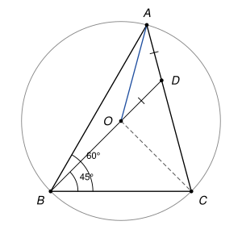

## Statement

Soit $ABC$ un triangle et $O$ le centre de son cercle circonscrit. On suppose que $\widehat{CBA} = 60°$ et $\widehat{CBO} = 45°$. Soit $D$ le point d'intersection des droites $(AC)$ et $(BO)$.

Montrer que $AD = DO$.

## Hints

1. Pour montrer que $AD = DO$, il suffit de montrer que le triangle $ADO$ a deux angles égaux, en $A$ et en $O$.
2. Les triangles $OAB$, $OBC$, $OCA$ sont isocèles en $O$. Que vaut $\widehat{ABO}$ ? Et $\widehat{AOB}$ ?
3. L'angle au centre $\widehat{AOC}$ intercepte le même arc que l'angle inscrit $\widehat{ABC}$.

## Solution

*Rappel (angle au centre).* Si $A$, $B$, $C$ sont sur un cercle de centre $O$ et si l'angle inscrit $\widehat{ABC}$ est aigu, alors $\widehat{AOC} = 2\,\widehat{ABC}$.

**Étape 1 : l'angle $\widehat{ABO}$.** Les demi-droites $[BA)$ et $[BO)$ font avec $[BC)$ des angles de $60°$ et $45°$. Si elles étaient de part et d'autre de la droite $(BC)$, l'angle $\widehat{ABO}$ vaudrait $60° + 45° = 105°$. C'est impossible : le triangle $OAB$ est isocèle en $O$ (car $OA = OB$), donc ses angles à la base $\widehat{OBA}$ et $\widehat{OAB}$ sont égaux, et deux angles égaux d'un triangle sont aigus. Les deux demi-droites sont donc du même côté de $(BC)$, et comme $45° < 60°$, la demi-droite $[BO)$ est à l'intérieur de l'angle $\widehat{ABC}$ :

$$\widehat{ABO} = 60° - 45° = 15°.$$

Le triangle $OAB$ est isocèle en $O$, donc $\widehat{OAB} = 15°$ et $\widehat{AOB} = 180° - 2 \times 15° = 150°$.

**Étape 2 : l'angle $\widehat{OAC}$.** L'angle inscrit $\widehat{ABC} = 60°$ est aigu. D'après le rappel, $\widehat{AOC} = 2 \times 60° = 120°$. Le triangle $OAC$ est isocèle en $O$, donc

$$\widehat{OAC} = \widehat{OCA} = \frac{180° - 120°}{2} = 30°.$$

**Étape 3 : l'angle en $O$ du triangle $ADO$.** La demi-droite $[BO)$ est à l'intérieur de l'angle $\widehat{ABC}$, donc elle coupe le segment $[AC]$ : le point $D$ est sur $[AC]$, et $\widehat{OAD} = \widehat{OAC} = 30°$. Le point $O$ n'est pas sur $(AC)$, puisque $\widehat{AOC} = 120°$ n'est pas plat, donc $D \neq O$.

Si $D$ était entre $B$ et $O$, l'angle $\widehat{AOD}$ serait $\widehat{AOB} = 150°$, et le triangle $ADO$ aurait deux angles de $150°$ et $30°$, dont la somme fait déjà $180°$ : impossible. Donc $O$ est entre $B$ et $D$, et les angles $\widehat{AOB}$ et $\widehat{AOD}$ sont supplémentaires :

$$\widehat{AOD} = 180° - 150° = 30°.$$

**Conclusion.** Le triangle $ADO$ a deux angles égaux, $\widehat{OAD} = \widehat{AOD} = 30°$. Il est donc isocèle en $D$ :

$$AD = DO.$$

*Remarque.* Les hypothèses fixent la forme du triangle : avec $\widehat{BOC} = 2 \times \widehat{BAC}$ et $\widehat{OBC} = 45°$, on trouve $\widehat{BAC} = 45°$, puis $\widehat{ACB} = 75°$. Les correcteurs notent que l'exercice a été très bien réussi, mais qu'une chasse aux angles, même courte, doit être justifiée à chaque ligne.
