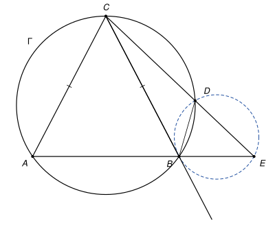

## Statement

Soit $ABC$ un triangle isocèle en $C$ et $\Gamma$ son cercle circonscrit. Soit $D$ un point du petit arc $BC$ de $\Gamma$, celui qui ne contient pas $A$, avec $D$ différent de $B$ et de $C$. Les droites $(CD)$ et $(AB)$ se coupent en un point $E$.

Montrer que la droite $(BC)$ est tangente au cercle circonscrit au triangle $BDE$.

## Hints

1. Pour montrer qu'une droite passant par $B$ est tangente au cercle $BDE$, on peut utiliser le théorème de l'angle entre une tangente et une corde « à l'envers » : quel angle de sommet $B$ doit être égal à $\widehat{BDE}$ ?
2. L'angle $\widehat{BDE}$ est le supplément de $\widehat{BDC}$. Que dit le quadrilatère inscrit $ABDC$ sur l'angle $\widehat{BDC}$ ?
3. N'oubliez pas que le triangle $ABC$ est isocèle en $C$.

## Solution

*Rappels.*

- *Quadrilatère inscrit.* Dans un quadrilatère convexe inscrit dans un cercle, deux angles opposés ont pour somme $180°$.
- *Angle entre une tangente et une corde, et sa réciproque.* Soit $[BE]$ une corde d'un cercle et $D$ un autre point du cercle. Une droite qui passe par $B$ est tangente au cercle en $B$ si et seulement si elle fait avec la corde $[BE]$, du côté opposé à $D$, un angle égal à l'angle inscrit $\widehat{BDE}$.

*La figure.* Les points $C$ et $D$ sont sur le même arc d'extrémités $A$ et $B$, donc les cordes $[CD]$ et $[AB]$ ne se coupent pas. Le point $E$ est en dehors de ces deux segments : $D$ est entre $C$ et $E$, et $B$ est entre $A$ et $E$. Sur le cercle $\Gamma$, les points se suivent dans l'ordre $A$, $B$, $D$, $C$.

**Étape 1 : l'angle en $D$.** Les points $C$, $D$, $E$ sont alignés dans cet ordre, donc

$$\widehat{BDE} = 180° - \widehat{BDC}.$$

Le quadrilatère $ABDC$ est inscrit dans $\Gamma$ et convexe. Ses angles en $D$ et en $A$ sont opposés, donc $\widehat{BDC} + \widehat{BAC} = 180°$. Ainsi

$$\widehat{BDE} = \widehat{BAC}.$$

**Étape 2 : le triangle isocèle.** Comme $CA = CB$, les angles à la base sont égaux : $\widehat{BAC} = \widehat{ABC}$.

**Étape 3 : l'angle en $B$.** Prenons un point $C'$ sur la droite $(BC)$, au-delà de $B$. Les angles $\widehat{C'BE}$ et $\widehat{CBA}$ sont opposés par le sommet, puisque $B$ est entre $C$ et $C'$ et entre $A$ et $E$. Donc

$$\widehat{C'BE} = \widehat{ABC} = \widehat{BAC} = \widehat{BDE}.$$

![La même figure, avec le point C′ sur le prolongement de [CB] au-delà de B et les quatre angles égaux marqués en D, A, B](10282-figure-2.svg)

**Conclusion.** Dans le cercle circonscrit au triangle $BDE$, la droite $(BC)$ fait avec la corde $[BE]$ l'angle $\widehat{C'BE}$, du côté de $C'$. Le point $D$ est de l'autre côté de la droite $(BE) = (AB)$, du côté de $C$. Cet angle est égal à l'angle inscrit $\widehat{BDE}$, donc d'après la réciproque du rappel, **la droite $(BC)$ est tangente en $B$ au cercle circonscrit au triangle $BDE$**.

*Remarque.* Les correcteurs notent que beaucoup d'élèves ont redémontré à la main, et avec peine, la propriété de l'angle entre une tangente et une corde. Elle fait partie des outils à connaître par cœur, avec sa réciproque.

## Going further

1. Montrer que les triangles $CBD$ et $CEB$ sont semblables, et en déduire que $CD \times CE = CB^2$.
2. En déduire que le produit $CD \times CE$ ne dépend pas de la position du point $D$ sur le petit arc $BC$.
