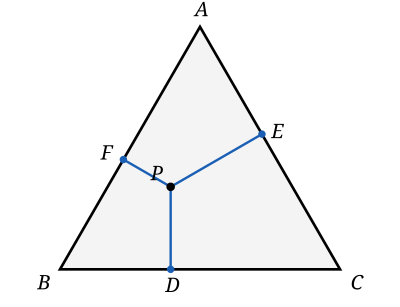

## Statement

Soit $ABC$ un triangle équilatéral de côté $a$, et soit $P$ un point situé à l'intérieur de ce triangle. On note $D$, $E$ et $F$ les pieds des perpendiculaires abaissées de $P$ sur les trois côtés.

Déterminer tous les points $P$ pour lesquels la somme

$$PD + PE + PF$$

est **la plus petite possible**.

## Hints

1. Avant de chercher un minimum, essayer plusieurs positions de $P$ et mesurer. Que constate-t-on ?
2. Relier $P$ aux trois sommets $A$, $B$ et $C$. Le triangle se retrouve découpé en trois morceaux : lesquels ?
3. Quelle est l'aire du triangle $PBC$, en fonction de $a$ et de $PD$ ?
4. Additionner les trois aires et comparer à l'aire du grand triangle.
5. Le facteur $a$ se met en facteur parce que le triangle est **équilatéral** : les trois bases ont la même longueur.

## Solution

**Le découpage.**

Relions $P$ aux trois sommets. Le triangle $ABC$ est alors partagé en trois triangles sans recouvrement : $PBC$, $PCA$ et $PAB$. Leurs aires s'ajoutent pour donner l'aire de $ABC$ :

$$\text{aire}(ABC) = \text{aire}(PBC) + \text{aire}(PCA) + \text{aire}(PAB).$$

**Calculer chaque morceau.**

Dans le triangle $PBC$, prenons $[BC]$ pour base : elle mesure $a$, et la hauteur correspondante est exactement la distance de $P$ à la droite $(BC)$, c'est-à-dire $PD$. Donc

$$\text{aire}(PBC) = \frac{a \times PD}{2}.$$

De la même façon, puisque les trois côtés ont tous la même longueur $a$ :

$$\text{aire}(PCA) = \frac{a \times PE}{2}, \qquad \text{aire}(PAB) = \frac{a \times PF}{2}.$$

**Additionner.**

$$\text{aire}(ABC) = \frac{a \times PD}{2} + \frac{a \times PE}{2} + \frac{a \times PF}{2} = \frac{a}{2}\bigl(PD + PE + PF\bigr).$$

Notons $h$ la hauteur du triangle équilatéral. Alors $\text{aire}(ABC) = \dfrac{a \times h}{2}$, d'où

$$\frac{a \times h}{2} = \frac{a}{2}\bigl(PD + PE + PF\bigr), \qquad \text{donc} \qquad PD + PE + PF = h.$$

**La réponse.**

La somme ne dépend pas du tout de la position de $P$ : elle vaut toujours $h$, la hauteur du triangle. Il n'y a donc rien à minimiser — **tous** les points intérieurs conviennent, la somme est la même partout.

Avec le théorème de Pythagore dans un demi-triangle équilatéral, $h = \dfrac{a\sqrt{3}}{2}$, donc

$$PD + PE + PF = \frac{a\sqrt{3}}{2}.$$

**Conclusion.** Pour tout point $P$ intérieur au triangle équilatéral de côté $a$, la somme des distances aux trois côtés vaut $\dfrac{a\sqrt{3}}{2}$. La question « où est-ce minimal ? » n'a pas de réponse privilégiée : c'est minimal partout, parce que c'est constant. Ce résultat porte le nom de **théorème de Viviani**.

## Going further

1. Que devient le résultat si $P$ est à l'extérieur du triangle ? (Indication : compter négativement la distance au côté dont $P$ s'est éloigné.)
2. Le triangle n'est plus équilatéral, mais seulement isocèle en $A$. La somme $PD + PE + PF$ est-elle encore constante ? Et la somme $PE + PF$ des distances aux deux côtés égaux ?
3. Énoncer et démontrer le résultat analogue pour un losange, puis pour un polygone régulier à $n$ côtés.
