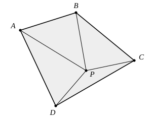
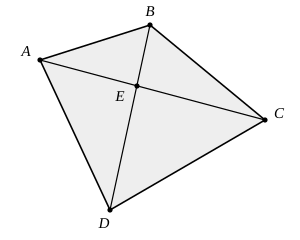

## Statement

$ABCD$ est un quadrilatère **convexe**, c'est-à-dire un quadrilatère dont les deux diagonales se coupent à l'intérieur.

Pour un point $P$ situé à l'intérieur de ce quadrilatère, on note

$$S(P) = PA + PB + PC + PD$$

la somme des distances de $P$ aux quatre sommets.

Où faut-il placer le point $P$ pour que $S(P)$ soit la plus petite possible ? Démontrer la réponse et donner la valeur de ce minimum.

## Hints

1. Quatre longueurs à la fois, c'est trop. Essaie de les regrouper deux par deux. Quel regroupement fait apparaître des points déjà présents sur la figure ?
2. Regroupe $PA + PC$ d'un côté et $PB + PD$ de l'autre : à chaque fois, les deux sommets sont opposés. Applique l'inégalité triangulaire aux trois points $A$, $P$, $C$.
3. Rappelle-toi aussi le cas d'égalité : $XY + YZ = XZ$ exactement lorsque $Y$ est sur le segment $[XZ]$.
4. Tu obtiens une minoration de $S(P)$ qui ne dépend plus du tout de $P$. Il reste à trouver un point pour lequel les deux inégalités sont en même temps des égalités : où ce point doit-il se trouver ?

## Solution

**L'idée : regrouper les quatre distances deux par deux, en associant les sommets opposés.**

On n'utilise qu'un seul outil, l'inégalité triangulaire : pour trois points $X$, $Y$, $Z$,

$$XY + YZ \ge XZ,$$

avec égalité si et seulement si $Y$ appartient au segment $[XZ]$.

**Étape 1. Une minoration valable pour tout point $P$.**

Appliquons l'inégalité aux trois points $A$, $P$, $C$ :

$$PA + PC \ge AC,$$

avec égalité si et seulement si $P$ est sur le segment $[AC]$.

De même, avec les trois points $B$, $P$, $D$ :

$$PB + PD \ge BD,$$

avec égalité si et seulement si $P$ est sur le segment $[BD]$.

En additionnant ces deux inégalités :

$$S(P) = (PA + PC) + (PB + PD) \ge AC + BD.$$

Le nombre $AC + BD$ est la somme des longueurs des deux diagonales : il ne dépend pas de $P$. Aucun point ne peut donc descendre en dessous de cette valeur.

**Étape 2. Ce minimum est effectivement atteint.**

Le quadrilatère est convexe, donc ses diagonales $[AC]$ et $[BD]$ se coupent en un point $E$ situé à l'intérieur.

Le point $E$ est sur le segment $[AC]$, donc $EA + EC = AC$. Il est aussi sur le segment $[BD]$, donc $EB + ED = BD$. Par conséquent

$$S(E) = AC + BD.$$

La valeur annoncée à l'étape 1 est donc bien atteinte, et c'est le minimum.

**Étape 3. C'est le seul point qui convient.**

Supposons que $S(P) = AC + BD$ pour un certain point $P$. Alors les deux inégalités de l'étape 1 doivent être des égalités en même temps. Donc $P$ est sur $[AC]$ **et** sur $[BD]$. Ces deux segments n'ont qu'un seul point commun, le point $E$. Donc $P = E$.

**Conclusion.** La somme $PA + PB + PC + PD$ est minimale lorsque $P$ est le point d'intersection des diagonales, et elle vaut alors $AC + BD$, la somme des longueurs des deux diagonales. C'est le seul point où ce minimum est atteint.

**Remarque.** La démonstration n'a jamais utilisé le fait que $P$ était à l'intérieur du quadrilatère : le résultat vaut pour n'importe quel point du plan.

## Going further

1. Dessiner un quadrilatère $ABCD$ non convexe (ses diagonales ne se coupent alors plus à l'intérieur). L'étape 1 de la démonstration reste-t-elle vraie ? Et l'étape 2 ? Où se trouve, à votre avis, le point qui rend la somme minimale ?
2. Avec trois points $A$, $B$, $C$ au lieu de quatre, le point qui minimise $PA + PB + PC$ s'appelle le point de Fermat du triangle. Expliquer pourquoi le raisonnement ci-dessus ne s'adapte pas à ce cas.
