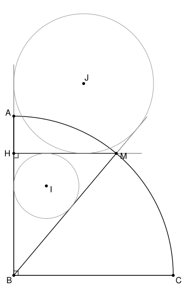

## Statement

$ABC$ est un triangle rectangle isocèle en $B$. On trace l'arc de cercle de centre $B$ qui va de $A$ à $C$, et on choisit un point $M$ sur cet arc. On note $H$ le projeté orthogonal de $M$ sur la droite $(AB)$.

On note $I$ le centre du cercle inscrit dans le triangle $BHM$, et $J$ le centre de son cercle exinscrit dans l'angle $\widehat{B}$. Autrement dit, $J$ est le point où se coupent la bissectrice intérieure de l'angle en $B$ et les bissectrices extérieures des angles en $H$ et en $M$ du triangle $BHM$.

Montrer que $MIAJ$ est un carré.

## Hints

1. En un même sommet d'un triangle, la bissectrice intérieure et la bissectrice extérieure sont perpendiculaires. Que peut-on en déduire pour l'angle $\widehat{IMJ}$ ?
2. Calcule l'angle $\widehat{BIM}$ en utilisant le fait que le triangle $BHM$ est rectangle en $H$.
3. Le triangle $MBA$ est isocèle en $B$. Quel rôle joue la droite $(BI)$ pour le segment $[AM]$ ?

## Solution

### Étape 1 : $MIJ$ est un triangle rectangle isocèle en $M$

La droite $(MI)$ est la bissectrice intérieure de l'angle en $M$ du triangle $BHM$, et $(MJ)$ est sa bissectrice extérieure. L'angle en $M$ et son angle supplémentaire font $180°$ à eux deux, et chaque bissectrice en prend la moitié : l'angle entre $(MI)$ et $(MJ)$ vaut $\dfrac{180°}{2} = 90°$. Donc $\widehat{IMJ} = 90°$.

Calculons maintenant $\widehat{BIM}$ dans le triangle $BIM$. Comme $I$ est sur les bissectrices des angles en $B$ et en $M$ du triangle $BHM$,
$$\widehat{IBM} + \widehat{IMB} = \frac{1}{2}\left(\widehat{HBM} + \widehat{HMB}\right) = \frac{1}{2} \times 90° = 45°,$$
car le triangle $BHM$ est rectangle en $H$, si bien que ses deux autres angles font $90°$ à eux deux. Donc $\widehat{BIM} = 180° - 45° = 135°$.

Les points $B$, $I$ et $J$ sont alignés, sur la bissectrice de l'angle en $B$, et $I$ est entre $B$ et $J$. Donc
$$\widehat{MIJ} = 180° - \widehat{BIM} = 45° .$$

Le triangle $MIJ$ est rectangle en $M$ avec un angle de $45°$ en $I$ : son troisième angle vaut aussi $45°$, il est **rectangle isocèle en $M$**.

### Étape 2 : $A$ est le symétrique de $M$ par rapport à $(IJ)$

Le point $H$ est sur le segment $[BA]$, donc $\widehat{HBM} = \widehat{ABM}$, et la droite $(BI)$ est aussi la bissectrice de l'angle $\widehat{ABM}$.

Or le triangle $ABM$ est isocèle en $B$, car $BA = BM$ (ce sont deux rayons du cercle de centre $B$). Dans un triangle isocèle, la bissectrice issue du sommet principal est aussi la médiatrice de la base. Donc $(BI)$, c'est-à-dire $(IJ)$, est la médiatrice de $[AM]$ : **$A$ est le symétrique de $M$ par rapport à la droite $(IJ)$**.

### Étape 3 : conclusion

La symétrie d'axe $(IJ)$ laisse $I$ et $J$ en place et envoie $M$ sur $A$. Elle envoie donc le triangle $MIJ$ sur le triangle $AIJ$, qui est lui aussi rectangle isocèle, en $A$. Ainsi
$$MI = MJ = AI = AJ \qquad \text{et} \qquad \widehat{IMJ} = \widehat{IAJ} = 90° .$$
Le quadrilatère $MIAJ$ a quatre côtés égaux, c'est un losange, et il a un angle droit.

**Conclusion.** $MIAJ$ est un carré.
