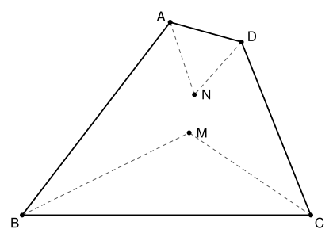

## Statement

$ABCD$ est un quadrilatère convexe. On note $M$ le point d'intersection des bissectrices des angles $\widehat{ABC}$ et $\widehat{BCD}$, et $N$ le point d'intersection des bissectrices des angles $\widehat{DAB}$ et $\widehat{CDA}$. On suppose que les droites $(AB)$ et $(CD)$ ne sont pas parallèles, et que $M \neq N$.

Montrer que les droites $(AB)$, $(CD)$ et $(MN)$ passent par un même point.

## Hints

1. Prolonge les côtés $[AB]$ et $[CD]$ jusqu'à leur point de rencontre $E$. Que représente $M$ pour le triangle $EBC$ ?
2. Un point situé sur la bissectrice d'un angle est à la même distance des deux côtés de cet angle. De quelles droites le point $M$ est-il à égale distance ? Et le point $N$ ?
3. À l'intérieur d'un angle, les points qui sont à égale distance des deux côtés sont exactement ceux de la bissectrice. Vérifie que $M$ et $N$ sont tous les deux à l'intérieur de l'angle $\widehat{BEC}$.

## Solution

On note $E$ le point d'intersection des droites $(AB)$ et $(CD)$. Comme le quadrilatère est convexe, $E$ n'est ni sur le côté $[AB]$ ni sur le côté $[CD]$, et les deux sommets les plus proches de $E$ sont soit $A$ et $D$, soit $B$ et $C$. Quitte à échanger les noms ($A$ avec $B$ et $C$ avec $D$, ce qui donne le même quadrilatère et échange $M$ et $N$), on peut supposer que $A$ est entre $E$ et $B$, et $D$ entre $E$ et $C$, comme sur la figure.

On va montrer que $M$ et $N$ sont tous les deux sur la bissectrice de l'angle $\widehat{BEC}$. Comme cette droite passe par $E$, cela prouvera que $E$ est sur $(MN)$.

On utilise deux faits sur la bissectrice d'un angle :

- un point de la bissectrice est à la même distance des deux côtés de l'angle ;
- un point situé à l'intérieur d'un angle et à la même distance de ses deux côtés est sur sa bissectrice.

### Étape 1 : le point $M$

Comme $A$ est sur $[BE]$, l'angle $\widehat{ABC}$ du quadrilatère est l'angle $\widehat{EBC}$ du triangle $EBC$. De même, $\widehat{BCD} = \widehat{BCE}$. Le point $M$ est donc le point de rencontre de deux bissectrices du triangle $EBC$ : c'est le centre de son cercle inscrit. Il est à l'intérieur du triangle $EBC$, donc à l'intérieur de l'angle $\widehat{BEC}$.

Sur la bissectrice issue de $B$, il est à la même distance de $(BE)$ et de $(BC)$. Sur la bissectrice issue de $C$, il est à la même distance de $(CB)$ et de $(CE)$. Il est donc à la même distance de $(EB)$ et de $(EC)$ : **$M$ est sur la bissectrice de $\widehat{BEC}$**.

### Étape 2 : le point $N$

Comme $A$ est entre $E$ et $B$, les angles $\widehat{EAD}$ et $\widehat{DAB}$ sont supplémentaires : l'angle $\widehat{DAB}$ du quadrilatère est l'angle extérieur en $A$ du triangle $EAD$. De même, $\widehat{CDA}$ est l'angle extérieur en $D$ du triangle $EAD$.

Les demi-droites bissectrices issues de $A$ et de $D$ partent du côté de $(AD)$ où ne se trouve pas $E$, et elles font avec $[AD]$ les angles
$$\frac{180° - \widehat{EAD}}{2} \qquad \text{et} \qquad \frac{180° - \widehat{EDA}}{2},$$
dont la somme vaut $180° - \dfrac{\widehat{EAD} + \widehat{EDA}}{2}$, qui est plus petite que $180°$. Ces deux demi-droites se coupent donc, et leur point commun est $N$.

Le point $N$ est sur la demi-droite bissectrice issue de $A$, à l'intérieur de l'angle $\widehat{DAB}$ : il est du même côté de $(AB)$ que $D$, donc que $C$. De même, il est du même côté de $(CD)$ que $A$, donc que $B$. Ainsi **$N$ est à l'intérieur de l'angle $\widehat{BEC}$**.

Sur la bissectrice issue de $A$, il est à la même distance de $(AB)$ et de $(AD)$. Sur la bissectrice issue de $D$, il est à la même distance de $(DA)$ et de $(DC)$. Il est donc à la même distance de $(AB)$ et de $(CD)$, c'est-à-dire de $(EB)$ et de $(EC)$ : **$N$ est sur la bissectrice de $\widehat{BEC}$**. (Le point $N$ est le centre du cercle exinscrit du triangle $EAD$ dans l'angle $\widehat{E}$.)

### Conclusion

Les points $M$ et $N$, qui sont distincts, sont sur la bissectrice de l'angle $\widehat{BEC}$. La droite $(MN)$ est donc cette bissectrice, et elle passe par $E$.

**Conclusion.** Les droites $(AB)$, $(CD)$ et $(MN)$ passent toutes les trois par $E$.

## Going further

1. Si $(AB)$ et $(CD)$ sont parallèles, montrer que $(MN)$ leur est parallèle.
2. Que peut-on dire du quadrilatère quand $M = N$ ?
