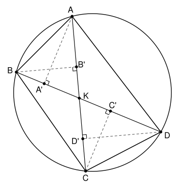

## Statement

Soient $A$, $B$, $C$, $D$ quatre points placés dans cet ordre sur un cercle, tels que les droites $(AC)$ et $(BD)$ ne soient pas perpendiculaires. On note $A'$ et $C'$ les projetés orthogonaux de $A$ et de $C$ sur la droite $(BD)$, et $B'$ et $D'$ les projetés orthogonaux de $B$ et de $D$ sur la droite $(AC)$.

Montrer que les points $A'$, $B'$, $C'$, $D'$ sont sur un même cercle.

## Hints

1. Note $K$ le point d'intersection des diagonales $[AC]$ et $[BD]$. Dans le triangle rectangle $AKA'$, exprime $KA'$ à l'aide de $KA$ et de l'angle entre les deux diagonales.
2. Quand deux cordes $[AC]$ et $[BD]$ d'un cercle se coupent en $K$, on a $KA \times KC = KB \times KD$.
3. Compare $KA' \times KC'$ et $KB' \times KD'$. Il reste à trouver la réciproque qui permet de conclure.

## Solution

**Deux rappels sur les cordes qui se coupent.**

- **Rappel 1.** Si deux cordes $[UV]$ et $[ST]$ d'un cercle se coupent en un point $K$, alors $KU \times KV = KS \times KT$.
  En effet, les triangles $KUS$ et $KTV$ ont des angles égaux en $K$, opposés par le sommet. De plus $\widehat{KUS} = \widehat{VUS}$ et $\widehat{KTV} = \widehat{STV}$ sont deux angles inscrits qui interceptent le même arc $SV$, donc ils sont égaux. Les deux triangles sont donc semblables, d'où $\dfrac{KU}{KT} = \dfrac{KS}{KV}$, ce qui donne l'égalité.
- **Rappel 2 (la réciproque).** Si deux segments $[UV]$ et $[ST]$, portés par deux droites différentes, se coupent en un point $K$ situé entre $U$ et $V$ et entre $S$ et $T$, et si $KU \times KV = KS \times KT$, alors $U$, $S$, $V$, $T$ sont sur un même cercle.
  En effet, les points $U$, $V$, $S$ ne sont pas alignés, donc il existe un cercle $\mathcal{C}$ qui passe par eux. Le point $K$ est sur la corde $[UV]$, donc à l'intérieur de $\mathcal{C}$, et la droite $(SK)$ recoupe $\mathcal{C}$ en un point $T'$ situé de l'autre côté de $K$ par rapport à $S$. D'après le rappel 1, $KS \times KT' = KU \times KV = KS \times KT$, donc $KT' = KT$. Les points $T$ et $T'$ sont sur la même demi-droite issue de $K$, à la même distance de $K$ : ils sont confondus, et $T$ est sur $\mathcal{C}$.

Les points $A$, $B$, $C$, $D$ sont dans cet ordre sur le cercle, donc $ABCD$ est un quadrilatère convexe et ses diagonales $[AC]$ et $[BD]$ se coupent en un point $K$. On note $\alpha$ l'angle aigu entre les droites $(AC)$ et $(BD)$. Ce n'est pas un angle droit, par hypothèse.

### Étape 1 : $KA' = KA \cos\alpha$, et de même pour les trois autres

Le point $A'$ n'est pas $K$, sinon $(AK)$, c'est-à-dire $(AC)$, serait perpendiculaire à $(BD)$. Le triangle $AKA'$ est rectangle en $A'$, donc son angle $\widehat{AKA'}$ est aigu. C'est un angle entre les droites $(AC)$ et $(BD)$, donc $\widehat{AKA'} = \alpha$, et
$$KA' = KA \cos\alpha .$$
De la même façon, $KC' = KC\cos\alpha$, $KB' = KB\cos\alpha$ et $KD' = KD\cos\alpha$.

### Étape 2 : $K$ est entre $A'$ et $C'$, et entre $B'$ et $D'$

D'après l'étape 1, le point $A'$ est sur la demi-droite de $(BD)$ issue de $K$ qui fait un angle aigu avec $[KA)$. De même, $C'$ est sur celle qui fait un angle aigu avec $[KC)$. Or les demi-droites $[KA)$ et $[KC)$ sont opposées : si une demi-droite fait un angle aigu $\alpha$ avec l'une, elle fait l'angle obtus $180° - \alpha$ avec l'autre. Les points $A'$ et $C'$ sont donc sur les deux demi-droites opposées de $(BD)$ issues de $K$ : le point $K$ est entre $A'$ et $C'$.

Pour la même raison, $K$ est entre $B'$ et $D'$.

### Étape 3 : on conclut

D'après l'étape 1, puis le rappel 1 appliqué aux cordes $[AC]$ et $[BD]$ du cercle de départ :
$$KA' \times KC' = KA \times KC \times \cos^2\alpha = KB \times KD \times \cos^2\alpha = KB' \times KD' .$$
Les segments $[A'C']$ et $[B'D']$ sont portés par les droites différentes $(BD)$ et $(AC)$, et ils se coupent en $K$, qui est entre $A'$ et $C'$ et entre $B'$ et $D'$ d'après l'étape 2.

**Conclusion.** D'après le rappel 2, les points $A'$, $B'$, $C'$, $D'$ sont sur un même cercle.

## Going further

- Si les diagonales sont perpendiculaires, les quatre projetés sont tous confondus avec $K$, et l'énoncé n'a plus de sens.
- Il existe une autre preuve, plus courte, avec des transformations. Soit $s$ la symétrie d'axe la bissectrice de l'angle aigu formé par les deux diagonales, et $h$ l'homothétie de centre $K$ et de rapport $\cos\alpha$. La symétrie $s$ échange les droites $(AC)$ et $(BD)$, et envoie la demi-droite $[KA)$ sur la demi-droite de $(BD)$ qui fait avec elle l'angle aigu $\alpha$. D'après l'étape 1, $h$ envoie alors l'image de $A$ sur $A'$. De même, la transformation « $s$ puis $h$ » envoie $B$, $C$, $D$ sur $B'$, $C'$, $D'$. Elle transforme le cercle de départ en un cercle, qui passe donc par les quatre projetés.
- Si les points ne sont pas dans l'ordre $A$, $B$, $C$, $D$, les droites $(AC)$ et $(BD)$ peuvent se couper à l'extérieur du cercle. L'égalité $KA \times KC = KB \times KD$ reste vraie (on parle de la puissance du point $K$ par rapport au cercle), ainsi que sa réciproque quand $K$ est à l'extérieur des deux segments, et la même preuve fonctionne.
