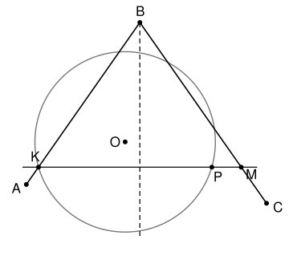

## Statement

Le sommet $B$ d'un angle $\widehat{ABC}$ est à l'extérieur d'un cercle $\omega$ de centre $O$, et les deux demi-droites $[BA)$ et $[BC)$ coupent ce cercle. Soit $K$ un point d'intersection de $\omega$ avec la demi-droite $[BA)$. La perpendiculaire à la bissectrice de l'angle $\widehat{ABC}$ passant par $K$ recoupe le cercle $\omega$ au point $P$, et coupe la droite $(BC)$ au point $M$.

Montrer que la longueur $PM$ est le double de la distance du point $O$ à la bissectrice de l'angle $\widehat{ABC}$.

## Hints

1. La bissectrice $\Delta$ de l'angle est un axe de symétrie de cet angle. Quelle est l'image du point $K$ par la symétrie d'axe $\Delta$ ?
2. Note $\ell$ la droite $(KP)$, $H$ le point où $\ell$ coupe $\Delta$, et $F$ le pied de la perpendiculaire à $\ell$ menée de $O$. Que représente le point $H$ pour le segment $[KM]$ ? Et le point $F$ pour la corde $[KP]$ ?
3. Écris le vecteur $\overrightarrow{PM}$ à l'aide de $\overrightarrow{KM}$ et de $\overrightarrow{KP}$.

## Solution

On note $\Delta$ la bissectrice de l'angle $\widehat{ABC}$ et $\ell$ la perpendiculaire à $\Delta$ passant par $K$. On note $H$ le point d'intersection de $\ell$ et de $\Delta$, et $F$ le pied de la perpendiculaire à $\ell$ menée de $O$.

### Étape 1 : $H$ est le milieu de $[KM]$

La symétrie d'axe $\Delta$ échange les deux côtés de l'angle, donc elle envoie la droite $(BA)$ sur la droite $(BC)$. Elle envoie aussi la droite $\ell$ sur elle-même, car $\ell$ est perpendiculaire à l'axe $\Delta$.

L'image $K'$ du point $K$ est donc à la fois sur $(BC)$ et sur $\ell$. La droite $\ell$ n'est pas parallèle à $(BC)$, car $(BC)$ n'est pas perpendiculaire à $\Delta$. Ces deux droites ont donc un seul point commun, qui est $M$ : ainsi $K' = M$. Le segment $[KM]$ est perpendiculaire à l'axe $\Delta$, et son milieu est sur $\Delta$, donc ce milieu est $H$. Autrement dit,
$$\overrightarrow{KM} = 2\,\overrightarrow{KH} .$$

### Étape 2 : $F$ est le milieu de $[KP]$

Le centre $O$ est à la même distance de $K$ et de $P$, donc il est sur la médiatrice de la corde $[KP]$. Cette médiatrice est la perpendiculaire à $\ell$ passant par $O$, et elle coupe $\ell$ en $F$. Le point $F$ est donc le milieu de $[KP]$ :
$$\overrightarrow{KP} = 2\,\overrightarrow{KF} .$$

### Étape 3 : $PM = 2\,FH$

D'après la relation de Chasles et les étapes 1 et 2,
$$\overrightarrow{PM} = \overrightarrow{PK} + \overrightarrow{KM} = \overrightarrow{KM} - \overrightarrow{KP} = 2\,\overrightarrow{KH} - 2\,\overrightarrow{KF} = 2\,\overrightarrow{FH} .$$
Donc $PM = 2\,FH$.

### Étape 4 : $FH$ est la distance de $O$ à $\Delta$

Soit $\Delta'$ la parallèle à $\Delta$ passant par $O$. Elle est perpendiculaire à $\ell$, comme $\Delta$, et passe par $O$, donc elle coupe $\ell$ en $F$. Les points $F$ et $H$ sont les points où la droite $\ell$ coupe les deux droites parallèles $\Delta'$ et $\Delta$, et $\ell$ est perpendiculaire à ces deux droites. La longueur $FH$ est donc la distance entre $\Delta'$ et $\Delta$, c'est-à-dire la distance de $O$ à $\Delta$. (Si $O$ est sur $\Delta$, alors $\Delta' = \Delta$, $F = H$, et cette distance est nulle.)

**Conclusion.** $PM = 2\,FH$, c'est-à-dire que la longueur $PM$ est le double de la distance du centre $O$ à la bissectrice de l'angle $\widehat{ABC}$.

## Going further

- La longueur $PM$ ne dépend donc pas du choix de $K$ : on trouve la même valeur avec les deux points où $\omega$ coupe la demi-droite $[BA)$.
- Le corrigé utilise des transformations. La symétrie d'axe $\Delta'$ envoie $P$ sur $K$, puis la symétrie d'axe $\Delta$ envoie $K$ sur $M$. Quand on fait deux symétries d'axes parallèles l'une après l'autre, on obtient une translation, dont le vecteur est perpendiculaire aux deux axes et a pour longueur le double de la distance entre eux. Cette translation envoie $P$ sur $M$, d'où le résultat.
