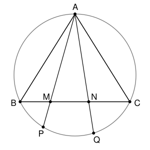

## Statement

Soit $ABC$ un triangle isocèle en $A$, et $\Omega$ son cercle circonscrit. Soient $M$ et $N$ deux points distincts du segment $[BC]$, différents de $B$ et de $C$. Les droites $(AM)$ et $(AN)$ recoupent le cercle $\Omega$ en $P$ et $Q$.

1. Montrer que les points $M$, $N$, $P$, $Q$ sont sur un même cercle.
2. Soient $R_1$ et $R_2$ les rayons des cercles circonscrits aux triangles $BMP$ et $CMP$. Calculer $R_1 + R_2$ en fonction des longueurs $AB$ et $BC$.

## Hints

1. Compare les angles $\widehat{ABM}$ et $\widehat{APB}$. Qu'en déduis-tu pour les triangles $ABM$ et $APB$ ?
2. Tu dois obtenir $AM \times AP = AB^2$. Écris la même chose avec $N$ et $Q$, puis compare les triangles $AMN$ et $AQP$.
3. Pour la question 2, que vaut l'angle $\widehat{BPM}$ ? Dans un triangle de cercle circonscrit de rayon $\rho$, un côté est égal à $2\rho$ multiplié par le sinus de l'angle opposé.

## Solution

**Rappel : l'angle inscrit et les quadrilatères inscrits.** Deux points situés du même côté d'une droite $(KL)$ voient le segment $[KL]$ sous le même angle si et seulement s'ils sont sur un même cercle passant par $K$ et $L$. Et un quadrilatère convexe est inscrit dans un cercle si et seulement si deux de ses angles opposés ont pour somme $180°$.

**Rappel : triangles semblables.** Deux triangles sont semblables, c'est-à-dire que l'un est un agrandissement ou une réduction de l'autre, dès qu'ils ont deux angles égaux, ou bien un angle égal compris entre deux côtés proportionnels. Leurs côtés sont alors proportionnels.

Le point $P$ est sur l'arc $BC$ qui ne contient pas $A$, puisque la droite $(AM)$ traverse le segment $[BC]$ en $M$. Ainsi $P$ et $C$ sont du même côté de la droite $(AB)$, et $P$ et $B$ sont du même côté de la droite $(AC)$. Il en est de même pour $Q$.

### Question 1

Les points $P$ et $C$ sont sur $\Omega$, du même côté de $(AB)$, donc $\widehat{APB} = \widehat{ACB}$. Le triangle est isocèle en $A$, donc $\widehat{ACB} = \widehat{ABC}$. Ainsi
$$\widehat{ABM} = \widehat{ABC} = \widehat{ACB} = \widehat{APB} .$$
Les triangles $ABM$ et $APB$ ont aussi le même angle en $A$, car $M$ est sur $[AP]$. Ils sont donc semblables, avec $A \leftrightarrow A$, $B \leftrightarrow P$, $M \leftrightarrow B$, et
$$\frac{AM}{AB} = \frac{AB}{AP}, \qquad \text{donc} \qquad AM \times AP = AB^2 .$$
De la même façon, $AN \times AQ = AC^2 = AB^2$. On a donc $AM \times AP = AN \times AQ$, c'est-à-dire
$$\frac{AM}{AQ} = \frac{AN}{AP} .$$
Les triangles $AMN$ et $AQP$ ont le même angle en $A$, compris entre deux côtés proportionnels. Ils sont semblables, avec $M \leftrightarrow Q$ et $N \leftrightarrow P$, et donc $\widehat{AMN} = \widehat{AQP}$.

Le point $M$ est entre $A$ et $P$, donc $\widehat{NMP} = 180° - \widehat{AMN}$. Le point $N$ est sur $[AQ]$, donc $\widehat{AQP} = \widehat{NQP}$. Ainsi
$$\widehat{NMP} + \widehat{NQP} = 180° .$$
Le quadrilatère $MNQP$ est convexe : $M$ et $N$ sont sur $[BC]$, et $P$ et $Q$ sont de l'autre côté de $(BC)$, sur les demi-droites $[AM)$ et $[AN)$. Ses angles opposés en $M$ et en $Q$ ont pour somme $180°$, donc il est inscrit dans un cercle.

**Conclusion.** Les points $M$, $N$, $P$, $Q$ sont sur un même cercle.

### Question 2

**Un outil : la loi des sinus.** Soit $XYZ$ un triangle dont l'angle en $X$ est aigu, et $\rho$ le rayon de son cercle circonscrit. Alors
$$YZ = 2\rho \sin \widehat{YXZ} .$$
En effet, soit $Y'$ le point du cercle diamétralement opposé à $Y$. Le point $Z$ est sur l'un des deux demi-cercles qui vont de $Y$ à $Y'$, donc $Y'$ est sur le grand arc $YZ$. L'angle en $X$ est aigu, donc $X$ est aussi sur le grand arc $YZ$. Les points $X$ et $Y'$ sont donc du même côté de $(YZ)$, et $\widehat{YY'Z} = \widehat{YXZ}$. Le triangle $YZY'$ est rectangle en $Z$, car $[YY']$ est un diamètre. Donc
$$\sin \widehat{YXZ} = \sin \widehat{YY'Z} = \frac{YZ}{YY'} = \frac{YZ}{2\rho} .$$

**Les angles en $P$.** Le point $M$ est sur $[PA]$, donc $\widehat{BPM} = \widehat{BPA} = \widehat{BCA}$, comme on l'a vu à la question 1. De même, $P$ et $B$ sont du même côté de $(AC)$, donc $\widehat{CPM} = \widehat{CPA} = \widehat{CBA} = \widehat{BCA}$. On note $\gamma = \widehat{BCA}$. C'est un angle à la base d'un triangle isocèle, il est donc aigu.

**Le calcul.** La loi des sinus dans les triangles $BMP$ et $CMP$, pour l'angle en $P$, donne
$$BM = 2R_1 \sin \gamma \qquad \text{et} \qquad CM = 2R_2 \sin \gamma .$$
En additionnant, et comme $M$ est entre $B$ et $C$,
$$BC = BM + MC = 2(R_1 + R_2)\sin \gamma .$$
Soit $H$ le milieu de $[BC]$. Le triangle est isocèle en $A$, donc $(AH)$ est la hauteur issue de $A$, et le triangle $AHC$ est rectangle en $H$. D'après le théorème de Pythagore, $AH = \sqrt{AB^2 - \dfrac{BC^2}{4}}$, et
$$\sin \gamma = \frac{AH}{AC} = \frac{\sqrt{AB^2 - \frac{BC^2}{4}}}{AB} = \frac{\sqrt{4AB^2 - BC^2}}{2AB} .$$
Donc
$$R_1 + R_2 = \frac{BC}{2\sin\gamma} = \frac{AB \times BC}{\sqrt{4AB^2 - BC^2}} .$$

**Conclusion.** $R_1 + R_2 = \dfrac{AB \times BC}{\sqrt{4AB^2 - BC^2}}$. Cette somme ne dépend pas de la position du point $M$ sur $[BC]$.

## Going further

- Le corrigé fait la question 1 en calculant les angles : $\widehat{PMN} = 180° - \widehat{BCP} - \widehat{CBA}$ et $\widehat{NQP} = \widehat{CBA} + \widehat{BCP}$.
- La loi des sinus appliquée au triangle $ABC$ lui-même donne $AB = 2R\sin\gamma$, où $R$ est le rayon de $\Omega$. On en déduit que $R_1 + R_2 = \dfrac{BC}{AB} \times R$.
- L'égalité $AM \times AP = AB^2$ dit aussi que le cercle circonscrit à $BMP$ est tangent à la droite $(AB)$ en $B$.
