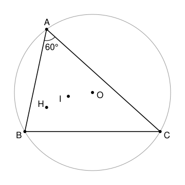

## Statement

Soit $ABC$ un triangle tel que $\widehat{BAC} = 60°$. On note $O$ le centre de son cercle circonscrit, $I$ le centre de son cercle inscrit et $H$ son orthocentre, le point commun des trois hauteurs.

1. Montrer que les cinq points $B$, $C$, $O$, $I$ et $H$ sont sur un même cercle.
2. Montrer que $IO = IH$ : le triangle $OIH$ est isocèle en $I$.

## Hints

1. Soit $K$ le milieu de $[BC]$, et $S$ le point du cercle circonscrit qui est sur la demi-droite $[OK)$, de l'autre côté de $(BC)$ par rapport à $A$. Calcule l'angle $\widehat{BOC}$, puis montre que $SB = SC = SO$.
2. Montre que $\overrightarrow{AH} = 2\,\overrightarrow{OK}$. Pour cela, place le point $H'$ tel que $\overrightarrow{AH'} = 2\,\overrightarrow{OK}$ et vérifie qu'il est sur deux hauteurs.
3. Montre que la bissectrice issue de $A$ passe par $S$, puis que le triangle $SBI$ est isocèle en $S$.
4. Pour la question 2, regarde les distances de $A$ et de $S$ aux points $O$ et $H$.

## Solution

**Rappel : angle inscrit et angle au centre.** Dans un cercle de centre $O$, un angle inscrit vaut la moitié de l'angle au centre qui intercepte le même arc. Deux angles inscrits qui interceptent le même arc, ou deux arcs de même longueur, sont égaux.

On note $R$ le rayon du cercle circonscrit $\Gamma$, $K$ le milieu de $[BC]$, et $S$ le point de $\Gamma$ sur la demi-droite $[OK)$, de l'autre côté de $(BC)$ par rapport à $A$. On va montrer que les cinq points sont tous à la distance $R$ de $S$.

### Étape 1 : $SO = SB = SC = R$

D'abord $SO = R$, car $S$ est sur $\Gamma$.

L'angle inscrit $\widehat{BAC} = 60°$ intercepte l'arc $BC$ qui ne contient pas $A$, donc l'angle au centre vaut $\widehat{BOC} = 120°$. Le triangle $OBC$ est isocèle en $O$, donc la médiane $(OK)$ est aussi la bissectrice de $\widehat{BOC}$ et la hauteur issue de $O$ : $\widehat{BOK} = 60°$ et $(OK) \perp (BC)$.

Le triangle $OBS$ a deux côtés égaux, $OB = OS = R$, et un angle de $60°$ entre eux. Il est donc équilatéral, et $SB = R$. De même, $SC = R$.

### Étape 2 : $SH = R$

Le triangle $OKB$ est rectangle en $K$, avec $\widehat{BOK} = 60°$, donc $OK = OB \times \cos 60° = \frac{R}{2}$. Comme $S$ est sur la demi-droite $[OK)$ et que $OS = R = 2\,OK$, on a $\overrightarrow{OS} = 2\,\overrightarrow{OK}$.

Montrons que $\overrightarrow{AH} = 2\,\overrightarrow{OK}$. Soit $H'$ le point tel que $\overrightarrow{AH'} = 2\,\overrightarrow{OK}$.

- La droite $(OK)$ est perpendiculaire à $(BC)$, donc $H'$ est sur la hauteur issue de $A$.
- Comme $K$ est le milieu de $[BC]$, on a $2\,\overrightarrow{OK} = \overrightarrow{OB} + \overrightarrow{OC}$. Donc
$$\overrightarrow{BH'} = \overrightarrow{BA} + \overrightarrow{AH'} = (\overrightarrow{OA} - \overrightarrow{OB}) + (\overrightarrow{OB} + \overrightarrow{OC}) = \overrightarrow{OA} + \overrightarrow{OC} = 2\,\overrightarrow{OL},$$
où $L$ est le milieu de $[AC]$. Or $(OL) \perp (AC)$, car $O$ est sur la médiatrice de $[AC]$. Donc $H'$ est sur la hauteur issue de $B$ (si $O = L$, alors $H' = B$, et c'est encore vrai).

Le point $H'$ est sur deux hauteurs, c'est donc l'orthocentre : $H' = H$. Ainsi $\overrightarrow{AH} = 2\,\overrightarrow{OK} = \overrightarrow{OS}$. On en déduit
$$\overrightarrow{HS} = \overrightarrow{HA} + \overrightarrow{AO} + \overrightarrow{OS} = \overrightarrow{AO} ,$$
car $\overrightarrow{HA} = -\overrightarrow{OS}$. Donc $SH = AO = R$, et au passage $AH = OS = R$.

### Étape 3 : $SI = R$

Le point $S$ est sur la médiatrice de $[BC]$, donc les cordes $[SB]$ et $[SC]$ sont égales, et les arcs $SB$ et $SC$ aussi. D'après le rappel, $\widehat{BAS} = \widehat{SAC}$ : la droite $(AS)$ est la bissectrice issue de $A$, et elle passe par $I$. Le point $I$ est à l'intérieur du triangle, entre $A$ et $S$.

Notons $\alpha = 60°$, $\beta$ et $\gamma$ les angles du triangle en $A$, $B$, $C$. La droite $(BI)$ est la bissectrice de l'angle en $B$.

- L'angle $\widehat{SBC}$ intercepte l'arc $SC$, comme $\widehat{SAC}$, donc $\widehat{SBC} = \widehat{SAC} = \frac{\alpha}{2}$. Ainsi $\widehat{SBI} = \widehat{SBC} + \widehat{CBI} = \frac{\alpha}{2} + \frac{\beta}{2}$.
- L'angle $\widehat{SIB}$ est un angle extérieur du triangle $ABI$, donc $\widehat{SIB} = \widehat{IAB} + \widehat{IBA} = \frac{\alpha}{2} + \frac{\beta}{2}$.

Le triangle $SBI$ a deux angles égaux, il est isocèle en $S$, et $SI = SB = R$.

### Conclusion de la question 1

Les cinq points $B$, $C$, $O$, $I$ et $H$ sont tous à la distance $R$ du point $S$. **Ils sont sur le cercle de centre $S$ et de rayon $R$.**

### Question 2

D'après l'étape 2, $AO = AH = R$, et d'après la question 1, $SO = SH = R$. Si $O = H$, il n'y a rien à montrer. Sinon, les deux points $A$ et $S$ sont chacun à la même distance de $O$ et de $H$, donc la droite $(AS)$ est la médiatrice de $[OH]$. Le point $I$ est sur la droite $(AS)$, donc **$IO = IH$, et le triangle $OIH$ est isocèle en $I$.**

## Going further

- Le quadrilatère $AOSH$ a ses quatre côtés égaux à $R$ : c'est un losange.
- L'étape 3 marche pour tout triangle : le milieu $S$ de l'arc $BC$ est toujours à la même distance de $B$, de $C$ et de $I$. C'est un résultat très utile en géométrie d'olympiade.
- L'exercice 7749 montre le même résultat que la question 1, en comparant des angles, pour un triangle dont les trois angles sont aigus.
