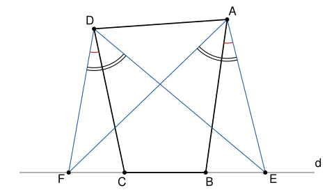

## Statement

Soit $ABCD$ un quadrilatère convexe (ses diagonales $[AC]$ et $[BD]$ se coupent). Soit $E$ et $F$ deux points tels que $E$, $B$, $C$, $F$ soient alignés dans cet ordre. On suppose que
$$\widehat{BAE} = \widehat{CDF} \qquad \text{et} \qquad \widehat{EAF} = \widehat{FDE} .$$

Montrer que $\widehat{FAC} = \widehat{EDB}$.

## Hints

1. Les points $A$ et $D$ voient le segment $[EF]$ sous le même angle. Que peut-on dire des quatre points $A$, $D$, $E$, $F$ ?
2. L'angle $\widehat{ABC}$ est un angle extérieur du triangle $ABE$. Exprime-le avec $\widehat{BAE}$ et $\widehat{AEF}$.
3. Montre que $A$, $B$, $C$, $D$ sont aussi sur un même cercle, en calculant $\widehat{ABC} + \widehat{ADC}$.
4. Écris $\widehat{FAC}$ et $\widehat{EDB}$ comme des différences d'angles, et utilise le deuxième cercle.

## Solution

**Rappel.**

- *Angle inscrit.* Si $X$, $Y$, $Z$, $T$ sont sur un même cercle, avec $Z$ et $T$ du même côté de la droite $(XY)$, alors $\widehat{XZY} = \widehat{XTY}$.
- *Réciproque.* Si $Z$ et $T$ sont du même côté de la droite $(XY)$ et si $\widehat{XZY} = \widehat{XTY}$, alors $X$, $Y$, $Z$, $T$ sont sur un même cercle.
- *Quadrilatère inscrit.* Si $X$, $Z$, $Y$, $T$ sont sur un même cercle, avec $Z$ et $T$ de part et d'autre de $(XY)$, alors $\widehat{XZY} + \widehat{XTY} = 180°$. Réciproquement, si $Z$ et $T$ sont de part et d'autre de $(XY)$ et si $\widehat{XZY} + \widehat{XTY} = 180°$, les quatre points sont sur un même cercle.

On note $d$ la droite qui porte $E$, $B$, $C$, $F$, et on pose
$$\alpha = \widehat{BAE} = \widehat{CDF}, \qquad \beta = \widehat{EAF} = \widehat{FDE} .$$

### Étape 1 : la place des points

Les diagonales $[AC]$ et $[BD]$ se coupent en un point $X$. Ce point est sur le segment $[AC]$, donc du même côté de $d$ que $A$. Il est aussi sur $[BD]$, donc du même côté de $d$ que $D$. Ainsi **$A$ et $D$ sont du même côté de $d$**. De même, $B$ et $D$ sont de part et d'autre de $(AC)$.

Les points $E$, $B$, $C$, $F$ se suivent dans cet ordre sur $d$, et $A$ n'est pas sur $d$. Les demi-droites $[AE)$, $[AB)$, $[AC)$, $[AF)$ se suivent donc dans cet ordre, et les angles s'ajoutent :
$$\beta = \widehat{EAF} = \alpha + \widehat{BAC} + \widehat{CAF} .$$
De même en $D$ :
$$\beta = \widehat{EDF} = \widehat{EDB} + \widehat{BDC} + \alpha .$$

### Étape 2 : un premier cercle

Les points $A$ et $D$ sont du même côté de $(EF)$, et $\widehat{EAF} = \widehat{EDF}$. D'après la réciproque du théorème de l'angle inscrit, **$A$, $D$, $E$, $F$ sont sur un même cercle $\omega$**.

Sur $\omega$, les points $A$ et $D$ sont sur le même arc $EF$, puisqu'ils sont du même côté de $(EF)$. Montrons que l'ordre sur le cercle est $E$, $A$, $D$, $F$.

Sinon l'ordre serait $E$, $D$, $A$, $F$. Les cordes $[AE]$ et $[DF]$ auraient leurs extrémités alternées sur le cercle, donc elles se couperaient, et la demi-droite $[AE)$ serait à l'intérieur de l'angle $\widehat{DAF}$. En partant de $[AD)$, on rencontrerait alors $[AE)$, puis $[AB)$, puis $[AC)$, puis $[AF)$, et $[AB)$ serait à l'intérieur de l'angle $\widehat{DAC}$. Or la diagonale $[AC]$ coupe le segment $[BD]$ : c'est $[AC)$ qui est à l'intérieur de l'angle $\widehat{DAB}$. Les deux ne peuvent pas être vrais en même temps, c'est une contradiction.

Donc l'ordre est $E$, $A$, $D$, $F$. Deux conséquences :

- $E$ et $D$ sont de part et d'autre de $(AF)$. Le quadrilatère $EADF$ est inscrit dans $\omega$, donc
$$\widehat{AEF} + \widehat{ADF} = 180° .$$
- Les cordes $[DE]$ et $[AF]$ se coupent, donc $[DE)$ est à l'intérieur de l'angle $\widehat{ADF}$. Comme $[DC)$ est entre $[DE)$ et $[DF)$, elle est aussi à l'intérieur de $\widehat{ADF}$, et
$$\widehat{ADC} = \widehat{ADF} - \widehat{CDF} = \widehat{ADF} - \alpha .$$

### Étape 3 : un deuxième cercle

Le point $C$ est sur le prolongement de $[EB]$ au-delà de $B$. L'angle $\widehat{ABC}$ est donc un angle extérieur du triangle $ABE$, et il est égal à la somme des deux autres angles de ce triangle :
$$\widehat{ABC} = \widehat{BAE} + \widehat{AEB} = \alpha + \widehat{AEF} ,$$
car $B$ est sur $[EF]$. Avec l'étape 2 :
$$\widehat{ABC} + \widehat{ADC} = \alpha + \widehat{AEF} + \widehat{ADF} - \alpha = 180° .$$
Les points $B$ et $D$ sont de part et d'autre de $(AC)$. D'après la réciproque du rappel sur le quadrilatère inscrit, **$A$, $B$, $C$, $D$ sont sur un même cercle**.

### Étape 4 : conclusion

Les points $A$ et $D$ sont du même côté de $(BC)$, donc, d'après le théorème de l'angle inscrit dans ce deuxième cercle,
$$\widehat{BAC} = \widehat{BDC} .$$
Avec l'étape 1 :
$$\widehat{FAC} = \beta - \alpha - \widehat{BAC} = \beta - \alpha - \widehat{BDC} = \widehat{EDB} .$$

**On a bien $\widehat{FAC} = \widehat{EDB}$.**

## Going further

- La preuve montre en fait que $\widehat{FAC} = \widehat{EDB}$ revient à dire que $A$, $B$, $C$, $D$ sont cocycliques. Pourquoi ?
- Le corrigé officiel écrit $\widehat{DAB} = \widehat{DAF} + \widehat{FAB}$. Montre que la demi-droite $[AF)$ est bien à l'intérieur de l'angle $\widehat{DAB}$, puis refais la preuve par ce chemin.
