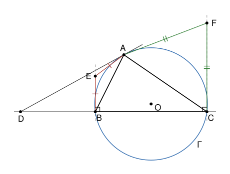

## Statement

Soit $ABC$ un triangle tel que $AB \neq AC$, et $\Gamma$ son cercle circonscrit. Soit $E$ le point tel que $AE = BE$ et $(BE)$ perpendiculaire à $(BC)$, et soit $F$ le point tel que $AF = CF$ et $(CF)$ perpendiculaire à $(BC)$. Soit $D$ le point de la droite $(BC)$ tel que la droite $(AD)$ soit tangente à $\Gamma$ en $A$.

Montrer que les points $D$, $E$ et $F$ sont alignés.

## Hints

1. Prends un repère orthonormé dont l'origine est le pied de la hauteur issue de $A$, avec $A(0\,;\,h)$, $B(-p\,;\,0)$ et $C(q\,;\,0)$.
2. Le point $E$ est sur la perpendiculaire à $(BC)$ en $B$, donc $E(-p\,;\,e)$. Écris $AE^2 = BE^2$ pour trouver $e$. Fais de même pour $F$.
3. La tangente en $A$ est perpendiculaire au rayon $[OA]$. Pour un point $M(x\,;\,0)$ de $(BC)$, calcule $OM^2 - OB^2$ : seule l'abscisse de $O$ intervient. Utilise ensuite le théorème de Pythagore dans le triangle $OAD$.
4. Vérifie que les vecteurs $\overrightarrow{ED}$ et $\overrightarrow{EF}$ sont colinéaires.

## Solution

### Étape 1 : le repère

On prend un repère orthonormé dont l'origine est le pied de la hauteur issue de $A$, dont l'axe des abscisses est $(BC)$ et l'axe des ordonnées cette hauteur :
$$A(0\,;\,h), \qquad B(-p\,;\,0), \qquad C(q\,;\,0) ,$$
avec $h > 0$ et $p + q > 0$ (le point $C$ est à droite de $B$). Les nombres $p$ et $q$ peuvent être négatifs, si le triangle a un angle obtus en $B$ ou en $C$.

L'hypothèse $AB \neq AC$ s'écrit $p^2 + h^2 \neq q^2 + h^2$, soit $(p - q)(p + q) \neq 0$. Comme $p + q > 0$, elle veut dire **$p \neq q$**.

### Étape 2 : les points $E$ et $F$

La perpendiculaire à $(BC)$ en $B$ est la droite d'équation $x = -p$, donc $E(-p\,;\,e)$ pour un certain réel $e$. Alors
$$AE^2 = p^2 + (e - h)^2 = p^2 + e^2 - 2eh + h^2, \qquad BE^2 = e^2 .$$
L'égalité $AE = BE$ donne $p^2 + h^2 - 2eh = 0$, donc
$$e = \frac{p^2 + h^2}{2h} .$$
De la même façon, $F(q\,;\,f)$ avec
$$f = \frac{q^2 + h^2}{2h} .$$

### Étape 3 : le point $D$

Soit $O(m\,;\,n)$ le centre de $\Gamma$. Il est sur la médiatrice de $[BC]$, donc $m$ est la moyenne de $-p$ et de $q$ : $2m = q - p$.

Pour un point $M(x\,;\,0)$ de la droite $(BC)$, on a
$$OM^2 - OB^2 = (x - m)^2 + n^2 - (-p - m)^2 - n^2 = (x - m)^2 - (p + m)^2 .$$
On factorise $a^2 - b^2 = (a - b)(a + b)$, et on utilise $p + 2m = q$ :
$$OM^2 - OB^2 = (x - m - p - m)(x - m + p + m) = (x - q)(x + p) .$$

La tangente à $\Gamma$ en $A$ est la perpendiculaire au rayon $(OA)$ en $A$. Un point $M$ de $(BC)$ est sur cette tangente exactement quand le triangle $OAM$ est rectangle en $A$, c'est-à-dire, par le théorème de Pythagore et sa réciproque, quand $OM^2 = OA^2 + AM^2$. Comme $OA = OB$, cela s'écrit
$$OM^2 - OB^2 = AM^2, \qquad \text{soit} \qquad (x - q)(x + p) = x^2 + h^2 .$$
On développe : $x^2 + (p - q)\,x - pq = x^2 + h^2$, donc $(p - q)\,x = h^2 + pq$. Comme $p \neq q$,
$$D\left(\frac{h^2 + pq}{p - q}\,;\,0\right) .$$
(Si l'on avait $p = q$, la tangente en $A$ serait parallèle à $(BC)$ et le point $D$ n'existerait pas. C'est le rôle de l'hypothèse $AB \neq AC$.)

### Étape 4 : l'alignement

On calcule les coordonnées des vecteurs $\overrightarrow{ED}$ et $\overrightarrow{EF}$. L'abscisse de $\overrightarrow{ED}$ est
$$\frac{h^2 + pq}{p - q} + p = \frac{h^2 + pq + p^2 - pq}{p - q} = \frac{p^2 + h^2}{p - q} = \frac{2he}{p - q} ,$$
et son ordonnée est $-e$. Pour $\overrightarrow{EF}$, l'abscisse est $q + p$ et l'ordonnée est
$$f - e = \frac{q^2 - p^2}{2h} = \frac{(q - p)(q + p)}{2h} .$$

Le déterminant de ces deux vecteurs vaut
$$\frac{2he}{p - q} \times \frac{(q - p)(q + p)}{2h} - (-e) \times (q + p) = -e\,(q + p) + e\,(q + p) = 0 .$$
Les vecteurs $\overrightarrow{ED}$ et $\overrightarrow{EF}$ sont colinéaires. **Les points $D$, $E$ et $F$ sont alignés.**

## Going further

- Le cercle de centre $E$ et de rayon $EB$ passe par $A$ et il est tangent à $(BC)$ en $B$. Que dire du cercle de centre $F$ et de rayon $FC$ ?
- Une preuve sans repère. Montre d'abord que $EB = AB^2/(2h)$ et $FC = AC^2/(2h)$, où $h$ est la longueur de la hauteur issue de $A$. Avec le théorème de l'angle entre la tangente et la corde, montre que les triangles $DBA$ et $DAC$ sont semblables, et déduis-en $DB/DC = AB^2/AC^2$. Conclus avec le théorème de Thalès.
