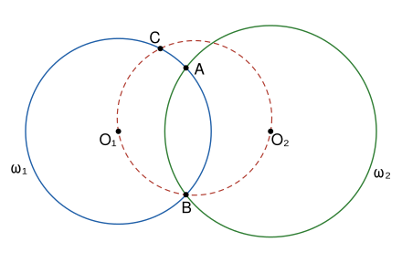

## Statement

Soit $\omega_1$ et $\omega_2$ deux cercles de centres $O_1$ et $O_2$, qui se coupent en deux points $A$ et $B$. On suppose que $O_2$ n'est pas sur la droite $(AB)$. Le cercle qui passe par $O_1$, $O_2$ et $B$ recoupe le cercle $\omega_1$ en un point $C$, autre que $B$.

Montrer que les points $C$, $A$ et $O_2$ sont alignés.

## Hints

1. Pourquoi la droite $(O_1O_2)$ est-elle la médiatrice de $[AB]$ ? Prends un repère orthonormé d'origine le milieu de $[AB]$, avec $A(0\,;\,a)$, $B(0\,;\,-a)$, $O_1(p\,;\,0)$ et $O_2(q\,;\,0)$.
2. Au lieu de partir de $C$, pars de la droite $(AO_2)$ : soit $C'$ le second point où elle coupe $\omega_1$. Il suffit de montrer que $C' = C$.
3. Les points de la droite $(AO_2)$ s'écrivent $M$ avec $\overrightarrow{AM} = t\,\overrightarrow{AO_2}$. Pour quelles valeurs de $t$ a-t-on $O_1M = O_1A$ ?
4. Calcule les coordonnées du centre $W$ du cercle qui passe par $O_1$, $O_2$ et $B$, puis vérifie que $WC' = WB$.

## Solution

**Rappel.** Deux cercles distincts ont au plus deux points communs.

On note $\Gamma$ le cercle qui passe par $O_1$, $O_2$ et $B$.

### Étape 1 : le repère

Le point $O_1$ est le centre de $\omega_1$, qui passe par $A$ et $B$, donc $O_1A = O_1B$ : le point $O_1$ est sur la médiatrice de $[AB]$. De même pour $O_2$. Les deux centres sont distincts, puisque deux cercles de même centre qui ont un point commun sont égaux. Donc **la droite $(O_1O_2)$ est la médiatrice de $[AB]$**.

On prend un repère orthonormé dont l'origine est le milieu de $[AB]$, dont l'axe des abscisses est $(O_1O_2)$ et l'axe des ordonnées $(AB)$ :
$$A(0\,;\,a), \qquad B(0\,;\,-a), \qquad O_1(p\,;\,0), \qquad O_2(q\,;\,0),$$
avec $a > 0$ et $p \neq q$. Le point $O_2$ n'est pas sur $(AB)$, qui est l'axe des ordonnées, donc **$q \neq 0$**.

On pose
$$n = q^2 + a^2 \qquad \text{et} \qquad s = pq + a^2 .$$
On a $n > 0$, et le rayon de $\omega_1$ vérifie $O_1A^2 = p^2 + a^2$.

### Étape 2 : le point $C'$

Le vecteur $\overrightarrow{AO_2}$ a pour coordonnées $(q\,;\,-a)$. Les points $M$ de la droite $(AO_2)$ sont ceux tels que $\overrightarrow{AM} = t\,\overrightarrow{AO_2}$, avec $t$ réel, c'est-à-dire $M(tq\,;\,a - ta)$. Alors
$$O_1M^2 = (tq - p)^2 + (a - ta)^2 = t^2 q^2 - 2tpq + p^2 + a^2 - 2ta^2 + t^2 a^2 = t^2 n - 2ts + p^2 + a^2 .$$
Le point $M$ est sur $\omega_1$ exactement quand $O_1M^2 = p^2 + a^2$, c'est-à-dire quand $t\,(tn - 2s) = 0$. La valeur $t = 0$ donne le point $A$. L'autre valeur est
$$t_0 = \frac{2s}{n}, \qquad \text{et l'on retiendra que} \qquad t_0\, n = 2s .$$
On note $C'$ le point qui correspond à $t_0$ : c'est le second point d'intersection de la droite $(AO_2)$ avec $\omega_1$, et
$$C'(t_0 q\,;\,a - t_0 a) .$$
(Si $s = 0$, alors $t_0 = 0$ et $C' = A$ : la droite $(AO_2)$ est alors tangente à $\omega_1$ en $A$.)

### Étape 3 : le centre de $\Gamma$

Le centre $W(m\,;\,k)$ de $\Gamma$ est à égale distance de $O_1$ et de $O_2$, donc sur la médiatrice de $[O_1O_2]$, qui est la droite verticale passant par le milieu de $[O_1O_2]$ : $2m = p + q$.

Il est aussi à égale distance de $O_2$ et de $B$ :
$$(m - q)^2 + k^2 = m^2 + (k + a)^2 \quad \Longleftrightarrow \quad q^2 - 2mq = 2ak + a^2 .$$
Avec $2m = p + q$, le membre de gauche vaut $q^2 - pq - q^2 = -pq$. Donc $2ak = -pq - a^2$, c'est-à-dire
$$2ak = -s .$$

### Étape 4 : le point $C'$ est sur $\Gamma$

Pour un point $M(x\,;\,y)$, on développe :
$$WM^2 - WB^2 = (x - m)^2 + (y - k)^2 - m^2 - (k + a)^2 = x^2 + y^2 - 2mx - 2ky - 2ak - a^2 .$$
On calcule chaque terme pour $M = C'$, avec $x = t_0 q$ et $y = a\,(1 - t_0)$.

- $x^2 + y^2 = t_0^2 q^2 + a^2 - 2t_0 a^2 + t_0^2 a^2 = t_0\,(t_0 n) - 2t_0 a^2 + a^2 = 2st_0 - 2t_0a^2 + a^2 = 2pq\,t_0 + a^2$, car $s - a^2 = pq$.
- $2mx = (p + q)\,t_0 q = pq\,t_0 + q^2 t_0$.
- $2ky = 2ak\,(1 - t_0) = -s + s\,t_0$.
- $2ak = -s$.

On rassemble :
$$WC'^2 - WB^2 = 2pq\,t_0 + a^2 - pq\,t_0 - q^2 t_0 + s - s\,t_0 + s - a^2 = t_0\,(pq - q^2 - s) + 2s .$$
Or $pq - q^2 - s = -q^2 - a^2 = -n$, donc
$$WC'^2 - WB^2 = -t_0\, n + 2s = 0 .$$
Ainsi $WC' = WB$ : **le point $C'$ est sur le cercle $\Gamma$.**

### Étape 5 : conclusion

Le point $C'$ n'est pas $B$. En effet, si $C' = B$, son abscisse $t_0 q$ serait nulle, donc $t_0 = 0$ puisque $q \neq 0$, et son ordonnée vaudrait $a$, alors que celle de $B$ vaut $-a$.

Les cercles $\Gamma$ et $\omega_1$ sont distincts : $O_1$ est sur $\Gamma$, mais pas sur $\omega_1$, dont il est le centre. D'après le rappel, ils ont au plus deux points communs, et ces deux points sont $B$ et $C$. Le point $C'$ est un point commun aux deux cercles et il n'est pas $B$, donc $C' = C$.

Le point $C'$ est sur la droite $(AO_2)$ par construction. **Les points $C$, $A$ et $O_2$ sont donc alignés.**

## Going further

- Que se passe-t-il quand $O_2$ est le milieu de $[AB]$ ? Montre qu'alors $\Gamma$ est le cercle de diamètre $[O_1B]$, et qu'il ne touche $\omega_1$ qu'au point $B$.
- Une preuve avec les angles. Dans le cas de la figure, montre que les triangles $O_1AC$ et $O_1AB$ sont isocèles, que $\widehat{O_1AO_2} = \widehat{O_1BO_2}$ par la symétrie d'axe $(O_1O_2)$, et déduis-en que $\widehat{O_2C'O_1} + \widehat{O_2BO_1} = 180°$.
- Soit $D$ le second point d'intersection de la droite $(O_1A)$ avec $\omega_2$. Montre que $D$ est lui aussi sur le cercle $\Gamma$.
