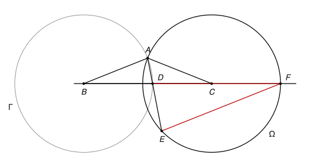

## Statement

$ABC$ est un triangle isocèle en $A$, dont l'angle en $A$ est obtus (plus grand que $90^\circ$).

- $\Gamma$ est le cercle de centre $B$ qui passe par $A$ ;
- $\Omega$ est le cercle de centre $C$ qui passe par $A$.

Le cercle $\Gamma$ coupe le segment $[BC]$ en un point $D$. La droite $(AD)$ recoupe le cercle $\Omega$ en un point $E$. Enfin, la droite $(BC)$ coupe le cercle $\Omega$ en deux points ; on appelle $F$ celui qui n'est pas sur le segment $[BC]$.

Montrer que le triangle $DEF$ est isocèle en $F$.

## Hints

1. Appelez $\beta$ l'angle $\widehat{ABC}$ (qui est aussi l'angle $\widehat{ACB}$) et exprimez tous les angles utiles en fonction de $\beta$.
2. Le triangle $BAD$ est isocèle : en quel sommet ? Déduisez-en l'angle $\widehat{BDA}$, puis l'angle $\widehat{EDF}$.
3. Pour l'angle $\widehat{DEF}$, c'est-à-dire $\widehat{AEF}$, servez-vous du cercle $\Omega$ : les points $A$, $E$, $F$ sont dessus, et son centre est $C$. Que vaut l'angle au centre $\widehat{ACF}$ ?

## Solution

*Rappel (théorème de l'angle inscrit).* Si $A$, $E$, $F$ sont trois points d'un cercle de centre $C$, et si $E$ et $C$ sont du même côté de la droite $(AF)$, alors l'angle inscrit $\widehat{AEF}$ vaut la moitié de l'angle au centre $\widehat{ACF}$.

Notons $\beta = \widehat{ABC}$. Le triangle est isocèle en $A$, donc on a aussi $\widehat{ACB} = \beta$.

**Étape 1 : l'angle en $D$.**

Le point $D$ est sur le cercle $\Gamma$ de centre $B$ passant par $A$, donc $BD = BA$ : le triangle $BAD$ est isocèle en $B$. Ses deux angles à la base sont égaux, et leur somme vaut $180^\circ - \beta$, donc

$$\widehat{BDA} = \frac{180^\circ - \beta}{2} = 90^\circ - \frac{\beta}{2}.$$

Le point $D$ est entre $B$ et $F$ (le point $D$ est sur le segment $[BC]$ et $F$ est au-delà de $C$). Il est aussi entre $A$ et $E$ : en effet $D$ est à l'intérieur du cercle $\Omega$, car $CD = CB - BD = CB - CA$, qui est plus petit que le rayon $CA$ (on a bien $CB < 2\,CA$ par l'inégalité triangulaire, puisque $CB < CA + AB = 2\,CA$). La droite $(AD)$ entre donc dans le disque en $A$, passe par $D$, et en ressort en $E$.

Les angles $\widehat{EDF}$ et $\widehat{ADB}$ sont donc opposés par le sommet, et ils sont égaux :

$$\widehat{EDF} = 90^\circ - \frac{\beta}{2}.$$

**Étape 2 : l'angle en $E$.**

Les points $A$, $E$ et $F$ sont sur le cercle $\Omega$ de centre $C$.

L'angle au centre $\widehat{ACF}$ : le point $C$ est entre $B$ et $F$, donc $\widehat{ACF} = 180^\circ - \widehat{ACB} = 180^\circ - \beta$.

Le point $C$ est sous la droite $(AF)$ sur la figure, et le point $E$ aussi (il est même sous la droite $(BC)$, puisque la droite $(AD)$ traverse $(BC)$ en $D$). Par le théorème de l'angle inscrit,

$$\widehat{AEF} = \frac{\widehat{ACF}}{2} = \frac{180^\circ - \beta}{2} = 90^\circ - \frac{\beta}{2}.$$

Comme $D$ est sur le segment $[AE]$, l'angle $\widehat{DEF}$ est le même que $\widehat{AEF}$.

**Conclusion.**

Dans le triangle $DEF$, on a trouvé

$$\widehat{EDF} = 90^\circ - \frac{\beta}{2} = \widehat{DEF}.$$

Un triangle qui a deux angles égaux est isocèle : les deux côtés opposés à ces angles sont égaux, donc $FD = FE$. Le triangle $DEF$ est isocèle en $F$.

## Going further

1. Montrer que $FD = BC$.
2. L'hypothèse « obtus » sert surtout à bien placer la figure. Pour quels triangles isocèles en $A$ le point $D$ existe-t-il sur le segment $[BC]$ ? La conclusion reste-t-elle vraie pour tous ces triangles ?
