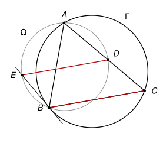

## Statement

Soit $ABC$ un triangle et $\Gamma$ son cercle circonscrit. Soit $\Omega$ un autre cercle qui passe lui aussi par les points $A$ et $B$.

La droite $(AC)$ recoupe le cercle $\Omega$ en un point $D$, et la tangente au cercle $\Gamma$ en $B$ recoupe le cercle $\Omega$ en un point $E$.

Montrer que les droites $(BC)$ et $(DE)$ sont parallèles.

## Hints

1. Pour montrer que deux droites sont parallèles, cherchez deux angles correspondants égaux, par exemple pour la sécante $(AC)$ : comparez $\widehat{EDA}$ et $\widehat{BCA}$.
2. La droite $(BE)$ est tangente à $\Gamma$ et $[BA]$ est une corde de $\Gamma$. L'angle $\widehat{EBA}$ est égal à un angle inscrit de $\Gamma$. Lequel ?
3. Les quatre points $A$, $B$, $D$, $E$ sont sur le cercle $\Omega$. Quel angle de sommet $D$ est égal à $\widehat{EBA}$ ?

## Solution

*Rappels.*

- *Angle inscrit.* Si $X$ et $Y$ sont deux points d'un cercle, tous les angles $\widehat{XMY}$, où $M$ parcourt le cercle d'un même côté de la droite $(XY)$, sont égaux.
- *Angle entre une tangente et une corde.* Si une droite est tangente en $B$ à un cercle et si $[BA]$ est une corde, l'angle entre la tangente et la corde est égal à l'angle inscrit $\widehat{BCA}$, pour tout point $C$ du cercle situé de l'autre côté de la corde. C'est le cas limite du théorème de l'angle inscrit, quand un côté de l'angle devient tangent.

On raisonne dans la disposition de la figure : $D$ est sur le segment $[AC]$, le point $E$ est de l'autre côté de la droite $(AB)$ que $C$, et les points $B$ et $D$ sont du même côté de la droite $(AE)$.

**Étape 1 : la tangente.** La droite $(BE)$ est tangente au cercle $\Gamma$ en $B$, et $[BA]$ est une corde de $\Gamma$. Le point $C$ est sur $\Gamma$, de l'autre côté de $(AB)$ que $E$. D'après le second rappel :

$$\widehat{EBA} = \widehat{BCA}.$$

**Étape 2 : le cercle $\Omega$.** Les points $B$ et $D$ sont sur $\Omega$, du même côté de la corde $[AE]$. Les angles inscrits $\widehat{EBA}$ et $\widehat{EDA}$ interceptent la même corde, donc

$$\widehat{EDA} = \widehat{EBA}.$$

**Étape 3 : conclusion.** Des deux étapes on tire

$$\widehat{EDA} = \widehat{BCA}.$$

Regardons ces deux angles sur la sécante $(AC)$. Comme $D$ est entre $A$ et $C$, les demi-droites $[DA)$ et $[CA)$ vont dans le même sens. Les points $E$ et $B$ sont du même côté de $(AC)$. Les angles $\widehat{EDA}$ et $\widehat{BCA}$ sont donc des angles correspondants pour les droites $(DE)$ et $(CB)$ coupées par la sécante $(AC)$. Ils sont égaux, donc

$$(DE) \parallel (BC).$$

*Remarque.* Si les points sont placés autrement, par exemple si $D$ tombe au-delà de $C$, ou si $B$ et $D$ sont de part et d'autre de $(AE)$, l'un des angles ci-dessus est remplacé par son supplément ($\widehat{EDA} = 180° - \widehat{EBA}$ quand $ABED$ est un quadrilatère inscrit non croisé), et le même raisonnement conclut avec des angles alternes-internes ou supplémentaires. Les correcteurs signalent que beaucoup de copies ne traitaient que leur propre figure. La question 1 de la partie suivante donne une preuve qui marche dans toutes les dispositions d'un seul coup.

## Going further

1. On suppose que les droites $(AC)$ et $(BE)$ se coupent en un point $X$. Montrer que $XA \times XD = XB \times XE$ (en comparant les triangles $XAB$ et $XED$), puis que $XB^2 = XA \times XC$ (en comparant les triangles $XBA$ et $XCB$). En déduire que $\frac{XD}{XC} = \frac{XE}{XB}$, et conclure avec la réciproque du théorème de Thalès.
2. Que se passe-t-il quand $(AC)$ et $(BE)$ sont parallèles ?
