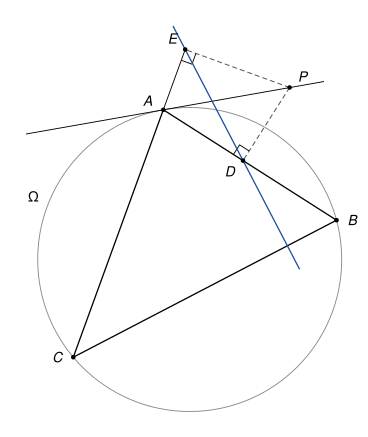

## Statement

Soit $ABC$ un triangle et $\Omega$ son cercle circonscrit. Soit $P$ un point de la tangente à $\Omega$ en $A$, distinct de $A$.

On note $D$ et $E$ les projetés orthogonaux du point $P$ sur les droites $(AB)$ et $(AC)$.

Montrer que les droites $(DE)$ et $(BC)$ sont perpendiculaires.

## Hints

1. Les angles $\widehat{ADP}$ et $\widehat{AEP}$ sont droits. Quel cercle passe par les quatre points $A$, $D$, $P$, $E$ ?
2. Dans ce cercle, l'angle $\widehat{DEP}$ est égal à un angle de sommet $A$. Puis, avec la tangente : l'angle entre la tangente $(AP)$ et la corde $[AB]$ est égal à un angle inscrit de $\Omega$. Lequel ?
3. Appelez $M$ le point où $(DE)$ coupe $(BC)$, calculez l'angle $\widehat{MEC}$ et faites la somme des angles du triangle $EMC$.

## Solution

*Rappels.*

- *Cercle de diamètre.* Si l'angle $\widehat{XMY}$ est droit, le point $M$ est sur le cercle de diamètre $[XY]$.
- *Angle inscrit.* Si $X$ et $Y$ sont deux points d'un cercle, tous les angles $\widehat{XMY}$, où $M$ parcourt le cercle d'un même côté de la droite $(XY)$, sont égaux.
- *Angle entre une tangente et une corde.* Si une droite est tangente en $A$ à un cercle et si $[AB]$ est une corde, l'angle entre la tangente et la corde est égal à l'angle inscrit $\widehat{ACB}$, pour tout point $C$ du cercle situé de l'autre côté de la corde.

On raisonne dans la disposition de la figure : $AB < AC$, le point $P$ est sur la demi-tangente du côté de $B$, le point $D$ est sur le segment $[AB]$, et le point $E$ est sur le prolongement de $[CA]$ au-delà de $A$. On appelle $M$ le point d'intersection des droites $(DE)$ et $(BC)$.

![La même figure avec le cercle de diamètre [AP], qui passe par D et E, et le point M](10214-figure-2.svg)

**Étape 1 : un cercle.** Les angles $\widehat{ADP}$ et $\widehat{AEP}$ sont droits, donc $D$ et $E$ sont sur le cercle de diamètre $[AP]$. Les quatre points $A$, $D$, $P$, $E$ sont sur un même cercle.

**Étape 2 : deux angles égaux dans ce cercle.** Les angles $\widehat{DEP}$ et $\widehat{DAP}$ interceptent la même corde $[DP]$, et $E$ et $A$ sont du même côté de $(DP)$. Donc

$$\widehat{DEP} = \widehat{DAP}.$$

**Étape 3 : la tangente.** Comme $D$ est sur $[AB]$, $\widehat{DAP} = \widehat{BAP}$. C'est l'angle entre la tangente $(AP)$ et la corde $[AB]$, et $C$ est de l'autre côté de $(AB)$ que $P$. Donc $\widehat{BAP} = \widehat{ACB}$, et finalement

$$\widehat{DEP} = \widehat{ACB}.$$

**Étape 4 : l'angle en $E$.** L'angle $\widehat{AEP}$ est droit, et la demi-droite $[ED)$ est entre $[EA)$ et $[EP)$. Donc

$$\widehat{DEA} = 90^\circ - \widehat{DEP} = 90^\circ - \widehat{ACB}.$$

Comme $A$ est entre $E$ et $C$, les demi-droites $[EA)$ et $[EC)$ sont les mêmes, et $M$ est sur la demi-droite $[ED)$. Donc $\widehat{MEC} = \widehat{DEA} = 90^\circ - \widehat{ACB}$.

**Étape 5 : conclusion.** Dans le triangle $EMC$, l'angle en $C$ est $\widehat{MCE} = \widehat{BCA}$. La somme des angles donne

$$\widehat{EMC} = 180^\circ - \left(90^\circ - \widehat{ACB}\right) - \widehat{ACB} = 90^\circ.$$

Les droites $(DE)$ et $(BC)$ sont perpendiculaires.

*Remarque.* Pour une autre position de $P$, ou si $AB > AC$, les points $D$ et $E$ changent de place sur les droites $(AB)$ et $(AC)$, mais la même chasse aux angles marche, avec parfois un angle remplacé par son supplément. Il est bon de refaire la figure dans un autre cas pour le vérifier.

## Going further

1. Quand $P$ se déplace sur la tangente, que peut-on dire de toutes les droites $(DE)$ obtenues ?
2. Refaire la chasse aux angles quand $P$ est sur l'autre demi-tangente, du côté de $C$. Quels angles changent ?
