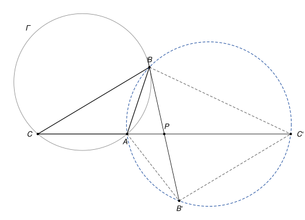

## Statement

Soit $ABC$ un triangle tel que $BA \neq BC$, et soit $\Gamma$ son cercle circonscrit. La tangente au cercle $\Gamma$ au point $B$ coupe la droite $(AC)$ en un point $P$.

On note $B'$ et $C'$ les symétriques respectifs des points $B$ et $C$ par rapport au point $P$.

Montrer que les quatre points $B$, $A$, $B'$ et $C'$ sont sur un même cercle.

## Hints

1. Le point $P$ est le milieu de $[BB']$ et de $[CC']$. Les longueurs $PB'$ et $PC'$ sont donc faciles à connaître.
2. Comparez les triangles $PBA$ et $PCB$ (dans la disposition de la figure). Ils ont un angle commun en $P$, et la tangente fournit une deuxième paire d'angles égaux. Qu'obtient-on sur les longueurs $PA$, $PB$, $PC$ ?
3. Montrez que $PA \times PC' = PB \times PB'$, puis comparez les triangles $PAB$ et $PB'C'$.

## Solution

*Rappels.*

- *Angle entre une tangente et une corde.* Si une droite est tangente en $B$ à un cercle et si $[BX]$ est une corde, l'angle entre la tangente et la corde est égal à l'angle inscrit $\widehat{BYX}$, pour tout point $Y$ du cercle situé de l'autre côté de la corde.
- *Triangles semblables.* Deux triangles qui ont deux angles égaux sont semblables, et leurs côtés sont alors proportionnels. Deux triangles qui ont un angle égal compris entre deux côtés proportionnels sont semblables, et leurs angles sont alors égaux.
- *Quatre points sur un cercle.* Si $M$ et $N$ sont du même côté de la droite $(XY)$ et si $\widehat{XMY} = \widehat{XNY}$, alors $X$, $Y$, $M$, $N$ sont sur un même cercle.

**Étape 0 : où est $P$ ?** Le point $P$ est sur la tangente en $B$ et différent de $B$, donc il est à l'extérieur du cercle $\Gamma$. Or le segment $[AC]$ est une corde, il est à l'intérieur du disque. Donc $P$ n'est pas entre $A$ et $C$ : les points $A$ et $C$ sont du même côté de $P$ sur la droite $(AC)$.

**Étape 1 : $PB^2 = PA \times PC$.** Dans cette étape, $A$ et $C$ jouent le même rôle. Supposons par exemple que $A$ est entre $C$ et $P$, comme sur la figure (dans l'autre cas, on échange les lettres $A$ et $C$ dans cette étape seulement).

Comparons les triangles $PBA$ et $PCB$. Ils ont le même angle en $P$, car $A$ et $C$ sont sur la même demi-droite issue de $P$. De plus, la droite $(PB)$ est tangente à $\Gamma$ en $B$ et $[BA]$ est une corde. Le point $C$ est de l'autre côté de $(AB)$ que $P$, puisque $A$ est entre $C$ et $P$. D'après le premier rappel,

$$\widehat{PBA} = \widehat{BCA} = \widehat{PCB}.$$

Les deux triangles ont deux angles égaux, ils sont semblables, avec $B \leftrightarrow C$ et $A \leftrightarrow B$. Leurs côtés sont proportionnels :

$$\frac{PB}{PC} = \frac{PA}{PB}, \qquad \text{donc} \qquad PB^2 = PA \times PC.$$

**Étape 2 : un produit égal.** Comme $P$ est le milieu de $[BB']$ et de $[CC']$, on a $PB' = PB$ et $PC' = PC$. L'étape 1 devient

$$PA \times PC' = PB \times PB'.$$

De plus, $P$ est entre $B$ et $B'$, et $P$ est entre $A$ et $C'$, puisque $C'$ est de l'autre côté de $P$ que $C$, donc que $A$.

**Étape 3 : deux triangles semblables.** Comparons les triangles $PAB$ et $PB'C'$. Les angles $\widehat{APB}$ et $\widehat{B'PC'}$ sont opposés par le sommet, donc égaux. L'égalité de l'étape 2 s'écrit

$$\frac{PA}{PB'} = \frac{PB}{PC'}.$$

L'angle égal est compris entre deux côtés proportionnels : les triangles $PAB$ et $PB'C'$ sont semblables, avec $A \leftrightarrow B'$ et $B \leftrightarrow C'$. Donc $\widehat{PAB} = \widehat{PB'C'}$, c'est-à-dire

$$\widehat{C'AB} = \widehat{BB'C'}.$$

**Étape 4 : conclusion.** Les segments $[AC']$ et $[BB']$ se coupent en $P$, donc $A$, $B$, $C'$, $B'$ forment, dans cet ordre, un quadrilatère convexe dont ce sont les diagonales. En particulier $A$ et $B'$ sont du même côté de la droite $(BC')$. Les angles $\widehat{BAC'}$ et $\widehat{BB'C'}$ sont égaux et regardent le segment $[BC']$ du même côté. D'après le dernier rappel, les points $B$, $A$, $B'$, $C'$ sont sur un même cercle.

*Remarque.* Dans la disposition de la figure, il y a un chemin plus court. Le quadrilatère $CBC'B'$ a des diagonales qui se coupent en leur milieu $P$ : c'est un parallélogramme, donc $\widehat{AC'B'} = \widehat{ACB}$. La tangente donne $\widehat{ABP} = \widehat{ACB}$. Donc $\widehat{ABB'} = \widehat{AC'B'}$, et on conclut avec le dernier rappel. Mais quand $BA > BC$, le point $P$ est du côté de $C$, et il faut refaire ce raisonnement avec d'autres angles. La preuve par les longueurs marche dans tous les cas d'un coup.

## Going further

1. Le nombre $PA \times PC$ s'appelle la *puissance* du point $P$ par rapport au cercle $\Gamma$. Montrer que pour toute droite passant par $P$ et coupant $\Gamma$ en deux points $U$ et $V$, on a $PU \times PV = PB^2$.
2. Soit $O$ le centre de $\Gamma$. Montrer que le centre du cercle qui passe par $B$, $A$, $B'$, $C'$ est sur la droite qui passe par $P$ et qui est parallèle à $(OB)$.
