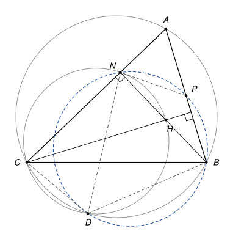

## Statement

Soit $ABC$ un triangle dont les trois angles sont aigus, et tel que $AC > BC$. On note $H$ son orthocentre, $N$ le pied de la hauteur issue de $B$, et $P$ le milieu du segment $[AB]$.

Le cercle circonscrit au triangle $ABC$ et le cercle circonscrit au triangle $CNH$ se coupent en $C$ et en un second point $D$.

Montrer que les quatre points $D$, $N$, $P$ et $B$ sont sur un même cercle.

![Le triangle ABC, ses hauteurs issues de B et de C qui se coupent en H, le milieu P de [AB], et les cercles circonscrits à ABC et à CNH qui se recoupent en D](10222-figure-1.svg)

## Hints

1. On ne voit pas de lien direct entre $P$ et $D$. Il vaut mieux montrer que les angles $\widehat{NPB}$ et $\widehat{NDB}$ ont une somme de $180°$.
2. Pour $\widehat{NPB}$ : le triangle $ANB$ est rectangle en $N$, et $P$ est le milieu de son hypoténuse. Que peut-on dire du triangle $PAN$ ? Exprimez $\widehat{NPB}$ à l'aide de l'angle $\widehat{BAC}$.
3. Pour $\widehat{NDB}$, écrivez-le comme $\widehat{CDB} - \widehat{CDN}$ et utilisez chacun des deux cercles.

## Solution

*Rappels.*

- *Angle inscrit.* Si $X$ et $Y$ sont deux points d'un cercle, tous les angles $\widehat{XMY}$, où $M$ parcourt le cercle d'un même côté de la droite $(XY)$, sont égaux.
- *Quadrilatère inscrit.* Si $U$ et $V$ sont sur un cercle de part et d'autre de la corde $[XY]$, alors $\widehat{XUY} + \widehat{XVY} = 180°$. Réciproquement, si $U$ et $V$ sont de part et d'autre de la droite $(XY)$ et si $\widehat{XUY} + \widehat{XVY} = 180°$, les quatre points $X$, $Y$, $U$, $V$ sont sur un même cercle.
- Dans un triangle rectangle, le milieu de l'hypoténuse est à la même distance des trois sommets.

On note $\alpha = \widehat{BAC}$. On raisonne dans la disposition de la figure : l'hypothèse $AC > BC$ place $D$ sur l'arc $BC$ qui ne contient pas $A$, et $D$ est du même côté de $(AC)$ que $H$.

**Étape 1 : l'angle $\widehat{NPB}$.** Le triangle $ANB$ est rectangle en $N$, et $P$ est le milieu de son hypoténuse $[AB]$. D'après le dernier rappel, $PA = PN$ : le triangle $PAN$ est isocèle en $P$, et $\widehat{PNA} = \widehat{PAN} = \alpha$. L'angle $\widehat{NPB}$ est un angle extérieur du triangle $PAN$ (car $B$ est sur le prolongement de $[AP]$), il est donc égal à la somme des deux autres angles :

$$\widehat{NPB} = \widehat{PAN} + \widehat{PNA} = 2\alpha.$$

**Étape 2 : l'angle $\widehat{CDB}$.** Les points $A$, $B$, $D$, $C$ sont sur le cercle circonscrit à $ABC$, et $A$ et $D$ sont de part et d'autre de la corde $[BC]$. D'après le deuxième rappel :

$$\widehat{CDB} = 180° - \widehat{CAB} = 180° - \alpha.$$

**Étape 3 : l'angle $\widehat{CDN}$.** Les points $C$, $N$, $H$, $D$ sont sur un même cercle, et $H$ et $D$ sont du même côté de la corde $[CN]$. D'après le premier rappel, $\widehat{CDN} = \widehat{CHN}$.

Calculons $\widehat{CHN}$. Notons $F$ le pied de la hauteur issue de $C$, qui passe par $H$. Le triangle $AFC$ est rectangle en $F$, donc $\widehat{ACF} = 90° - \alpha$, c'est-à-dire $\widehat{HCN} = 90° - \alpha$. Le triangle $CNH$ est rectangle en $N$, donc

$$\widehat{CHN} = 90° - \widehat{HCN} = 90° - (90° - \alpha) = \alpha.$$

Ainsi $\widehat{CDN} = \alpha$.

**Étape 4 : l'angle $\widehat{NDB}$.** Dans la disposition de la figure, la demi-droite $[DN)$ est à l'intérieur de l'angle $\widehat{CDB}$, donc

$$\widehat{NDB} = \widehat{CDB} - \widehat{CDN} = (180° - \alpha) - \alpha = 180° - 2\alpha.$$

**Conclusion.** On a $\widehat{NPB} + \widehat{NDB} = 2\alpha + (180° - 2\alpha) = 180°$, et les points $P$ et $D$ sont de part et d'autre de la droite $(NB)$. D'après la réciproque du deuxième rappel, les points $D$, $N$, $P$, $B$ sont sur un même cercle.

*Remarque.* Le résultat reste vrai quand $AC < BC$, mais $D$ change de place (il passe sur l'arc qui contient $A$) et certains angles ci-dessus sont remplacés par leurs suppléments. Les correcteurs signalent aussi que plusieurs copies utilisaient sans le démontrer que $D$, $H$ et $P$ sont alignés : c'est vrai, mais il faut le prouver, et la preuve ci-dessus n'en a pas besoin.

## Going further

1. Montrer que $\widehat{CDH} = 90°$. En déduire que la droite $(DH)$ recoupe le cercle circonscrit à $ABC$ au point diamétralement opposé à $C$.
2. Soit $C'$ ce point diamétralement opposé à $C$. Montrer que $AHBC'$ est un parallélogramme, puis que $D$, $H$ et $P$ sont alignés.
