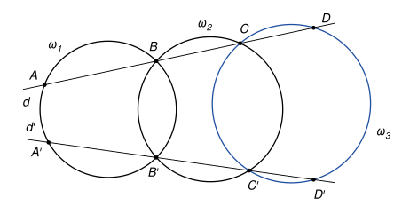
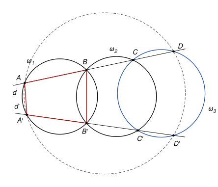

## Statement

Deux cercles $\omega_1$ et $\omega_2$ se coupent en deux points $B$ et $B'$.

- Une droite $d$ passant par $B$ recoupe $\omega_1$ en $A$ et $\omega_2$ en $C$.
- Une droite $d'$ passant par $B'$ recoupe $\omega_1$ en $A'$ et $\omega_2$ en $C'$.
- Un cercle $\omega_3$ passe par $C$ et $C'$. Il recoupe la droite $d$ en $D$ et la droite $d'$ en $D'$.

Montrer que les points $A$, $A'$, $D$ et $D'$ sont sur un même cercle.

## Hints

1. Le quadrilatère $ABB'A'$ est inscrit dans le cercle $\omega_1$. Quelle relation lie ses angles en $A'$ et en $B$ ?
2. Faites de même avec le quadrilatère $BCC'B'$ inscrit dans $\omega_2$, puis avec $CDD'C'$ inscrit dans $\omega_3$. Les angles $\widehat{ABB'}$ et $\widehat{CBB'}$ sont supplémentaires, car $A$, $B$, $C$ sont alignés.
3. Montrez que $\widehat{AA'D'} + \widehat{ADD'} = 180°$.

## Solution

*Rappel.* *Quadrilatère inscrit.* Si $U$ et $V$ sont sur un cercle, de part et d'autre de la corde $[XY]$, alors $\widehat{XUY} + \widehat{XVY} = 180°$. Autrement dit, dans un quadrilatère convexe inscrit dans un cercle, deux angles opposés ont pour somme $180°$. Réciproquement, si un quadrilatère convexe a deux angles opposés de somme $180°$, ses quatre sommets sont sur un même cercle.

On raisonne dans la disposition de la figure : les points sont dans l'ordre $A$, $B$, $C$, $D$ sur la droite $d$ et dans l'ordre $A'$, $B'$, $C'$, $D'$ sur la droite $d'$, et les droites $d$ et $d'$ ne se coupent pas entre ces points. Les quadrilatères $ABB'A'$, $BCC'B'$, $CDD'C'$ et $ADD'A'$ sont alors convexes.

**Étape 1 : le cercle $\omega_1$.** Le quadrilatère $ABB'A'$ est inscrit dans $\omega_1$, donc

$$\widehat{AA'B'} = 180° - \widehat{ABB'}.$$

**Étape 2 : le cercle $\omega_2$.** Le quadrilatère $BCC'B'$ est inscrit dans $\omega_2$, donc $\widehat{CC'B'} = 180° - \widehat{CBB'}$. Comme $B$ est entre $A$ et $C$, les angles $\widehat{ABB'}$ et $\widehat{CBB'}$ sont supplémentaires : $180° - \widehat{CBB'} = \widehat{ABB'}$. Donc

$$\widehat{CC'B'} = \widehat{ABB'}.$$

**Étape 3 : le cercle $\omega_3$.** Le même raisonnement dans le quadrilatère $CDD'C'$, inscrit dans $\omega_3$, avec $C'$ entre $B'$ et $D'$, donne

$$\widehat{CDD'} = 180° - \widehat{CC'D'} = \widehat{CC'B'}.$$

**Étape 4 : conclusion.** Le point $D'$ est sur la demi-droite $[A'B')$ et le point $A$ sur la demi-droite $[DC)$, donc $\widehat{AA'D'} = \widehat{AA'B'}$ et $\widehat{ADD'} = \widehat{CDD'}$. Avec les trois étapes :

$$\widehat{AA'D'} = 180° - \widehat{ABB'} = 180° - \widehat{CC'B'} = 180° - \widehat{CDD'} = 180° - \widehat{ADD'}.$$

Les angles opposés en $A'$ et en $D$ du quadrilatère convexe $AA'D'D$ ont donc pour somme $180°$. D'après la réciproque du rappel, **les points $A$, $A'$, $D$ et $D'$ sont sur un même cercle.**

*Remarque.* Les étapes 1 et 2 montrent au passage que $\widehat{AA'B'} + \widehat{CC'B'} = 180°$ : les droites $(AA')$ et $(CC')$ sont parallèles (angles de même côté de la sécante $d'$). De même, les étapes 2 et 3 donnent $(BB') \parallel (DD')$. Dans d'autres dispositions des points, certains angles sont remplacés par leurs suppléments et le même calcul conclut. Les correcteurs signalent que beaucoup de copies passaient par le point d'intersection de $d$ et $d'$ et oubliaient le cas où ces deux droites sont parallèles. La preuve par les angles évite ce piège.

## Going further

1. On suppose que les droites $d$ et $d'$ se coupent en un point $X$. Redémontrer le résultat avec la puissance du point $X$ : montrer que $XA \times XB = XA' \times XB'$ (en comparant les triangles $XAB'$ et $XA'B$), puis que $XA \times XD = XA' \times XD'$.
2. Combien de cercles peut-on ajouter à la chaîne ? Énoncer le résultat pour quatre cercles $\omega_1$, $\omega_2$, $\omega_3$, $\omega_4$.
