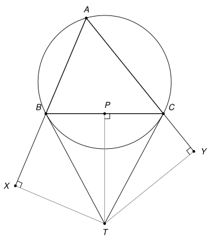

## Statement

Soit $ABC$ un triangle dont les trois angles sont aigus, et soit $T$ le point d'intersection des tangentes à son cercle circonscrit en $B$ et en $C$.

On note $X$, $Y$ et $P$ les projetés orthogonaux du point $T$ sur les droites $(AB)$, $(AC)$ et $(BC)$.

Montrer que le point $P$ est l'orthocentre du triangle $AXY$.

## Hints

1. Il suffit de montrer que $(XP) \perp (AC)$ : le même raisonnement, en échangeant les rôles de $B$ et $C$, donnera $(YP) \perp (AB)$.
2. Les angles $\widehat{TXB}$ et $\widehat{TPB}$ sont droits. Sur quel cercle se trouvent les points $X$ et $P$ ?
3. L'angle entre la tangente $(TB)$ et la corde $[BC]$ est égal à $\widehat{BAC}$. Calculez $\widehat{PXB}$ en fonction de $\widehat{BAC}$.

## Solution

*Rappels.*

- *Angle inscrit.* Si $U$ et $V$ sont deux points d'un cercle, tous les angles $\widehat{UZV}$, où $Z$ parcourt le cercle d'un même côté de la droite $(UV)$, sont égaux.
- *Angle entre une tangente et une corde.* Si une droite est tangente en $U$ à un cercle et si $[UV]$ est une corde, l'angle entre la tangente et la corde est égal à l'angle inscrit $\widehat{UZV}$, pour tout point $Z$ du cercle situé de l'autre côté de la corde que l'angle considéré.
- *Cercle de diamètre donné.* Si $\widehat{UZV} = 90°$, le point $Z$ est sur le cercle de diamètre $[UV]$.

On note $\alpha = \widehat{BAC}$, $\beta = \widehat{ABC}$ et $\gamma = \widehat{ACB}$.

**Étape 1 : la figure.** Comme l'angle $\alpha$ est aigu, le point $T$ est du côté de $(BC)$ opposé à $A$. D'après le deuxième rappel, $\widehat{TBC} = \alpha$ et de même $\widehat{TCB} = \alpha$. L'angle $\widehat{ABT} = \beta + \alpha = 180° - \gamma$ est obtus, donc le pied $X$ de la perpendiculaire à $(AB)$ issue de $T$ est sur le prolongement de $[AB]$ au-delà de $B$. De même, $Y$ est sur le prolongement de $[AC]$ au-delà de $C$. Enfin, le triangle $TBC$ a deux angles égaux, il est isocèle en $T$, et $P$, pied de sa hauteur issue de $T$, est le milieu de $[BC]$.

**Étape 2 : l'angle $\widehat{PXB}$.** Les angles $\widehat{TXB}$ et $\widehat{TPB}$ sont droits, donc $X$ et $P$ sont sur le cercle de diamètre $[BT]$ (troisième rappel). Dans ce cercle, les angles $\widehat{PXB}$ et $\widehat{PTB}$ interceptent la corde $[PB]$, et $X$ et $T$ sont du même côté de la droite $(PB)$, qui est la droite $(BC)$. Donc

$$\widehat{PXB} = \widehat{PTB} = 90° - \widehat{TBP} = 90° - \alpha,$$

la deuxième égalité venant du triangle $TBP$, rectangle en $P$.

**Étape 3 : $(XP) \perp (AC)$.** La droite $(XP)$ coupe $(AC)$ en un point $Q$, et sur la figure $P$ est entre $X$ et $Q$. Dans le triangle $AXQ$, l'angle en $A$ vaut $\alpha$ (car $X$ est sur la demi-droite $[AB)$ et $Q$ sur la demi-droite $[AC)$), et l'angle en $X$ vaut $\widehat{BXP} = 90° - \alpha$ (car $B$ est entre $X$ et $A$). La somme des angles d'un triangle vaut $180°$, donc

$$\widehat{AQX} = 180° - \alpha - (90° - \alpha) = 90°.$$

La droite $(XP)$ est donc perpendiculaire à $(AC)$, c'est-à-dire à $(AY)$ : c'est la hauteur du triangle $AXY$ issue de $X$.

**Étape 4 : conclusion.** En échangeant les rôles de $B$ et de $C$ (et donc de $X$ et de $Y$), le même raisonnement montre que $(YP) \perp (AX)$ : la droite $(YP)$ est la hauteur du triangle $AXY$ issue de $Y$. Le point $P$ est sur deux hauteurs du triangle $AXY$, donc **$P$ est l'orthocentre du triangle $AXY$.**

![Le cercle de diamètre [BT] passe par X et P, et les droites (XP) et (YP) sont perpendiculaires à (AY) et à (AX)](10230-figure-2.svg)

*Remarque.* Les correcteurs notent que beaucoup de copies écrivaient deux fois la même preuve, alors qu'un argument de symétrie des rôles suffit pour la seconde hauteur. L'énoncé original ne suppose pas le triangle acutangle ; on l'a ajouté pour que la figure soit celle-ci. Le résultat reste vrai pour tout triangle dont l'angle en $A$ n'est pas droit (sinon les deux tangentes sont parallèles et $T$ n'existe pas), mais les angles changent de forme selon les cas.

## Going further

1. Montrer que $(XP) \parallel (TY)$ et $(YP) \parallel (TX)$, et en déduire que $TXPY$ est un parallélogramme.
2. (Pour la 1re.) Dans un repère orthonormé où $B(-1\,;\,0)$, $C(1\,;\,0)$ et où le centre du cercle circonscrit est $(0\,;\,k)$ avec $k \neq 0$, montrer que $T(0\,;\,-\tfrac{1}{k})$, puis vérifier avec le produit scalaire que $\overrightarrow{PX} \cdot \overrightarrow{AC} = 0$. Ce calcul ne dépend pas de la figure.
