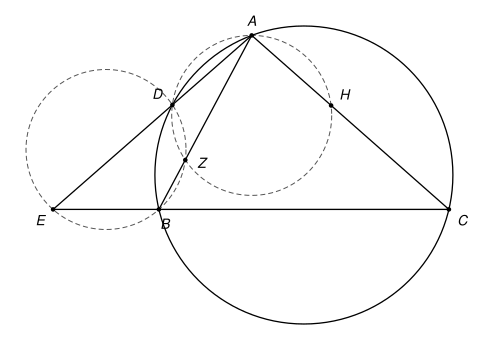
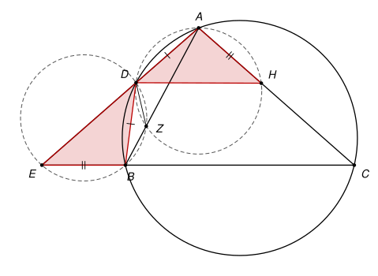

## Statement

Soit $ABC$ un triangle tel que $AB < AC < BC$. Soit $D$ le milieu de l'arc $AB$ de son cercle circonscrit qui ne contient pas $C$, c'est-à-dire le point de cet arc tel que $DA = DB$.

Les droites $(AD)$ et $(BC)$ se coupent en un point $E$. Le cercle qui passe par $B$, $D$ et $E$ recoupe la droite $(AB)$ en un point $Z$, et le cercle qui passe par $A$, $D$ et $Z$ recoupe la droite $(AC)$ en un point $H$.

Montrer que $BE = AH$.

## Hints

1. Comparez les triangles $DBE$ et $DAH$. Que savez-vous déjà des côtés $DB$ et $DA$ ?
2. Montrez que $\widehat{DEB} = \widehat{DHA}$, en passant par l'angle $\widehat{DZA}$ : utilisez d'abord le cercle qui passe par $B$, $D$, $E$, $Z$, puis celui qui passe par $A$, $D$, $Z$, $H$.
3. Dans le cercle circonscrit à $ABC$, montrez que $\widehat{DBE} = \widehat{DAC}$.

## Solution

*Rappels.*

- *Angle inscrit.* Si $U$ et $V$ sont deux points d'un cercle et si $X$ et $Y$ sont deux autres points du cercle, alors $\widehat{UXV} = \widehat{UYV}$ quand $X$ et $Y$ sont du même côté de la droite $(UV)$, et $\widehat{UXV} + \widehat{UYV} = 180°$ quand ils sont de part et d'autre de $(UV)$.
- *Triangles isométriques.* Si deux triangles ont un côté de même longueur compris entre deux angles égaux deux à deux, alors ils sont isométriques : leurs autres côtés sont égaux deux à deux.

On raisonne dans la disposition de la figure : $D$ est entre $A$ et $E$, $B$ est entre $E$ et $C$, $Z$ est sur le segment $[AB]$ et $H$ sur le segment $[AC]$. L'hypothèse $AB < AC < BC$ sert à imposer cette disposition (voir la remarque).

**Étape 1 : les angles en $E$ et en $H$.** Les points $B$, $D$, $E$, $Z$ sont sur un même cercle, et $E$ et $Z$ sont de part et d'autre de la droite $(BD)$. D'après le rappel,

$$\widehat{BED} = 180° - \widehat{BZD}.$$

Comme $Z$ est entre $A$ et $B$, les angles $\widehat{BZD}$ et $\widehat{DZA}$ sont supplémentaires, donc $\widehat{BED} = \widehat{DZA}$.

Les points $A$, $D$, $Z$, $H$ sont sur un même cercle, et $Z$ et $H$ sont du même côté de la droite $(AD)$. D'après le rappel, $\widehat{DZA} = \widehat{DHA}$. Finalement

$$\widehat{DEB} = \widehat{DHA}.$$

**Étape 2 : les angles en $B$ et en $A$.** Les points $A$, $D$, $B$, $C$ sont sur le cercle circonscrit, et $A$ et $B$ sont de part et d'autre de la droite $(DC)$. D'après le rappel, $\widehat{DBC} = 180° - \widehat{DAC}$. Comme $B$ est entre $E$ et $C$, l'angle $\widehat{DBE}$ est le supplémentaire de $\widehat{DBC}$, donc $\widehat{DBE} = \widehat{DAC}$. Enfin, $H$ est sur le segment $[AC]$, donc $\widehat{DAC} = \widehat{DAH}$, et

$$\widehat{DBE} = \widehat{DAH}.$$

**Étape 3 : les angles en $D$.** Dans les triangles $DBE$ et $DAH$, deux angles sont égaux deux à deux (étapes 1 et 2). La somme des angles d'un triangle vaut $180°$, donc les troisièmes angles sont égaux aussi : $\widehat{BDE} = \widehat{ADH}$.

**Étape 4 : conclusion.** Les triangles $DBE$ et $DAH$ ont un côté de même longueur, $DB = DA$, compris entre deux angles égaux : $\widehat{BDE} = \widehat{ADH}$ en $D$, et $\widehat{DBE} = \widehat{DAH}$ en $B$ et en $A$. D'après le second rappel, ils sont isométriques, avec $B \leftrightarrow A$ et $E \leftrightarrow H$. En particulier,

$$BE = AH.$$

*Remarque.* Voici pourquoi l'hypothèse fixe la disposition, au moins pour $D$ et $E$. Notons $\beta = \widehat{ABC}$ et $\gamma = \widehat{ACB}$. Le point $D$ est de l'autre côté de $(AB)$ que $C$, et par l'angle inscrit $\widehat{DAB} = \widehat{DCB} = \tfrac{\gamma}{2}$, car $D$ coupe l'arc $AB$ en deux arcs égaux. Comme $AB < AC$, on a $\gamma < \beta$, donc $\tfrac{\gamma}{2} + (180° - \beta) < 180°$ : la demi-droite $[AD)$ coupe le prolongement de $[CB]$ au-delà de $B$. Le point $E$ est hors du cercle et $D$ est le second point de $[AE]$ sur le cercle, donc $D$ est entre $A$ et $E$. Pour $Z$ et $H$, on a vérifié la disposition sur de nombreux triangles tirés au hasard. Les correcteurs signalent un piège dans une autre preuve : deux côtés égaux et un angle égal ne suffisent pas pour avoir des triangles isométriques, il faut que l'angle soit compris entre les deux côtés.

## Going further

1. Montrer que $DE = DH$ et que $\widehat{EDH} = \widehat{BDA}$.
2. Montrer que les points $E$, $Z$ et $H$ sont alignés. (Comparer $\widehat{DZE}$ et $\widehat{DBE}$ dans le premier cercle, puis $\widehat{DZH}$ et $\widehat{DAH}$ dans le second.)
