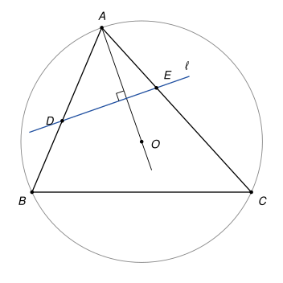
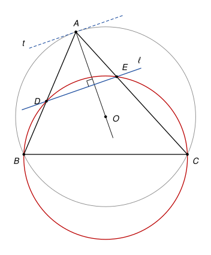

## Statement

Soit $ABC$ un triangle et $O$ le centre de son cercle circonscrit. Une droite $\ell$, perpendiculaire à la droite $(AO)$, coupe les côtés $[AB]$ et $[AC]$ en des points $D$ et $E$, distincts des sommets du triangle.

Montrer que les quatre points $B$, $C$, $E$ et $D$ sont sur un même cercle.

## Hints

1. Quelle droite bien connue passe par $A$ et est perpendiculaire à $(AO)$ ?
2. La tangente en $A$ au cercle circonscrit est parallèle à $\ell$. Quel angle fait-elle avec la corde $[AB]$ ?
3. Montrez que $\widehat{ADE} = \widehat{ACB}$, puis regardez les angles opposés du quadrilatère $BCED$.

## Solution

*Rappels.*

- *Tangente.* La tangente à un cercle en un point $A$ est la droite perpendiculaire au rayon $[OA]$ en $A$.
- *Angle entre une tangente et une corde.* Si une droite $t$ est tangente en $A$ à un cercle et si $[AB]$ est une corde, l'angle entre $t$ et la corde $[AB]$ est égal à l'angle inscrit $\widehat{ACB}$, pour tout point $C$ du cercle situé de l'autre côté de la corde. C'est le cas limite du théorème de l'angle inscrit, quand un côté de l'angle devient tangent.
- *Quadrilatère inscriptible.* Soient $X$ et $Y$ deux points, et $M$, $N$ deux points situés de part et d'autre de la droite $(XY)$. Si $\widehat{XMY} + \widehat{XNY} = 180°$, alors $X$, $Y$, $M$, $N$ sont sur un même cercle.

**Étape 1 : la tangente en $A$ est parallèle à $\ell$.** Notons $t$ la tangente en $A$ au cercle circonscrit. D'après le premier rappel, $t$ est perpendiculaire à $(AO)$. La droite $\ell$ est elle aussi perpendiculaire à $(AO)$. Deux droites perpendiculaires à une même droite sont parallèles, donc $t \parallel \ell$. Elles sont distinctes, car $\ell$ ne passe pas par $A$.

**Étape 2 : l'angle entre $t$ et $[AB]$.** Choisissons un point $T$ sur $t$, de l'autre côté de la droite $(AB)$ que $C$. D'après le deuxième rappel :

$$\widehat{TAB} = \widehat{ACB}.$$

**Étape 3 : on reporte cet angle en $D$.** Les droites parallèles $t$ et $\ell$ sont coupées par la sécante $(AB)$, en $A$ et en $D$. Le point $E$ est sur $[AC]$, donc du même côté de $(AB)$ que $C$, et $T$ est de l'autre côté. Comme $D$ est sur $[AB]$, la demi-droite $[AD)$ est la demi-droite $[AB)$. Les angles $\widehat{TAD}$ et $\widehat{ADE}$ sont donc alternes-internes, et ils sont égaux. Avec l'étape 2 :

$$\widehat{ADE} = \widehat{TAB} = \widehat{ACB}.$$

**Étape 4 : deux angles opposés supplémentaires.** Le point $D$ est entre $A$ et $B$, donc $\widehat{BDE} = 180° - \widehat{ADE}$. Le point $E$ est sur $[AC]$, donc $\widehat{BCE} = \widehat{BCA}$. Ainsi

$$\widehat{BDE} + \widehat{BCE} = 180° - \widehat{ACB} + \widehat{ACB} = 180°.$$

**Étape 5 : $D$ et $C$ sont de part et d'autre de $(BE)$.** Le point $E$ est strictement entre $A$ et $C$, donc la droite $(BE)$ laisse $A$ d'un côté et $C$ de l'autre. Le point $D$ est sur le segment $[AB]$, distinct de $B$, donc du même côté que $A$. Ainsi $D$ et $C$ sont de part et d'autre de $(BE)$.

**Conclusion.** D'après le troisième rappel, appliqué à $X = B$, $Y = E$, $M = D$ et $N = C$, **les points $B$, $C$, $E$ et $D$ sont sur un même cercle.**

*Remarques.*

- L'égalité $\widehat{ADE} = \widehat{ACB}$ de l'étape 3 est la clé de beaucoup de problèmes : une droite qui coupe $[AB]$ et $[AC]$ en faisant cet angle (on dit qu'elle est *antiparallèle* à $(BC)$) donne toujours quatre points cocycliques, et réciproquement.
- Le corrigé officiel passe par l'angle au centre : dans le triangle isocèle $AOB$, on calcule $\widehat{OAB} = 90° - \widehat{ACB}$, puis on conclut dans le triangle rectangle formé par $A$, $D$ et le point où $\ell$ coupe $(AO)$. Ce calcul suppose que l'angle $\widehat{ACB}$ est aigu. S'il est obtus, le point $O$ change de côté et il faut refaire le calcul. La tangente évite cette séparation des cas.

## Going further

1. Réciproquement, soit $D$ un point de $[AB]$ et $E$ un point de $[AC]$, distincts des sommets, tels que $B$, $C$, $E$, $D$ soient sur un même cercle. Montrer que $(DE)$ est perpendiculaire à $(AO)$.
2. On suppose que les trois angles du triangle $ABC$ sont aigus. En déduire que la droite qui joint les pieds des hauteurs issues de $B$ et de $C$ est perpendiculaire à $(AO)$. On pourra utiliser le cercle de diamètre $[BC]$.
