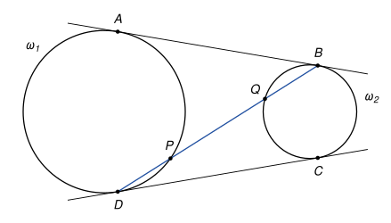
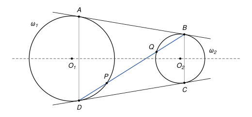

## Statement

Soient $\omega_1$ et $\omega_2$ deux cercles extérieurs l'un à l'autre (ils n'ont aucun point commun et aucun n'est à l'intérieur de l'autre).

- Une tangente commune extérieure à ces deux cercles touche $\omega_1$ en $A$ et $\omega_2$ en $B$.
- La deuxième tangente commune extérieure touche $\omega_1$ en $D$ et $\omega_2$ en $C$.
- La droite $(BD)$ recoupe $\omega_1$ en un point $P$ autre que $D$, et $\omega_2$ en un point $Q$ autre que $B$.

Montrer que $BQ = DP$.

## Hints

1. Commencez par montrer que $AB = DC$, à l'aide d'une symétrie bien choisie.
2. Comparez les triangles $DCQ$ et $DBC$. Ils ont un angle en commun, et un autre angle se calcule avec la tangente $(DC)$. Qu'en déduit-on pour $DQ \times DB$ ?
3. De la même façon, $BP \times BD = BA^2$. Comparez alors $DQ$ et $BP$.

## Solution

*Rappel (angle entre une tangente et une corde).* Si une droite est tangente en $T$ à un cercle et si $[TU]$ est une corde, l'angle entre la tangente et la corde est égal à l'angle inscrit $\widehat{TVU}$, pour tout point $V$ du cercle situé de l'autre côté de la corde.

On commence par un lemme très utile, qu'on démontre.

**Lemme (tangente et sécante).** Soit $M$ un point extérieur à un cercle, et $T$ le point de contact d'une tangente au cercle issue de $M$. Une droite passant par $M$ coupe le cercle en deux points $U$ et $V$. Alors

$$MU \times MV = MT^2.$$

*Preuve du lemme.* Le segment $[UV]$ est une corde, il est à l'intérieur du disque, et $M$ est à l'extérieur. Donc $M$ n'est pas entre $U$ et $V$ : les deux points sont sur la même demi-droite issue de $M$. Quitte à échanger leurs noms, $U$ est entre $M$ et $V$.

Comparons les triangles $MTU$ et $MVT$.

- Ils ont le même angle en $M$, car les demi-droites $[MU)$ et $[MV)$ sont les mêmes.
- Comme $U$ est entre $M$ et $V$, les points $M$ et $V$ sont de part et d'autre de la droite $(TU)$. D'après le rappel, l'angle entre la tangente $(TM)$ et la corde $[TU]$, du côté de $M$, est égal à l'angle inscrit $\widehat{TVU}$. Autrement dit $\widehat{MTU} = \widehat{MVT}$.

Les deux triangles ont deux angles égaux, ils sont donc semblables, et leurs côtés sont proportionnels :

$$\frac{MT}{MV} = \frac{MU}{MT}, \quad \text{donc} \quad MT^2 = MU \times MV.$$

**Étape 1 : $AB = DC$.** Notons $O_1$ et $O_2$ les centres des deux cercles, et $s$ la symétrie d'axe $(O_1O_2)$. Un cercle dont le centre est sur l'axe est son propre symétrique, donc $s$ envoie $\omega_1$ sur $\omega_1$ et $\omega_2$ sur $\omega_2$. Elle envoie donc une tangente commune extérieure sur une tangente commune extérieure.

La droite $(AB)$ n'est pas sa propre image. En effet, une droite égale à sa symétrique est l'axe lui-même, qui coupe les cercles et ne leur est pas tangent, ou bien une droite perpendiculaire à l'axe. Mais une droite perpendiculaire à l'axe et tangente aux deux cercles les toucherait tous deux en son point d'intersection avec l'axe, et les cercles auraient un point commun.

Donc $s$ envoie $(AB)$ sur l'autre tangente commune extérieure $(DC)$. Le point de contact avec $\omega_1$ va sur le point de contact avec $\omega_1$, donc $s(A) = D$, et de même $s(B) = C$. Une symétrie conserve les longueurs, d'où

$$AB = DC.$$

Ce raisonnement marche aussi quand les deux cercles ont le même rayon. Dans ce cas les deux tangentes sont parallèles et $ABCD$ est un rectangle.

**Étape 2 : le lemme au point $D$, pour le cercle $\omega_2$.** Le point $D$ est sur $\omega_1$, donc à l'extérieur de $\omega_2$. La droite $(DC)$ est tangente à $\omega_2$ en $C$, et la droite $(DB)$ coupe $\omega_2$ en $Q$ et $B$. Le lemme donne

$$DQ \times DB = DC^2.$$

**Étape 3 : le lemme au point $B$, pour le cercle $\omega_1$.** De même, $B$ est à l'extérieur de $\omega_1$, la droite $(BA)$ est tangente à $\omega_1$ en $A$, et la droite $(BD)$ coupe $\omega_1$ en $P$ et $D$. Donc

$$BP \times BD = BA^2.$$

**Étape 4 : $DQ = BP$.** D'après l'étape 1, $DC^2 = BA^2$. Les étapes 2 et 3 donnent donc $DQ \times DB = BP \times DB$, et en divisant par $DB$ :

$$DQ = BP.$$

**Étape 5 : conclusion.** D'après la preuve du lemme, $P$ est sur la demi-droite $[BD)$, donc $DP = |BD - BP|$. De même, $Q$ est sur la demi-droite $[DB)$, donc $BQ = |BD - DQ|$. Comme $BP = DQ$, on obtient **$BQ = DP$.**

*Remarques.*

- Le produit $MU \times MV$ du lemme ne dépend donc pas de la droite choisie. On l'appelle la *puissance* du point $M$ par rapport au cercle. C'est un outil classique des olympiades.
- Les correcteurs signalent que très peu de copies ont pensé au cas de deux cercles de même rayon, où les tangentes ne se coupent pas. Un raisonnement qui passe par le point d'intersection des deux tangentes doit traiter ce cas à part. La symétrie de l'étape 1 évite cette séparation.

## Going further

1. Montrer que le milieu de $[PQ]$ est aussi le milieu de $[BD]$.
2. Montrer que les droites $(AD)$ et $(BC)$ sont parallèles. On note $M$ et $N$ les milieux de $[AB]$ et de $[DC]$. Montrer que le milieu de $[PQ]$ est sur la droite $(MN)$.
