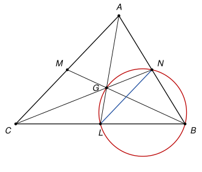

## Statement

Soit $ABC$ un triangle. On note $L$, $M$ et $N$ les milieux des côtés $[BC]$, $[CA]$ et $[AB]$. On suppose que

$$\widehat{ANC} = \widehat{ALB}.$$

Montrer que $\widehat{CAL} = \widehat{ABM}$.

## Hints

1. Les trois médianes $(AL)$, $(BM)$ et $(CN)$ se coupent au centre de gravité $G$. Réécrivez les deux angles de l'hypothèse avec le point $G$.
2. L'hypothèse dit que les angles $\widehat{BNG}$ et $\widehat{BLG}$ ont pour somme $180°$. Que peut-on dire des quatre points $B$, $N$, $G$, $L$ ?
3. La droite $(NL)$ est parallèle à $(AC)$. Comparez $\widehat{CAL}$ et $\widehat{ALN}$, puis utilisez le cercle trouvé à l'indication 2.

## Solution

*Rappels.*

- *Angle inscrit.* Si $X$ et $Y$ sont deux points d'un cercle, tous les angles $\widehat{XPY}$, où $P$ parcourt le cercle d'un même côté de la droite $(XY)$, sont égaux.
- *Quadrilatère inscriptible.* Soient $X$ et $Y$ deux points, et $P$, $Q$ deux points situés de part et d'autre de la droite $(XY)$. Si $\widehat{XPY} + \widehat{XQY} = 180°$, alors $X$, $Y$, $P$, $Q$ sont sur un même cercle.

On note $G$ le centre de gravité du triangle, le point où se coupent les trois médianes $(AL)$, $(BM)$ et $(CN)$. Il est sur chacun des segments $[AL]$, $[BM]$ et $[CN]$.

**Étape 1 : traduire l'hypothèse.** Le point $N$ est le milieu de $[AB]$, donc les demi-droites $[NA)$ et $[NB)$ sont opposées, et $\widehat{ANC} = 180° - \widehat{BNC}$. Comme $G$ est sur $[NC]$, on a $\widehat{BNC} = \widehat{BNG}$. De même $G$ est sur $[LA]$, donc $\widehat{ALB} = \widehat{GLB}$. L'hypothèse s'écrit donc

$$180° - \widehat{BNG} = \widehat{BLG}, \quad \text{c'est-à-dire} \quad \widehat{BNG} + \widehat{BLG} = 180°.$$

**Étape 2 : les points $B$, $N$, $G$, $L$ sont sur un même cercle.** La droite $(BG)$ est la médiane $(BM)$. Elle laisse $A$ d'un côté et $C$ de l'autre. Le point $N$ est sur $[AB]$, donc du côté de $A$, et le point $L$ est sur $[BC]$, donc du côté de $C$. Ainsi $N$ et $L$ sont de part et d'autre de $(BG)$, et le second rappel, avec $X = B$, $Y = G$, $P = N$, $Q = L$, montre que $B$, $N$, $G$, $L$ sont sur un même cercle.

**Étape 3 : des angles alternes-internes.** Dans le triangle $ABC$, la droite $(NL)$ qui joint les milieux de deux côtés est parallèle au troisième côté $(AC)$. Les droites $(AC)$ et $(NL)$ sont coupées par la sécante $(AL)$, et les points $C$ et $N$ sont de part et d'autre de $(AL)$. Donc les angles $\widehat{CAL}$ et $\widehat{ALN}$ sont alternes-internes, et

$$\widehat{CAL} = \widehat{ALN} = \widehat{GLN},$$

la dernière égalité venant de ce que $G$ est sur $[LA]$.

**Étape 4 : l'angle inscrit.** Dans le cercle de l'étape 2, les angles $\widehat{GLN}$ et $\widehat{GBN}$ interceptent la même corde $[GN]$. La droite $(GN)$ est la médiane $(CN)$, et les points $L$ et $B$ sont du même côté de cette droite, puisque $L$ est sur $[CB]$ et différent de $C$. D'après le premier rappel,

$$\widehat{GLN} = \widehat{GBN}.$$

Enfin $G$ est sur $[BM]$ et $N$ sur $[BA]$, donc $\widehat{GBN} = \widehat{MBA}$.

**Conclusion.** En mettant bout à bout les étapes 3 et 4 : **$\widehat{CAL} = \widehat{ABM}$.**

*Remarque.* Les correcteurs signalent que plusieurs élèves ont cru que l'hypothèse forçait le triangle à être isocèle, voire équilatéral. Ce n'est pas le cas. Par exemple le triangle de la figure, avec $BC = 4$, $AB = 3$ et $AC = \sqrt{\text{12,5}}$, vérifie l'hypothèse sans être isocèle. On peut montrer que l'hypothèse équivaut à $BC^2 + AB^2 = 2\,AC^2$.

## Going further

1. Réciproquement, on suppose que $\widehat{CAL} = \widehat{ABM}$. Montrer que $\widehat{ANC} = \widehat{ALB}$.
2. Montrer que l'hypothèse $\widehat{ANC} = \widehat{ALB}$ équivaut à $AN \times AB = AG \times AL$. En déduire, avec la formule de la médiane $AL^2 = \frac{AB^2 + AC^2}{2} - \frac{BC^2}{4}$, qu'elle équivaut à $BC^2 + AB^2 = 2\,AC^2$.
