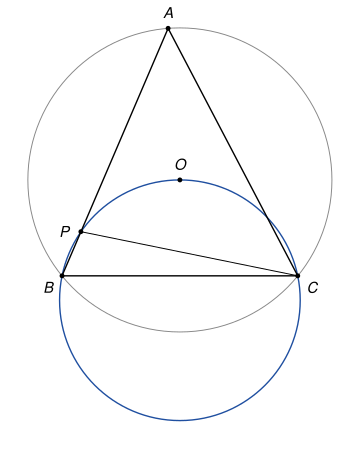

## Statement

Soit $ABC$ un triangle dont les trois angles sont aigus, avec $BA \neq BC$. On note $O$ le centre de son cercle circonscrit.

Le cercle qui passe par $B$, $O$ et $C$ recoupe la droite $(AB)$ en un point $P$ différent de $B$.

Montrer que $PA = PC$.

## Hints

1. Il suffit de montrer que le triangle $PAC$ a deux angles égaux, en $A$ et en $C$.
2. Que vaut l'angle $\widehat{BOC}$ en fonction de l'angle $\widehat{BAC}$ ?
3. Les points $B$, $O$, $C$, $P$ sont sur un même cercle. Comparez $\widehat{BPC}$ et $\widehat{BOC}$. Attention : la réponse dépend du côté de la droite $(BC)$ où se trouve $P$.

## Solution

*Rappels.*

- *Angle au centre.* Si $A$, $B$, $C$ sont sur un cercle de centre $O$, et si $O$ et $A$ sont du même côté de la droite $(BC)$, alors $\widehat{BOC} = 2\,\widehat{BAC}$.
- *Angles inscrits.* Si quatre points $B$, $C$, $X$, $Y$ sont sur un même cercle, alors $\widehat{BXC} = \widehat{BYC}$ lorsque $X$ et $Y$ sont du même côté de la droite $(BC)$, et $\widehat{BXC} + \widehat{BYC} = 180°$ lorsqu'ils sont de part et d'autre.

On note $\alpha = \widehat{BAC}$.

**Étape 1 : l'angle au centre.** Le triangle est acutangle, donc le centre $O$ est à l'intérieur du triangle, du même côté de $(BC)$ que $A$. D'après le premier rappel, $\widehat{BOC} = 2\alpha$.

**Étape 2 : il suffit de deux angles.** Dans le triangle $PAC$, si $\widehat{PAC} = \widehat{PCA}$, alors ce triangle est isocèle en $P$, et $PA = PC$. On va calculer les angles du triangle $PAC$. Remarquons d'abord que $P \neq A$ : sinon $A$ serait sur le cercle $BOC$, du même côté de $(BC)$ que $O$, et on aurait $\widehat{BAC} = \widehat{BOC} = 2\alpha$, c'est-à-dire $\alpha = 2\alpha$, ce qui est impossible.

Le point $P$ est sur la droite $(AB)$. Cette droite traverse la droite $(BC)$ au point $B$ : les points de $(AB)$ situés du côté de $A$ par rapport à $B$ sont du même côté de $(BC)$ que $A$ et $O$, les autres sont de l'autre côté. Il y a donc deux cas.

**Étape 3 : premier cas, $P$ est du même côté de $(BC)$ que $O$.** D'après le second rappel dans le cercle $BOC$, $\widehat{BPC} = \widehat{BOC} = 2\alpha$.

Le point $P$ ne peut pas être au-delà de $A$. Sinon $A$ serait entre $B$ et $P$, les angles du triangle $PAC$ en $P$ et en $A$ seraient $\widehat{APC} = \widehat{BPC} = 2\alpha$ et $\widehat{PAC} = 180° - \alpha$, et leur somme $180° + \alpha$ dépasserait $180°$. C'est impossible.

Donc $P$ est sur le segment $[AB]$, entre $A$ et $B$. Alors $\widehat{PAC} = \widehat{BAC} = \alpha$, et l'angle $\widehat{APC}$ est le supplément de $\widehat{BPC}$ :

$$\widehat{APC} = 180° - 2\alpha, \qquad \widehat{PCA} = 180° - \alpha - (180° - 2\alpha) = \alpha = \widehat{PAC}.$$

**Étape 4 : second cas, $P$ est de l'autre côté de $(BC)$ que $O$.** Alors $P$ est sur la droite $(AB)$ au-delà de $B$, et $B$ est entre $A$ et $P$. D'après le second rappel, $\widehat{BPC} = 180° - \widehat{BOC} = 180° - 2\alpha$. Dans le triangle $PAC$, on a $\widehat{APC} = \widehat{BPC} = 180° - 2\alpha$ et $\widehat{PAC} = \widehat{BAC} = \alpha$, donc

$$\widehat{PCA} = 180° - \alpha - (180° - 2\alpha) = \alpha = \widehat{PAC}.$$

**Conclusion.** Dans les deux cas, le triangle $PAC$ a deux angles égaux en $A$ et en $C$. **Il est donc isocèle en $P$, et $PA = PC$.**

*Remarques.*

- Le premier cas se produit quand $BC < BA$, comme sur la figure, et le second quand $BC > BA$. En effet, $P$ est sur $[AB]$ exactement quand l'angle $\widehat{PCA} = \alpha$ est plus petit que $\widehat{BCA}$, c'est-à-dire quand $\widehat{BAC} < \widehat{BCA}$, ce qui revient à $BC < BA$.
- Si $BA = BC$, on trouve $\widehat{PCA} = \widehat{BCA}$, donc $P = B$ : la droite $(AB)$ est alors tangente au cercle $BOC$, et le point $P$ n'existe pas. C'est pourquoi l'énoncé demande $BA \neq BC$.
- Autre façon de voir le résultat : $P$ est le point de $(AB)$ qui se trouve sur la médiatrice de $[AC]$, et cette médiatrice passe aussi par $O$.
