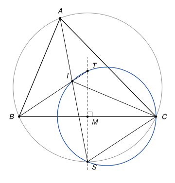

## Statement

Soit $ABC$ un triangle avec $AB \neq AC$, et $I$ le centre de son cercle inscrit. La médiatrice du segment $[BC]$ coupe la droite $(AI)$ en $S$ et la droite $(BI)$ en $T$.

Montrer que les points $C$, $I$, $S$ et $T$ sont cocycliques.

![Le triangle ABC, le centre I du cercle inscrit, la médiatrice de [BC] en pointillés, et ses points d'intersection S avec (AI) et T avec (BI)](10262-figure-1.svg)

## Hints

1. Montrez que $S$ est sur le cercle circonscrit au triangle $ABC$. On peut appeler $S'$ le second point d'intersection de $(AI)$ avec ce cercle et montrer que $S'B = S'C$.
2. Montrez que $SI = SC$ en calculant deux angles du triangle $SIC$.
3. La médiatrice $(TS)$ est l'axe de symétrie du triangle isocèle $TBC$. Que représente-t-elle pour l'angle formé par les droites $(TI)$ et $(TC)$ ? Utilisez alors l'indication 1 dans le triangle $TIC$.

## Solution

*Rappels.*

- *Angles inscrits.* Si $X$, $Y$, $U$, $V$ sont sur un même cercle et si $U$ et $V$ sont du même côté de la droite $(XY)$, alors $\widehat{XUY} = \widehat{XVY}$.
- *Angle droit.* Un angle inscrit qui intercepte un diamètre est droit.
- *Bissectrice extérieure.* En un sommet d'un triangle, la bissectrice extérieure est la perpendiculaire à la bissectrice intérieure.

On note $\alpha$, $\beta$, $\gamma$ les angles du triangle $ABC$ en $A$, $B$, $C$.

**Lemme (du pôle sud).** Soit $XYZ$ un triangle avec $XY \neq XZ$ et $\omega$ son cercle circonscrit. Alors la bissectrice intérieure en $X$ recoupe $\omega$ en un point de la médiatrice de $[YZ]$, et la bissectrice extérieure en $X$ aussi. De plus, chacune de ces deux bissectrices n'a qu'un seul point commun avec la médiatrice de $[YZ]$.

*Preuve.* La dernière phrase d'abord : une bissectrice en $X$ passe par $X$, qui n'est pas sur la médiatrice de $[YZ]$ puisque $XY \neq XZ$. Les deux droites sont donc distinctes et se coupent au plus en un point.

Bissectrice intérieure. Elle traverse le segment $[YZ]$, donc elle recoupe $\omega$ en un point $N$ situé de l'autre côté de $(YZ)$ que $X$ : sur le cercle, les points se suivent dans l'ordre $X$, $Y$, $N$, $Z$. Les angles inscrits $\widehat{NYZ}$ et $\widehat{NXZ}$ interceptent la corde $[NZ]$, et $Y$, $X$ sont du même côté de $(NZ)$ : ces angles sont égaux. De même $\widehat{NZY} = \widehat{NXY}$. Comme $(XN)$ est la bissectrice, $\widehat{NXY} = \widehat{NXZ}$. Le triangle $NYZ$ a donc deux angles égaux : il est isocèle en $N$, et $N$ est sur la médiatrice de $[YZ]$.

Bissectrice extérieure. Soit $O$ le centre de $\omega$. Les points $N$ et $O$ sont tous deux à égale distance de $Y$ et de $Z$, donc la droite $(NO)$ est la médiatrice de $[YZ]$. Soit $N'$ le point de $\omega$ diamétralement opposé à $N$ : il est sur cette médiatrice, donc $N' \neq X$. L'angle $\widehat{NXN'}$ intercepte le diamètre $[NN']$, il est droit. La droite $(XN')$ est donc perpendiculaire en $X$ à la bissectrice intérieure $(XN)$ : c'est la bissectrice extérieure, et elle recoupe $\omega$ en $N'$, qui est sur la médiatrice de $[YZ]$. $\square$

**Étape 1 : $S$ est sur le cercle circonscrit.** Appliquons le lemme au triangle $ABC$ et à la bissectrice $(AI)$. Elle recoupe le cercle circonscrit $\Gamma$ en un point de la médiatrice de $[BC]$, et c'est le seul point commun de ces deux droites : c'est donc $S$. Ainsi $S$ est sur $\Gamma$, de l'autre côté de $(BC)$ que $A$, et la preuve du lemme donne $\widehat{SCB} = \widehat{SAB} = \frac{\alpha}{2}$.

**Étape 2 : $SI = SC$.** Les points $I$ et $S$ sont de part et d'autre de $(BC)$, donc

$$\widehat{SCI} = \widehat{SCB} + \widehat{BCI} = \frac{\alpha}{2} + \frac{\gamma}{2}.$$

Le point $I$ est à l'intérieur du triangle et $S$ est au-delà de $(BC)$ sur la demi-droite $[AI)$. L'angle $\widehat{SIC}$ est donc l'angle extérieur en $I$ du triangle $AIC$, et il vaut la somme des deux autres angles de ce triangle :

$$\widehat{SIC} = \widehat{IAC} + \widehat{ICA} = \frac{\alpha}{2} + \frac{\gamma}{2}.$$

Le triangle $SIC$ est donc isocèle en $S$ : $SI = SC$, et $S$ est sur la médiatrice de $[IC]$.

**Étape 3 : la droite $(TS)$ est une bissectrice de l'angle en $T$ du triangle $TIC$.** D'abord $T \neq I$ : sinon $I$ serait un point commun de $(AI)$ et de la médiatrice de $[BC]$, donc $I = S$, alors que $I$ est à l'intérieur du triangle et $S$ de l'autre côté de $(BC)$. Le point $C$ n'est pas sur la droite $(BI)$, donc $TIC$ est un vrai triangle.

Le point $T$ est sur la médiatrice de $[BC]$, donc $TB = TC$, et cette médiatrice est l'axe de symétrie du triangle isocèle $TBC$ : c'est la bissectrice de l'angle $\widehat{BTC}$. Le point $I$ est sur la droite $(TB)$. S'il est sur la demi-droite $[TB)$, alors $\widehat{ITC} = \widehat{BTC}$ et $(TS)$ est la bissectrice intérieure de $\widehat{ITC}$. Sinon, $\widehat{ITC}$ est le supplément de $\widehat{BTC}$, et $(TS)$ est perpendiculaire à la bissectrice intérieure de $\widehat{ITC}$ : c'est la bissectrice extérieure.

**Étape 4 : $TI \neq TC$.** Comme $TC = TB$, avoir $TI = TC$ voudrait dire que $T$ est le milieu de $[BI]$. Soit $D$ le pied de la perpendiculaire à $(BC)$ issue de $I$. Les angles $\widehat{IBC}$ et $\widehat{ICB}$ sont aigus, donc $D$ est strictement entre $B$ et $C$, et $BD < BC$. D'après le théorème des milieux, le milieu de $[BI]$ se projette sur $(BC)$ au milieu de $[BD]$, alors que $T$ se projette au milieu de $[BC]$. Ces deux milieux sont différents, donc $T$ n'est pas le milieu de $[BI]$.

**Étape 5 : conclusion.** Appliquons le lemme au triangle $TIC$, qui vérifie $TI \neq TC$, et à la droite $(TS)$, qui est une de ses bissectrices en $T$ d'après l'étape 3. Cette droite recoupe le cercle circonscrit à $TIC$ en un point de la médiatrice de $[IC]$, et c'est son seul point commun avec cette médiatrice. Or $S$ est sur $(TS)$ et sur la médiatrice de $[IC]$ d'après l'étape 2. C'est donc ce point : $S$ est sur le cercle circonscrit au triangle $TIC$.

**Les points $C$, $I$, $S$ et $T$ sont cocycliques.**

*Remarques.*

- L'étape 2 montre aussi $SB = SI = SC$ : le point $S$ est le centre du cercle qui passe par $B$, $I$ et $C$.
- Le corrigé de la source procède par une chasse aux angles : $\widehat{SIC} = \widehat{STC} = 90° - \frac{\beta}{2}$. C'est plus court, mais seulement pour la figure où $AB < AC$, où $I$ est entre $B$ et $T$. Quand $AB > AC$, le point $T$ est entre $B$ et $I$, et l'un des angles est remplacé par son supplément. Le lemme utilisé ici traite les deux cas d'un coup.
- Si $AB = AC$, la droite $(AI)$ est la médiatrice de $[BC]$ elle-même : le point $S$ n'est pas défini, et $T = I$.
