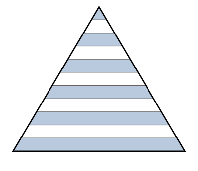

## Statement

Un triangle d'aire $770\ \mathrm{cm}^2$ est découpé en $11$ bandes de même hauteur par $10$ droites parallèles à sa base.

En partant du sommet, une bande sur deux est coloriée : la première (celle qui touche le sommet), la troisième, la cinquième, et ainsi de suite jusqu'à la onzième, qui touche la base.

Quelle est l'aire totale de la partie coloriée ?

## Hints

1. Ne pas essayer de calculer l'aire d'une bande directement. Calculer plutôt l'aire du petit triangle situé **au-dessus** de chaque droite de découpe.
2. Le petit triangle situé au-dessus de la $k$-ième droite est une réduction du grand triangle. Quel est le rapport de réduction ?
3. Quand on multiplie les longueurs par $k$, par combien multiplie-t-on les aires ?
4. L'aire d'une bande s'obtient alors par une soustraction entre deux de ces petits triangles.
5. Il reste à additionner six nombres. Repérer la suite qu'ils forment.

## Solution

**Les triangles emboîtés.**

Notons $h$ la hauteur du grand triangle. Les $10$ droites de découpe sont à la hauteur $\dfrac{h}{11}$, $\dfrac{2h}{11}$, …, $\dfrac{10h}{11}$ sous le sommet.

Le morceau situé au-dessus de la $k$-ième droite est lui-même un triangle : c'est une réduction du grand triangle, de sommet commun, de rapport $\dfrac{k}{11}$ (les deux triangles ont des côtés parallèles et le même sommet).

Dans une réduction de rapport $t$, les longueurs sont multipliées par $t$ et **les aires par $t^2$**. Donc le triangle au-dessus de la $k$-ième droite a pour aire

$$\mathcal{A}_k = \left(\frac{k}{11}\right)^{\!2} \times 770 = \frac{k^2}{121}\times 770.$$

(On pose $\mathcal{A}_0 = 0$ et $\mathcal{A}_{11} = 770$, ce qui est cohérent.)

**L'aire d'une bande.**

La $k$-ième bande, comprise entre la droite numéro $k-1$ et la droite numéro $k$, a pour aire

$$b_k = \mathcal{A}_k - \mathcal{A}_{k-1} = \frac{k^2 - (k-1)^2}{121}\times 770 = \frac{2k-1}{121}\times 770.$$

Les aires des onze bandes sont donc proportionnelles aux **nombres impairs successifs** :

$$1,\; 3,\; 5,\; 7,\; 9,\; 11,\; 13,\; 15,\; 17,\; 19,\; 21.$$

*(Contrôle : leur somme vaut $1+3+\dots+21 = 11^2 = 121$, et l'on retrouve bien l'aire totale $770$.)*

**Les bandes coloriées.**

Ce sont les bandes de rang $k = 1, 3, 5, 7, 9, 11$, dont les « poids » sont

$$1,\; 5,\; 9,\; 13,\; 17,\; 21.$$

Leur somme :

$$1 + 5 + 9 + 13 + 17 + 21 = 66.$$

L'aire coloriée vaut donc

$$\frac{66}{121}\times 770 = \frac{6}{11}\times 770 = 6 \times 70 = 420.$$

**Conclusion.** L'aire coloriée est de $420\ \mathrm{cm}^2$, soit $\dfrac{6}{11}$ de l'aire totale — un peu plus de la moitié, ce qui est logique puisque la bande la plus large, tout en bas, fait partie des bandes coloriées.

## Going further

1. Que vaudrait l'aire coloriée si l'on coloriait au contraire la deuxième, la quatrième, …, la dixième bande ? Vérifier que les deux aires s'ajoutent bien à $770$.
2. Reprendre le problème avec $2n+1$ bandes au lieu de $11$, en coloriant une bande sur deux à partir du sommet. Montrer que la fraction coloriée vaut $\dfrac{n+1}{2n+1}$, et qu'elle tend vers $\dfrac{1}{2}$ quand $n$ grandit.
